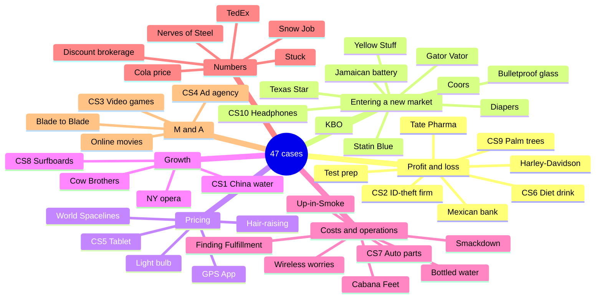

# 🗂️ Case library

All 47 practice cases in one place, so you can pick by **type**, **level** or **format**. "Dialogue" cases have a full walkthrough; "Partner" cases are written for a friend to run; "Start" means only the opening and structure.

## By type

## Full index

| Case | Level | Format | Main skills | Go |
|---|---|---|---|---|
| Harley-Davidson | — | Annotated | P&L, pricing decision, stress test | [6.1](/docs/chapters/part-3/anatomy#harley) |
| Coors | — | Annotated | Entry, M&A, growth gap | [6.1](/docs/chapters/part-3/anatomy#coors) |
| CS1 · China bottled water | — | Start | Growth, share | [6.2](/docs/chapters/part-3/case-starts#cs1) |
| CS2 · Identity-theft firm | — | Start | P&L, IPO | [6.2](/docs/chapters/part-3/case-starts#cs2) |
| CS3 · HK buyer, U.S. game maker | — | Start | M&A | [6.2](/docs/chapters/part-3/case-starts#cs3) |
| CS4 · Ad agency buys a shoe brand | — | Start | Pros & cons | [6.2](/docs/chapters/part-3/case-starts#cs4) |
| CS5 · Italian tablet | — | Start | Pricing | [6.2](/docs/chapters/part-3/case-starts#cs5) |
| CS6 · Diet-drink acquisition | — | Start | Turnaround | [6.2](/docs/chapters/part-3/case-starts#cs6) |
| CS7 · Automaker parts division | — | Start | Make vs buy | [6.2](/docs/chapters/part-3/case-starts#cs7) |
| CS8 · Surfboard brand | — | Start | Growth, brand | [6.2](/docs/chapters/part-3/case-starts#cs8) |
| CS9 · Palm-tree grower | — | Start | P&L | [6.2](/docs/chapters/part-3/case-starts#cs9) |
| CS10 · High-end headphones | — | Start | Entry | [6.2](/docs/chapters/part-3/case-starts#cs10) |
| 1 · Mexican bank | 1 | Dialogue | P&L, chart, segmentation | [6.3](/docs/chapters/part-3/cases-level-1#case-1) |
| 2 · Yellow Stuff chemicals | 1 | Dialogue | Diversification | [6.3](/docs/chapters/part-3/cases-level-1#case-2) |
| 3 · Eastern Training Network | 1 | Dialogue | Competitive response | [6.3](/docs/chapters/part-3/cases-level-1#case-3) |
| 4 · Cola price rise | 1 | Dialogue | Numbers | [6.3](/docs/chapters/part-3/cases-level-1#case-4) |
| 5 · Forever light bulb | 1 | Dialogue | Pricing | [6.3](/docs/chapters/part-3/cases-level-1#case-5) |
| 6 · Diaper material | 1 | Dialogue | Sizing, entry | [6.3](/docs/chapters/part-3/cases-level-1#case-6) |
| 7 · NY opera | 1 | Dialogue | Growth | [6.3](/docs/chapters/part-3/cases-level-1#case-7) |
| 8 · Discount brokerage | 2 | Dialogue | Numbers | [6.4](/docs/chapters/part-3/cases-level-2#case-8) |
| 9 · Cow Brothers | 2 | Dialogue | Growth | [6.4](/docs/chapters/part-3/cases-level-2#case-9) |
| 10 · Hair-raising | 2 | Dialogue | Sizing, pricing | [6.4](/docs/chapters/part-3/cases-level-2#case-10) |
| 11 · Wireless worries | 2 | Dialogue | Costs, chart | [6.4](/docs/chapters/part-3/cases-level-2#case-11) |
| 12 · Blade to Blade | 3 | Dialogue | M&A, supply crisis | [6.5](/docs/chapters/part-3/cases-level-3a#case-12) |
| 13 · World Spacelines | 3 | Dialogue | Cost → price → market | [6.5](/docs/chapters/part-3/cases-level-3a#case-13) |
| 14 · Snow Job | 3 | Dialogue | Expected value, risk | [6.5](/docs/chapters/part-3/cases-level-3a#case-14) |
| 15 · Jamaican Battery | 3 | Dialogue | Entry, switching sides | [6.5](/docs/chapters/part-3/cases-level-3a#case-15) |
| 16 · North American Airlines | 3 | Dialogue | New product, handling criticism | [6.5](/docs/chapters/part-3/cases-level-3a#case-16) |
| 17 · Texas Star Markets | 3 | Dialogue | Entry ×2 | [6.6](/docs/chapters/part-3/cases-level-3b#case-17) |
| 18 · Red Rocket Sports | 3 | Written | Company analysis, charts | [6.6](/docs/chapters/part-3/cases-level-3b#case-18) |
| 19 · Up-in-Smoke | 3 | Dialogue | Outsourcing, payback | [6.6](/docs/chapters/part-3/cases-level-3b#case-19) |
| 20 · Cabana Feet | 3 | Dialogue | Capacity, shift math | [6.6](/docs/chapters/part-3/cases-level-3b#case-20) |
| P1 · Beer brand → frozen food | 1 | Partner | Entry, brand | [6.7](/docs/chapters/part-4/partner-cases-level-1#grupo-modelo) |
| P2 · Test prep | 1 | Partner | Profitability | [6.7](/docs/chapters/part-4/partner-cases-level-1#test-prep) |
| P3 · Online movies | 1 | Partner | Sizing, ROI | [6.7](/docs/chapters/part-4/partner-cases-level-1#online-movies) |
| P4 · Tate Pharmaceuticals | 1 | Partner | Competitive threat | [6.7](/docs/chapters/part-4/partner-cases-level-1#tate) |
| P5 · Gator Vator | 1 | Partner | Entry | [6.7](/docs/chapters/part-4/partner-cases-level-1#gator-vator) |
| P6 · Stuck | 2 | Partner | Capacity, staying calm | [6.8](/docs/chapters/part-4/partner-cases-level-2#stuck) |
| P7 · Nerves of Steel | 2 | Partner | Time value, final slide | [6.8](/docs/chapters/part-4/partner-cases-level-2#nerves-of-steel) |
| P8 · GPS App | 2 | Partner | Price first, breakeven | [6.8](/docs/chapters/part-4/partner-cases-level-2#gps-app) |
| P9 · Finding Fulfillment | 2 | Partner | Outsourcing, perspective | [6.8](/docs/chapters/part-4/partner-cases-level-2#finding-fulfillment) |
| P10 · KBO Appliances | 2 | Partner | Final slide | [6.8](/docs/chapters/part-4/partner-cases-level-2#kbo) |
| P11 · Bulletproof glass | 3 | Partner | Worldwide sizing, entry | [6.9](/docs/chapters/part-4/partner-cases-level-3#bulletproof-glass) |
| P12 · Statin Blue | 3 | Partner | Rx vs OTC | [6.9](/docs/chapters/part-4/partner-cases-level-3#statin-blue) |
| P13 · Bottled water | 3 | Partner | Make vs buy | [6.9](/docs/chapters/part-4/partner-cases-level-3#bottled-water) |
| P14 · Smackdown Rivals | 3 | Partner | Financial statements | [6.9](/docs/chapters/part-4/partner-cases-level-3#smackdown) |
| P15 · TedEx | 3 | Partner | Decision tree, service | [6.9](/docs/chapters/part-4/partner-cases-level-3#tedex) |

## A 3-week practice plan

| Week | Cases |
|---|---|
| 1 · Foundations | Harley, Coors, CS1–CS5, Cases 1–4, P1–P2 |
| 2 · Breadth | CS6–CS10, Cases 5–11, P3–P8 |
| 3 · Final-round | Cases 12–20, P9–P15, then repeat the ones you missed |
