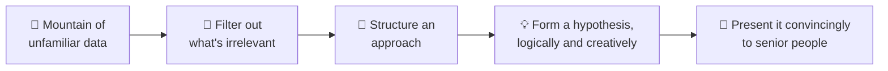

# 1 · Introduction: why firms ask case questions

> **In one line:** a case interview is a role-play of the consulting job itself. You get a messy business problem and are judged on how logically, numerically and persuasively you work through it, not on whether you land on "the" answer.

<BookRef pages="17–18" section="Chapter 1 · Introduction" />

## What consultants are actually paid for

The book opens with a teaser: the number-three wireless carrier is losing customers while its profits jump 35 percent. What's going on? (You'll solve it in [Case 11](/docs/chapters/part-3/cases-level-2#case-11).) The point is that clients hire consulting firms to "rent brains": people who can take in a flood of unfamiliar data and turn it into a clear recommendation.

A case question compresses that whole loop into 20 to 40 minutes. That's why firms weigh it so heavily: it's the closest thing to watching you do the job.

## Framework vs system

For years students memorised a handful of separate frameworks, then froze while deciding which one to apply. Meanwhile real case questions kept getting more complex. The book's answer is the **Ivy Case System** ([Chapter 4](/docs/chapters/part-2/ivy-case-system)).

| | Framework | System |
|---|---|---|
| What it is | A **tool**: one structure for one kind of problem | A **process** with the tools built in |
| Your job | Pick the right one (and often stitch several together) | Follow the steps; the scenario tells you which tools to use |
| Typical failure | Long, awkward silence while you choose | Rarely stuck at the start |

<KeyIdea>A system gets you moving immediately, with no long pause after the question, and keeps the rest of your answer organised. That first impression matters a lot.</KeyIdea>

## Cases are also a test for *you*

Case questions screen you as much as you screen the firm. While practising, ask yourself honestly:

- Do I enjoy this kind of problem solving?
- Could I see myself doing this every day, with this kind of team, under this kind of pressure?

If cases feel like a fun puzzle, that's a strong sign consulting fits. If they feel like torture after plenty of practice, that's useful information too.

## The preparation plan

<Steps items={[
  {letter: '1', title: 'Read the whole book', body: 'Every page, including the cases. Each case teaches a small trick you will reuse.'},
  {letter: '2', title: 'Go to workshops', body: 'Attend every case workshop run by consulting firms or your careers office. You hear how interviewers think.'},
  {letter: '3', title: 'Practise live', body: 'Do cases with professors, roommates, friends and anyone who works or worked in consulting. Aim for 30+ live cases.'},
  {letter: '4', title: 'Read it again', body: 'Second time through, the frameworks click because you now have cases to hang them on.'},
]} />

## 🧠 Check yourself

<Quiz question="Why do consulting firms put so much weight on the case question?" options={["It's the easiest part of the interview to standardise", "It simulates the actual job: structuring messy data and presenting a recommendation", "It tests industry knowledge", "It replaces the résumé review"]} answer={1} explain="A case is a role-play of consulting work: filter data, structure an approach, hypothesise and persuade." />

<Quiz question="What's the main difference between a framework and a system?" options={["A system is longer", "A framework is a tool for one problem; a system is a process with the tools built in", "Frameworks are only for market sizing", "There is no difference"]} answer={1} explain="With a system you don't have to choose between seven frameworks under pressure. The process tells you what to do next." />
