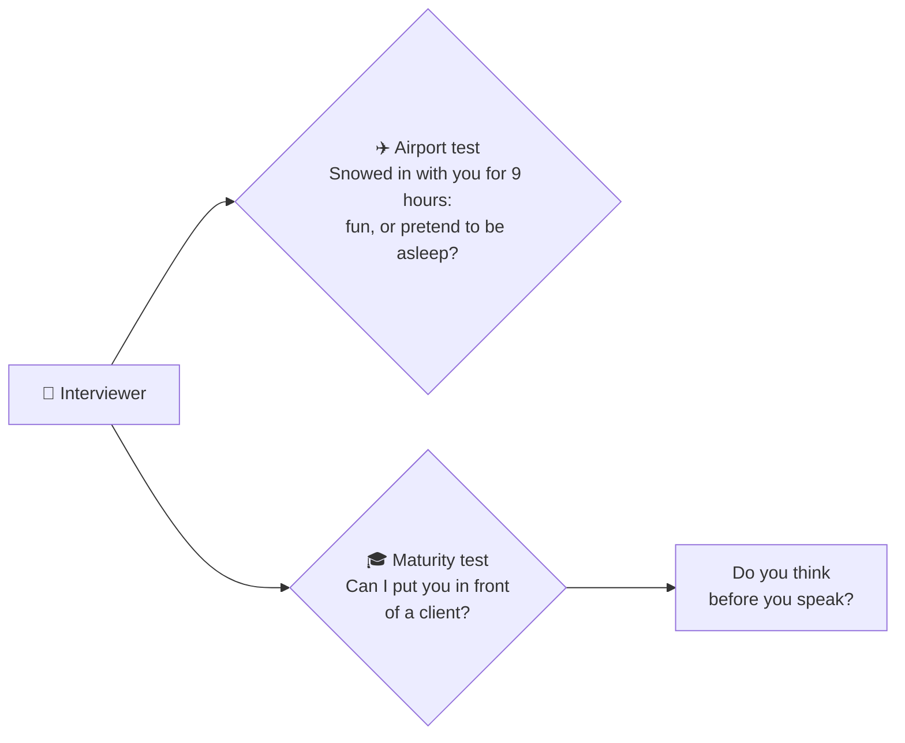
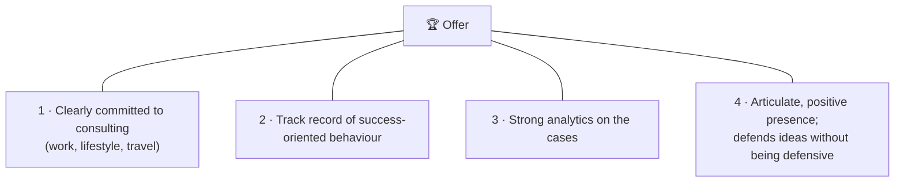
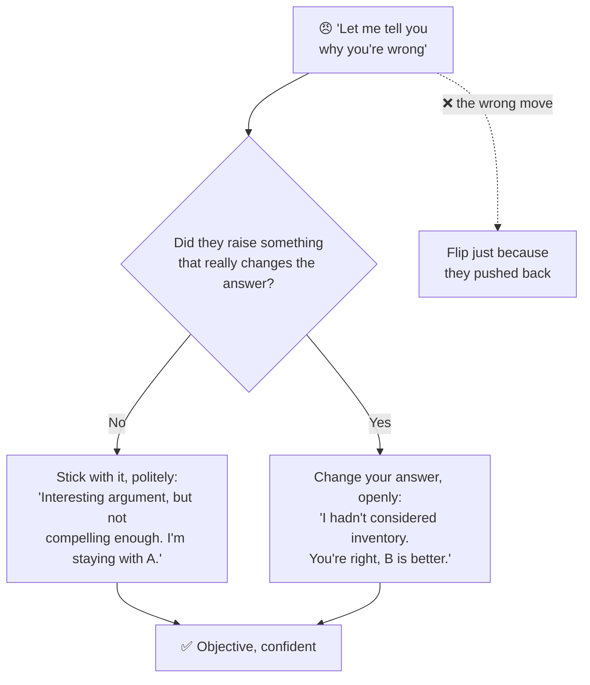

# 2 · The interview: what happens in the room

> **In one line:** a consulting interview has three parts (you, the case, your questions), and you are judged on all three. You should be *responding*, not thinking, about yourself, so that all your thinking energy goes into the case.

<BookRef pages="19–35" section="Chapter 2 · The Interview" />

The odds of getting an offer look terrible: get chosen for an interview, impress every interviewer, survive seven to ten cases. Ignore the odds. You already beat long odds getting into a good school. Focus on what you can control.

## 2.1 The shape of a first round

<BookRef pages="19–20" section="First-round interview" />

A typical first round is **two back-to-back 45-minute interviews**:

```mermaid
gantt
  title Typical first round (two 45-minute interviews)
  dateFormat mm
  axisFormat %M min
  section Interviewer 1
  About you (why consulting, leadership, failure, teamwork) :a1, 00, 25m
  Short case (market sizing, factor or small business) :a2, after a1, 15m
  Your questions :a3, after a2, 5m
  section Interviewer 2
  Ice-breaker :b1, 00, 10m
  Full case, often with charts :b2, after b1, 30m
  Your questions :b3, after b2, 5m
```

Later rounds are mostly cases:

| Round | Typical format | Notes |
|---|---|---|
| **First** | 2 × 45 min | Personal questions + one short and one full case |
| **Second** | 2 × 60 min, often at a hotel | Heavy on cases |
| **Final** | ~5 × 60 min at the firm's office | Lots of chart analysis; some firms add written cases where you design your own charts |
| **Variants** | Phone / Skype screen, group case | See [2.8](#28-other-first-round-formats) |

## 2.2 First impressions

<BookRef pages="20" section="Introduction" />

You never get a second chance at a first impression: eye contact, a real smile, a firm handshake. It sounds trivial; it isn't.

## 2.3 Questions about you

<BookRef pages="20–24" section="Questions About You" />

McKinsey calls this the **Personal Experience Interview (PEI)**: times you persuaded a group, how you build relationships, goals you set and hit. Anything on your résumé is fair game.

What they're checking:

<IconCards items={[
  {icon: '😌', title: 'Demeanour', text: 'Confident, comfortable, a strong communicator. Not a nervous wreck.', color: '#0d9488'},
  {icon: '🚀', title: 'Leadership & initiative', text: 'Things you started and drove, not things you attended.', color: '#3b82f6'},
  {icon: '🤝', title: 'Team player', text: 'Evidence you work well with others.', color: '#f59e0b'},
  {icon: '🔥', title: 'Drive & values', text: 'Energy, aspirations, morals and ethics.', color: '#ec4899'},
]} />

### Prepare stories, not scripts

Write answers to the common questions **as bullet points, not paragraphs**. Memorised paragraphs sound fake; bullet points keep you focused and natural.

📋 The commonly asked questions (prepare all of them)

- Tell me about yourself.
- What are you doing here? Why consulting?
- Why did you pick your school?
- What do you think consultants do?
- What do you know about this job and our firm? Why us over competitors?
- How are your quantitative skills? (Then: "What percentage is 7 of 63?")
- Tell me about a time you showed leadership / were a team player / influenced or persuaded a group.
- Tell me about a recent crisis you handled.
- Have you ever failed at anything?
- Tell me about a time you took the initiative to start something.
- What type of work do you like best?
- Which other firms / industries are you looking at?
- What accomplishments give you the most satisfaction?
- Which of your experiences transfer best to our organisation?
- Why should I hire you?

Two rules for stories:

1. **Go three stories deep.** Interviewers often say "Great, give me another example" two or three times for the same question.
2. **Get labelled.** If your story is memorable, you become "the windsurfer" in the interviewer's mind at the end of the day, and everything you said comes back with the label. If she sees your name and thinks "which one was that?", you're done.

### The three awkward questions

| Question | Do | Don't |
|---|---|---|
| **Have you ever failed?** | Say yes. Tell what happened, what you learned, and ideally how you turned it into a success. | Talk about a personal or family tragedy, or an "academic failure" that was really a B-minus. |
| **Which other firms?** | Be honest: you're talking to other consulting firms. Then explain why *this* firm is your first choice. | Pretend they're the only one. |
| **Which other industries?** | Investment banking and strategy/corporate planning are fine: they look for the same skills. | Name something unrelated that makes your commitment look weak. |

🎯 A baker's dozen of reasons people choose consulting

You work with very smart people; build marketable skills in a prestigious setting; never stop learning; see how senior executives think; get exposure to many industries; work in teams; solve problems; make organisations more efficient; juggle multiple projects; travel; improve your business-school chances; strengthen your résumé; and the pay is good.

## 2.4 "Why consulting?"

<BookRef pages="24" section="Why Consulting?" />

This one must be **instant, sincere and delivered while looking the interviewer in the eye**. If you look away to think, it signals you never thought about it, which can end the interview on the spot. Memorise *bullet points*, not sentences, so the answer is focused, linear and the right length.

## 2.5 The surprise math question and the "airport test"

<BookRef pages="24–25" section="Possible Math Question" />

Expect something like "What's 100 divided by 7?" or "9 is what percent of 72?" They're easy, but they arrive without warning. (Practise on the [🧮 math drills](/docs/math-drills) page.)

Meanwhile the interviewer is running two silent tests:

The book's cautionary tale: a student asked what percentage 3 is of 17 blurted out "80 percent." The interview was effectively over. Not because the answer was wrong, but because it showed he speaks before he thinks. If he does that here, what would he do in front of a client?

## 2.6 The case, then your questions

<BookRef pages="25–28" section="Case Questions · Your Questions" />

The case carries enormous weight: charm can't rescue a fumbled case, and a brilliant case can't rescue zero social skills. (Chapter 3 covers cases in depth.)

The last part is **your questions**, and they should come from real research. Interviewers will look you up online; do the same for them.

❓ Pre-interview research checklist (ask the ones you can't answer yourself)

1. What kind of consulting does the firm do?
2. Which industries does it specialise in?
3. How big is it (offices at home and abroad, number of professionals)?
4. What training does it offer?
5. What does an entry-level consultant actually do?
6. How much client contact in the first year?
7. Is there a mentor programme?
8. How often do first-years sleep in their own beds? What's the travel like?
9. How long is a typical work day?
10. How are case teams picked?
11. How often are consultants reviewed?
12. How many hires this year vs last year?
13. Where do people go when they leave?
14. Can you transfer between offices, including internationally?

**Where to get answers:**

| Source | Why it's useful |
|---|---|
| Career fairs | Turn it into a conversation, ask 3–4 questions, get a business card, follow up. |
| The firm's website | Shows how the firm wants to be seen. |
| Alumni and ex-employees | Tell you more in 30 minutes than two hours online, and they don't have to sell you anything. |
| Company presentations | **Arrive 15 minutes early.** Reps arrive early to set up; you get five real minutes instead of 45 seconds at the end. Top firms may get ~400 résumés for ~100 first-round slots, so being remembered matters. |
| News (e.g. WSJ) | Keeps you current on the firm. |

Bring your questions (with any facts you dug up) written down. And before your first question, if there's something important you didn't get to say, say it now: "Before I ask my first question, I want to make sure you know…"

## 2.7 The grand finale: "Why should I hire you?"

<BookRef pages="28–29" section="The Grand Finale" />

Start simple: because you *want to be a consultant*, then repeat your "why consulting" reasons. Firms want **low-risk hires**: people who know what the job involves and won't quit after six months.

The book's four reasons people get offers:

## 2.8 Other first-round formats {#28-other-first-round-formats}

<BookRef pages="29–31" section="Telephone, Skype and Group Interviews" />

| Format | What matters most |
|---|---|
| **Phone** | You *are* your voice: upbeat, clear, confident without arrogance. Quiet private room. **No calculator**: if you answer too fast or they hear buttons, you're sunk. |
| **Video (Skype)** | All of the above, plus dress fully (you may have to stand up!) and check what's visible behind you. Your background tells them about you. |
| **Group case** | They watch group dynamics, not just the answer. Build on what others say; don't dominate, don't drag the discussion back to your pet point. Aggressive people don't get called back. |

## 2.9 Stress interviews

<BookRef pages="31–32" section="Stress Interviews" />

Two flavours:

- **Two-on-one barrage:** rapid-fire questions, dismissive comments to each other, maybe rudeness.
- **Silent treatment:** no smile, one-word answers, every statement questioned.

Both test how you'd react when a client gets in your face. A common move inside any case: you choose A or B, and the interviewer says **"Let me tell you why you're wrong"**, whichever you picked.

**Rules:** don't take it personally · don't get flustered · roll with the punches · keep everything you say relevant · stay confident.

## 2.10 Confidence

<BookRef pages="32–33" section="Confidence" />

If you sound unsure, they'll question everything you say. The old line about professors applies: *often wrong, never uncertain*. You can be uncertain inside; sound confident outside.

## 2.11 Advice for international students and industry hires

<BookRef pages="33–35" section="International Students · Industry Hires" />

<IconCards items={[
  {icon: '🗣️', title: 'Be honest about communication', text: 'Much of the process runs on spoken and written English. Strong ideas with weak presentation lose to native speakers in the same office.', color: '#0d9488'},
  {icon: '🧭', title: 'Think long-term, play to strengths', text: 'Applying to your home-country office (language, culture, local economy) can be far easier. Work there two years, then transfer.', color: '#3b82f6'},
  {icon: '🥊', title: 'Come back in case-fighting form', text: "No internship? Take a job that builds consulting skills, meet alumni all summer, and ask each of them for a case.", color: '#f59e0b'},
]} />

**Industry hires** (roughly 20% of hires vs 80% from universities):

- Deep industry experience can count *against* you: firms worry you'll solve every problem the way your old industry did. Expect to be put on new industries at first.
- The process is similar (McKinsey may still give you the written test). Cases will rarely touch your old industry; they test structure, not knowledge.
- You'll be expected to be more confident and polished than a student, but you'll enter at roughly the same level as a fresh MBA, perhaps reporting to someone younger. That's fine: these firms are meritocracies.

## 🧠 Check yourself

<Quiz question="Asked 'Have you ever failed at anything?', what's the best approach?" options={["Say no: you've always succeeded", "Mention a B-minus in a hard class", "Say yes, describe a real failure, what you learned and how you turned it around", "Talk about a painful personal loss"]} answer={2} explain="Everyone fails. Show learning and recovery. Avoid personal tragedies and 'fake' academic failures." />

<Quiz question="During a case the interviewer says 'Let me tell you why you're wrong' but the argument doesn't change your analysis. What do you do?" options={["Switch to the other answer to please them", "Politely say the argument isn't compelling enough and keep your answer", "Argue until they agree", "Ask them which answer is right"]} answer={1} explain="They're testing whether you can defend yourself without getting defensive. Only change your mind if a new fact really changes the answer." />

<Quiz question="What is the 'airport test'?" options={["Whether you can travel 80% of the time", "Whether the interviewer would enjoy being stuck with you for hours", "A brainteaser about airport traffic", "A test of your luggage-packing efficiency"]} answer={1} explain="It's about fit: are you interesting, engaging and fun to be around when things go wrong?" />

<Quiz question="Why is a calculator a bad idea in a phone interview?" options={["It's against the law", "If you answer suspiciously fast or they hear beeps, you lose credibility", "Phones don't support calculators", "It's fine as long as you're quiet"]} answer={1} explain="They're testing mental math and thinking process. Getting caught is far worse than being a bit slower." />

**Practice prompts**
- Write bullet-point answers to every question in the list above. Then give each one a second and third example.
- Record yourself answering "Why consulting?" while looking at the camera. Do you look away? Do you ramble?
- Pick a firm and answer as many of the 15 research questions as you can. Turn the rest into your questions for the interviewer.
