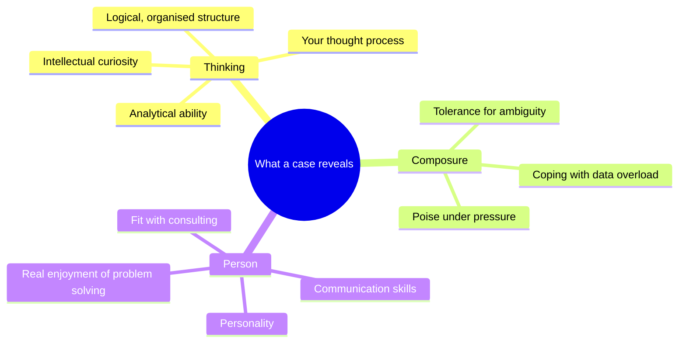
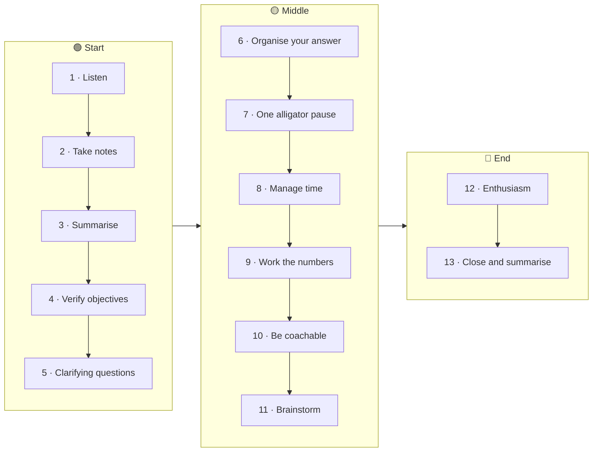
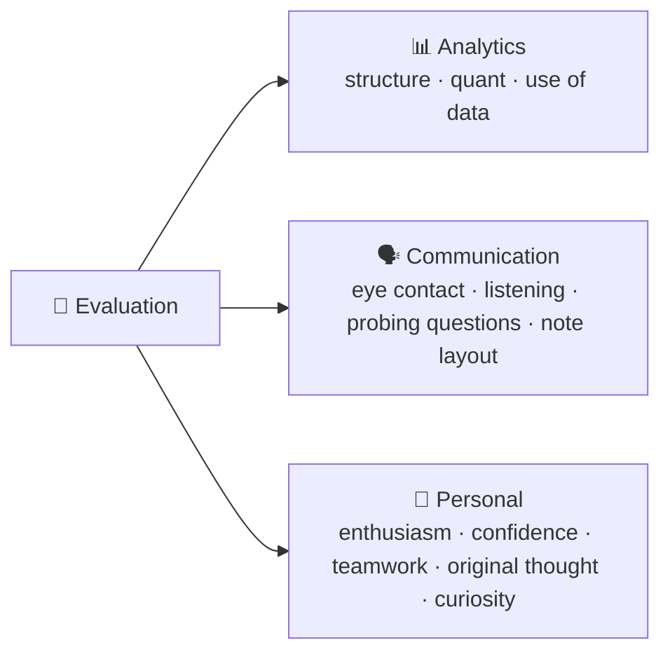
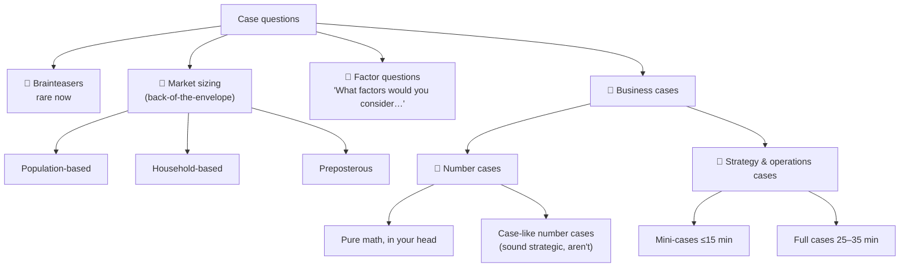
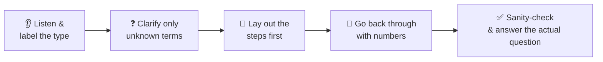
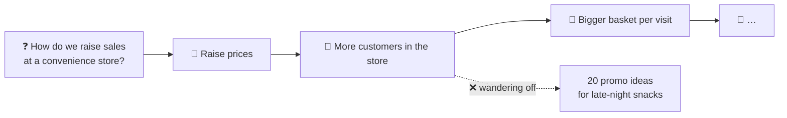
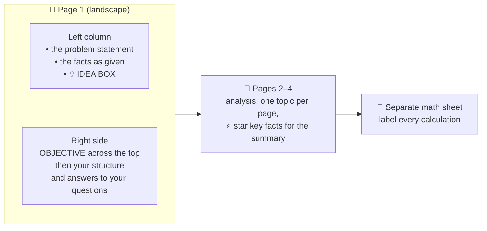

# 3 · Case questions: rules, types and traps

> **In one line:** a case is a conversation, not an exam. Follow the 13 "commandments", recognise which of four case types you've been handed, quantify everything, and finish with a crisp recommendation.

<BookRef pages="36–70" section="Chapter 3 · Case Questions" />

## 3.1 Why firms use cases

<BookRef pages="36–37" section="Purpose of the Case Question" />

Not to humiliate you. They want to see, under pressure:

Consultants spend a lot of time on the road, in small teams, often leading client staff, under pressure and in messy situations. So while you work, the interviewer is ticking boxes like these:

| Are you… | |
|---|---|
| relaxed, confident, mature? | a good listener? |
| engaging and enthusiastic? | strong at presenting? |
| asking insightful, probing questions? | able to spot what's truly relevant? |
| organising information into a logical framework? | **stating your assumptions** clearly? |
| comfortable with cross-functional issues? | **quantifying** at every opportunity? |
| showing business sense *and* common sense? | thinking creatively? |
| rolling with the punches? | defending yourself without being defensive? |

## 3.2 Preparation

<BookRef pages="37–38" section="Case Preparation" />

Like an exam you're over-prepared for, you want the "can't wait to rip through it" look. That look is just confidence, and it comes from practice. Many strong candidates come to see cases like crosswords: fun, and they learn something every time.

## 3.3 The 13 case commandments

<BookRef pages="38–41" section="The Case Commandments" />

| # | Commandment | What it means in practice |
|---|---|---|
| 1 | **Listen to the question** | The case is about the client, not you. Pay special attention to the **last sentence**: one word can change the whole case. |
| 2 | **Take notes** | If you blank, the facts are in front of you. Paper beats memory. |
| 3 | **Summarise the question** | Out loud. Proves you listened, lets you hear it twice, prevents answering the wrong question, and fills the awkward pause. |
| 4 | **Verify the objectives** | "One objective is X. Are there any others I should know about?" There's often a hidden second objective. |
| 5 | **Ask clarifying questions** | To gather information, to show you're not shy, and to turn a monologue into a conversation. Broad questions early, narrow ones later. |
| 6 | **Organise your answer** | Label the case type and lay out a structure. The hardest and most important step ([Chapter 4](/docs/chapters/part-2/ivy-case-system)). |
| 7 | **Hold that thought for "one alligator"** | Think out loud, but think *before* you speak. One wild statement and they wonder if they can trust you with a client. |
| 8 | **Manage your time** | Stay linear and high-level. Don't drown in detail. Keep checking back against the question and objective. |
| 9 | **Work the numbers** | Bring numbers in wherever you can. Say how you'll calculate before you do it. Slow and right beats fast and wrong. |
| 10 | **Be coachable** | Read the interviewer's hints and body language. Asking for help when truly stuck is mature, not weak. |
| 11 | **Be creative and brainstorm** | Toss around ideas "without commitment", then prune. Firms love fresh angles. |
| 12 | **Show enthusiasm** | Doing well isn't enough; you need to visibly *enjoy* the challenge. |
| 13 | **Close and summarise** | Recap the problem, two or three key findings, and a recommendation. There are no wrong answers, only answers without good business and common sense. |

> **When you've crossed the line:** if the interviewer turns your question around ("What do *you* think?"), you're asking them to solve the case for you. Switch from questions to **stated assumptions**.

### How you're scored

<BookRef pages="41–42" section="Interview Evaluation Forms" />

Every firm has its own form, but they all measure roughly the same three things:

The book walks through one firm's form as an example: five *value-added* scores (structured problem solving, business judgement, quant skills, creativity, drive to results/80-20), five *client/team* scores (drive, teamwork, communication, professionalism, leadership), a *reality check* (Interested in us? Would I want them on my team? Offer or pass?) and an overall rating, with space for strengths and "things to test next round".

## 3.4 The four types of case question

<BookRef pages="42–58" section="Types of Case Questions" />

Market sizing often hides inside a larger business case.

### Brainteasers

<BookRef pages="42–43" section="Brainteasers" />

Rare but still possible in a first round. They test composure as much as cleverness: stay calm, break it down logically, laugh at your own mistakes.

🪙 Example: three bags of gold, one weighing (try it first)

**Puzzle:** Three identical bags of coins; one bag is all fake. Real coins weigh 1 oz, fakes 1.1 oz. You may use a scale **once**. Which bag is fake?

**Trick:** take **1 coin from bag 1, 2 from bag 2, 3 from bag 3** and weigh all six. Six real coins would weigh 6.0 oz. The excess tells you the bag: +0.1 → bag 1, +0.2 → bag 2, +0.3 → bag 3. Giving each bag a different "signature" is a pattern worth remembering.

### Market-sizing questions

<BookRef pages="43–51" section="Market-sizing Questions" />

They care about **logic and assumptions**, not the exact number. The interviewer will correct a wildly wrong assumption; otherwise they let it go. You can say "I'm not familiar with this market, so please correct me if my assumptions are off." Usually you can't ask questions here, except to clarify jargon.

**Assumption rules:** base each one on *some* logic (or you'll be challenged), group several into one number ("the 20 percent covers X, Y and Z"), round to easy numbers, write every number down.

#### Numbers to memorise (U.S., as used in the book)

| Fact | Value | Why it's handy |
|---|---|---|
| Population | **320 million** | Divides nicely by 80 and by 4 |
| Life expectancy | **80 years** | |
| People per age year | **4 million** (assume an even spread) | Same number of 2-year-olds as 72-year-olds: a convenient fiction |
| Generations of 20 years | **80 million each** | 0–20, 21–40, 41–60, 61–80 |
| People per household | **3.2** | |
| Households | **100 million** (Europe: ~200 million) | |
| Homes with internet | ~70% | |

Learn the equivalents for whatever country you interview in. And **don't use your friends as a sample**: an elite-university crowd isn't the general population.

#### The three flavours, with worked examples

📱 Population-based: smartphones sold in the U.S. last year

Split 320M into four generations of 80M and estimate cell-phone and smartphone ownership for each in a small table. For example, kids 0–12 (~52M) have no phones; of the other 28M teens, maybe 20M have phones and 10M of those are smartphones. Fill in each row.

That gives roughly **100M smartphones in use**, but the question asks how many were **sold last year**. Contracts run about two years, so about 50M are due for upgrade; assume 80% buy a new smartphone (**40M**). Add regular-phone users switching up (20% of ~50M eligible = **10M**). Answer ≈ **50M sold**.

**Lesson:** a perfect stock estimate still answers the wrong question unless you convert stock → annual flow.

⛽ Population-based shortcut: gas stations in the U.S.

A town of 30,000 might have 6 stations, so about **1 station per 5,000 people**. 300M ÷ 5,000 ≈ **60,000 stations**. Trying this as a household problem would bog you down; pick the framing that keeps the math simple.

🎬 Household-based: digital movie downloads per year

100M households × 70% internet = 70M. Remove those who won't download (dial-up, won't use a card online, happy with cable/TV, patient Netflix-by-mail users, on-demand cable). Add people who download at a café, school or work. Assume **50M households**, averaging about **20 movies a year** (some households many, most about one a month).

50M × 20 = **≈1 billion downloads a year.**

🌱 Household-based: garden hoses sold per year

100M households → 50% suburban/rural = 50M → minus 20% apartments/condos = **40M houses** → 2 hoses each (front and back) = 80M → plus ~10M at nurseries, zoos and businesses = **90M hoses in use** → replaced every ~3 years → **≈30M sold per year**.

🌍 Worldwide: bulletproof auto glass (size one country, then extrapolate)

Sizing every government's fleet worldwide is hopeless. Size the U.S. and scale up.

| Household income | Share of 100M HH | Cars per HH | Cars |
|---|---|---|---|
| High | 10% | 3 | 30M |
| Middle | 60% | 2 | 120M |
| Low | 30% | 0.5 | 15M |
| **Households total** | | | **165M** |
| + fleets (government, military, taxis, limos, rentals, universities) | | | 35M |
| **All vehicles** | | | **200M** |

Assume 2% have bulletproof glass → **4M U.S. cars**. If the U.S. is 10% of the world → **≈40M cars worldwide**.

✈️ Preposterous: how much does a 747 weigh?

Ask a few clarifying questions (passengers? bags? fuel? → empty, no food, **full tanks**), then add up the parts:

| Part | Assumption | Pounds |
|---|---|---|
| Fuel | 6,000 mi range × 10 gal/mi = 60,000 gal × 2 lb | 120,000 |
| Wings | 2 × (200 ft × 30 ft) × 5 lb/sq ft | 60,000 |
| Engines | 4 × 2,500 | 10,000 |
| Fuselage skin | ~10,000 sq ft × 1 lb | 10,000 |
| Seats | 500 × 10 | 5,000 |
| Interior | ~400 ft × 10 lb/ft | 4,000 |
| Tyres | 18 × 200 | 3,600 |
| Cabin air | | 2,000 |
| Misc (tail, bins, carpet…) | | 2,000 |
| **Total** | | **≈216,000 → call it 220,000 lb (110 tons)** |

Preposterous questions test whether you can stay cheerful and logical when the question is absurd.

### Factor questions

<BookRef pages="52–53" section="Factor questions" />

"What factors would you consider when…?" They're popular when time is short. Think in **broad strokes**, not detail.

🎞️ Example: marketing a theatrical film

1. **Who is the target audience?** A film for younger audiences is marketed online and socially (shareable widgets, "leaked" trailers that out-draw the official one); one for older audiences leans on traditional media.
2. **Studio blockbuster or indie?** A big-name film opening on ~3,000 screens spends most of its budget in the two weeks before release on TV, billboards and bus ads. An indie on ~50 screens relies on cheap online buzz, then gets more money if it catches on.
3. **Media blitz:** stars appearing across many outlets in a single day to dominate a fragmented audience.

Bottom line: analyse the market and the product, put money where the ROI is highest, and keep learning new channels.

### Business cases

<BookRef pages="53–58" section="Business case questions" />

**Pure number cases**: arithmetic done in your head.

🔢 Try these without a calculator, then check

| Question | Answer |
|---|---|
| Market is $170M, our sales $30M. Our share? | ≈18% |
| $20M builds 39,379 units. Cost per unit? | ≈$500 |
| Total costs $75,000; labour is 25%. Labour cost? | $18,750 |
| Stock bought at $36 rises 6%. New price? | $38.16 |
| You raise $3.5M at a 2.5% commission. Your fee? | $87,500 |
| 7 × 45 | 315 |
| A brand makes 14% of a $16B parent's sales. Its sales? | ≈$2.3B |
| Population falls from 480M to 450M. % change? | ≈ −6% |
| 60% of 70 · 25% of 124 · 68% of 68 · 12% of 83 · 23% of 60 | 42 · 31 · 46 · 10 · 14 |
| 27% of 54 · 13% of 19 · 65% of 80 · 78% of 45 · 78% of 90 | 15 · 2 · 52 · 35 · 70 |

**Case-like number cases** *sound* strategic, but they're really about the numbers. Most people get them wrong because they don't listen to the question.

🩺 Rates: "one diagnosis every three minutes, how many per year?"

20 per hour × 24 = 480 per day × 365 ≈ **175,000 a year**.

🛬 Proportional redistribution: landing slots

Airlines hold 2,000 / 1,000 / 500 / 100 slots. The 500-slot airline folds and its slots are shared out in proportion. Without it, the remaining 3,100 split ≈ 65% / 32% / 3%, so the 500 freed slots go **≈325 / 160 / 15**.

💳 The classic: should a card company drop its $50 annual fee?

Nine in ten candidates turn this into a competition-strategy case. The question is only **"what are the economics of dropping the fee?"**

Ask three things: how many members, how much each spends, and what the revenue streams are.

- 10M members × $50 fee = **$500M**
- 10M × $2,000 spend × 2% merchant fee = **$400M**
- Total $900M, **55% from fees**

To replace $500M, members would have to more than double their spending ($2,000 → $4,000+), or membership would have to grow from 10M to about **25M** quickly. It took decades to reach 10M. **Keep the fee.** That's the whole answer.

**Strategy and operations cases** range from 15-minute **mini-cases** (e.g. "how would you price a light bulb that never burns out?", see [Case 5](/docs/chapters/part-3/cases-level-1#case-5)) to 25–35-minute full cases that combine sizing and strategy (e.g. a new diaper material, [Case 6](/docs/chapters/part-3/cases-level-1#case-6)).

## 3.5 Written, group and test formats

<BookRef pages="58–62" section="Written Group Case and Tests" />

| Scenario | What happens | How to play it |
|---|---|---|
| **1 · Written case, then present** | ~5 pages (3 text, 2 charts), 20–30 min to read, then present and discuss | Same points as a verbal case |
| **2 · Write three slides** | 30 min, no calculator or computer, sketch 3 slides (one a chart) on paper, then present | Clear titles, one message per slide |
| **3 · 80-page document, 30 minutes** | Discuss it afterwards | Read the **executive summary**, then spend the rest of the time on the **exhibits** at the back |
| **4 · Group case around a table** | Four candidates, one case | Treat rivals like teammates on a problem set. Persuade, build on others, never embarrass them, but don't vanish either |
| **5 · Group builds a deck** | 60 min, PowerPoint only, everyone presents 5 min | Who leads, and how? Who does the numbers? Judged as individuals |

**Written problem-solving tests** (e.g. McKinsey's test, about 26 multiple-choice questions in an hour at the time): mostly judgement calls on case-like information; some ratios, percentages and simple charts; no calculator. It's one more data point, not a magic cut-off.

### Reading and making charts

Round the numbers, see how they relate, spot the trend, state the "so what". When *you* draw: use one of the three basic forms, and always give it a title that says what it measures.

| Chart | Use it for |
|---|---|
| **Bar** | Comparing groups (e.g. revenue by year or by segment) |
| **Line** | Trends over time; effect of one variable on another |
| **Pie** | Parts of a whole, in percentages (some firms dislike pies) |

Practise by reading the charts in WSJ or *The Economist*, writing your takeaways, then reading the article to compare.

## 3.6 How to irritate an interviewer

<BookRef pages="63–65" section="Irking the Interviewer" />

| Mistake | What it looks like | Fix |
|---|---|---|
| 🎤 **The monologue** | Five minutes of you talking | Ask questions; make it a conversation |
| ❓ **"What was the question again?"** | Answering a different question | Write it down, repeat it back |
| 💥 **Mouth explosion** | Blurting the first idea | Pause, analyse, then speak |
| 🚪 **Digression city** | Wandering down a side corridor | Open each "door", shout the idea, close it, move on |
| 🐂 **Bull in the shop** | Buzzwords you don't understand | Use plain words you can explain |
| 🙋 **Open-ended fishing** | "What's been happening to labour costs?" | State an assumption: "With a strong job market, I'll assume labour costs rose." |
| 🤐 **Dead silence** | Staring out of the window | Silence is fine *only* while calculating, writing or drawing, and only for about 40 seconds |

## 3.7 If you get stuck

<BookRef pages="65–66" section="If You Get Stuck" />

<Steps items={[
  {letter: '1', title: 'Recap', body: 'Summarise where you have been. Usually you are too deep in detail or off on a tangent, and saying it out loud pulls you back up to the big picture.'},
  {letter: '2', title: 'Re-read the facts', body: 'Look at your first page of notes again. Information that looked irrelevant often becomes relevant later.'},
  {letter: '3', title: 'Run the 5 Cs', body: 'Company, costs, competition, consumers, channels: a quick mental scan for anything obvious you missed.'},
  {letter: '4', title: 'Ask for help', body: 'No shame in it. Just do it once, not repeatedly.'},
]} />

## 3.8 The trouble with math (it's the zeros)

<BookRef pages="66" section="The Trouble with Math" />

From undergrads to PhDs, the most common mistake is being **off by a zero**. Learn the names and get comfortable moving between them:

| Name | Zeros | Example | Shortcut |
|---|---|---|---|
| Thousand | 3 | 1,000 | 1K |
| Million | 6 | 1,000,000 | 1K × 1K |
| Billion | 9 | 1,000,000,000 | 1K × 1M |
| Trillion | 12 | 1,000,000,000,000 | 1M × 1M |

When multiplying, count the zeros separately: 40,000 × 3,000 = 4 × 3 = 12, plus 4 + 3 zeros → **120,000,000**. Then ask "does that make sense?" before you say it. If $140 billion should be $14 billion, catching it afterwards doesn't help: you can't un-ring the bell.

## 3.9 Note design

<BookRef pages="66–68" section="Notes Design" />

Take notes in **landscape** on **graph paper** (it lines up zeros, invites drawing, and looks organised). Number five sheets before you walk in and write on one side only.

- Be visual: boxes, arrows, trees, small tables. **Turn your notes toward the interviewer** to walk through them; it makes them feel like a teammate.
- Interviewers often **collect your notes** as another data point: is it legible and organised, and is the math clear?
- **Idea box:** a box on page 1 for early ideas that would sound like shooting from the hip if you said them now. You'll check it every time you glance at page 1.
- Always ask before writing on a chart they hand you; they might only have one copy.

## 3.10 The summary and the final slide

<BookRef pages="69" section="The Summary and The Final Slide" />

When asked to summarise, **start immediately**: no pause to gather thoughts. Keep it 30–90 seconds: the problem, then two or three key findings or recommendations. Not a replay.

**The final slide** is a power move few candidates make. When the interviewer asks for a list of numbers (market size, price, breakeven, profit) or wants you to compare options using the same criteria, sketch the summary table **at the start** and fill it in as you go:

| | Option A | Option B |
|---|---|---|
| Market size | … | … |
| Price | … | … |
| Breakeven | … | … |
| Profit | … | … |
| **Recommendation** | | |

It works as your structure, the interviewer's scorecard, and your summary: at the end you turn it around and walk them through it. See it in action in [GPS App](/docs/chapters/part-4/partner-cases-level-2#gps-app), [Nerves of Steel](/docs/chapters/part-4/partner-cases-level-2#nerves-of-steel) and [Statin Blue](/docs/chapters/part-4/partner-cases-level-3#statin-blue).

## 3.11 Keep a case journal

<BookRef pages="70" section="Case Journal" />

The book tells of a student with no business background whose first mock case was a disaster. She started a journal: for each of ~30 live cases and ~80 read cases she wrote down **the problem, the solution and, most importantly, what she hadn't thought of**, plus structures and ideas from her reading. She reviewed it constantly and landed at a top firm, and she was still adding to the journal years later.

| Journal entry | |
|---|---|
| Case & type | e.g. "Snow Job · numbers/risk" |
| My structure | … |
| What I missed | ← the most valuable line |
| Reusable idea | e.g. "expected value ≠ the right answer when the client is risk-averse" |

## 🧠 Check yourself

<Quiz question="You're asked 'What are the economics of dropping the $50 annual fee?' Where should most of your effort go?" options={["Competitive strategy against new no-fee cards", "Calculating fee revenue vs spend-based revenue and what it would take to replace the fees", "Brand repositioning", "Reducing the fee to $25"]} answer={1} explain="Listen to the question. It asks about economics, so run the numbers and give a yes/no." />

<Quiz question="When is silence acceptable during a case?" options={["Never", "When you're calculating, writing or drawing, for up to about 40 seconds", "Whenever you need to think", "Only at the very start"]} answer={1} explain="Silence while visibly working is fine. Staring into space, especially early on, kills momentum." />

<Quiz question="You estimated 100M smartphones in use. The question asked how many were sold last year. What next?" options={["Answer 100M", "Convert stock to annual flow using the replacement cycle plus new adopters", "Ask the interviewer", "Double it"]} answer={1} explain="With a ~2-year upgrade cycle, about half are eligible each year; add people switching up. Always answer the actual question." />

<Quiz question="What's the main purpose of the 'idea box' in your notes?" options={["To impress the interviewer", "To park early ideas so you can bring them up when they become relevant", "To do math", "To list questions for the end"]} answer={1} explain="Early ideas can sound premature. Parking them in a box you'll keep looking at means you won't forget them." />

<Quiz question="You've asked several broad questions and the interviewer replies 'What do you think?' What's happening?" options={["They like you", "You've crossed into asking them to solve the case; switch to stating assumptions", "They don't know the answer", "Time to summarise"]} answer={1} explain="Later in a case, replace open questions with stated, reasoned assumptions." />

**Practice prompts**
- Size, out loud and in under 4 minutes each: annual coffee cups sold in your city · pianos tuned per year in the U.S. · golf balls that fit in a school bus.
- Find a chart in today's news. Write three bullet takeaways and a one-line "so what" before reading the article.
- Start your case journal today with the five worked examples above.
