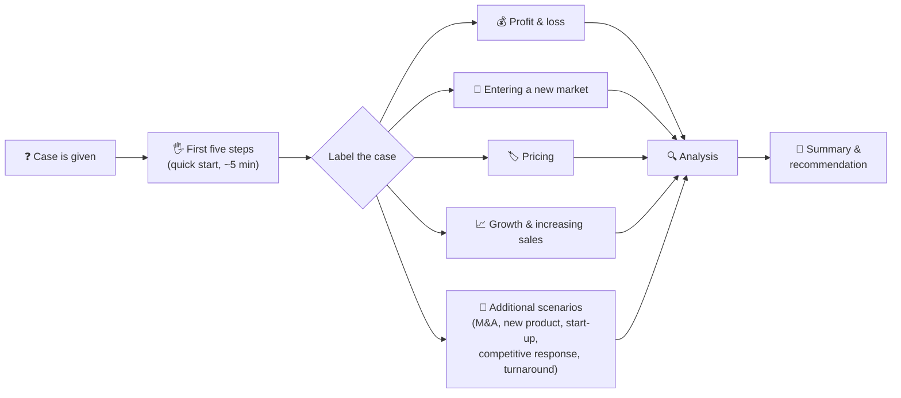
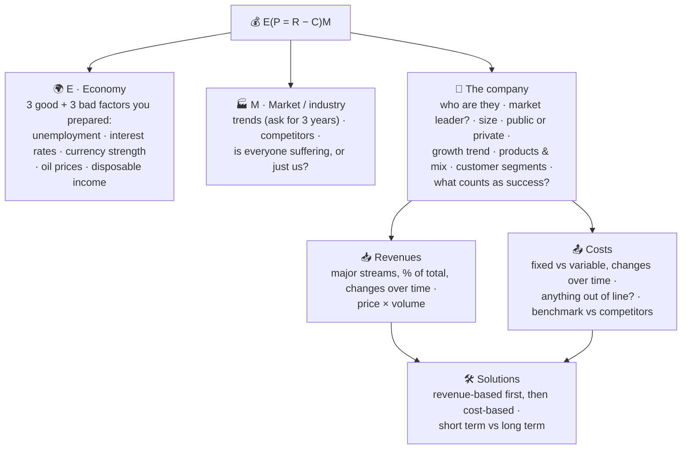
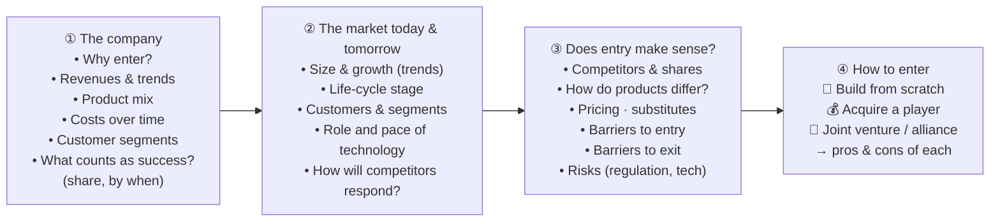
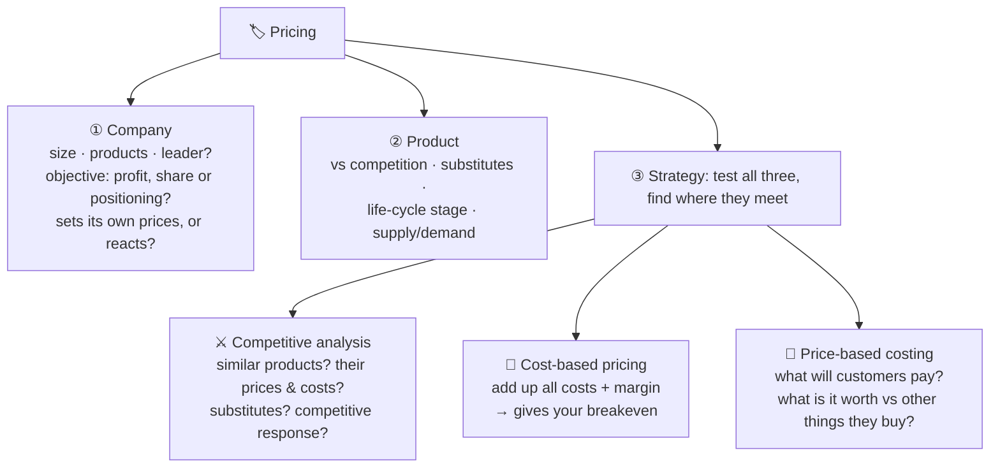
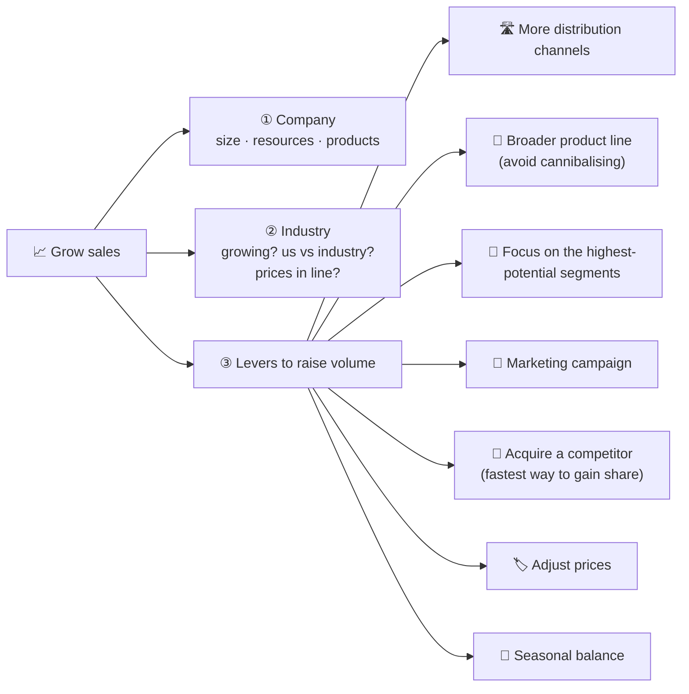
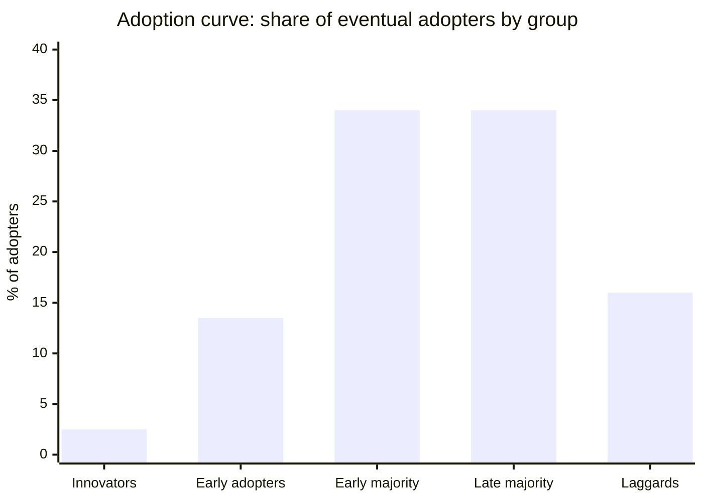
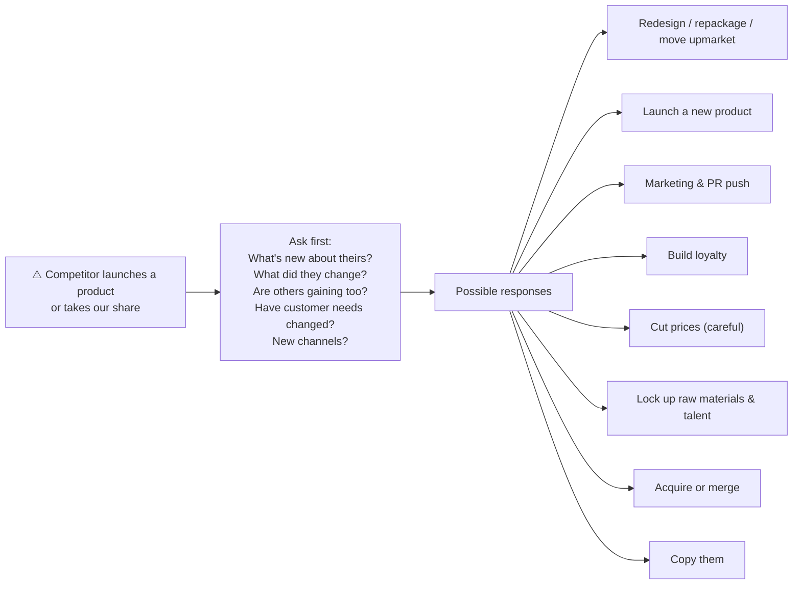
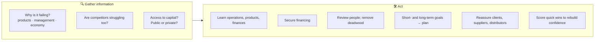
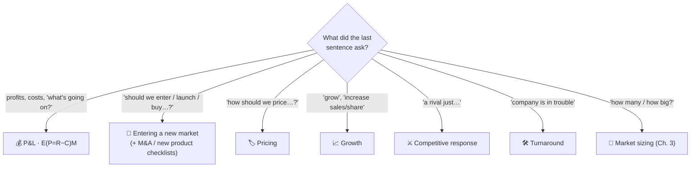

# 4 · The Ivy Case System

> **In one line:** five opening steps get you moving within seconds and buy you five minutes of information. Then you pick one (or a mix) of four scenarios (**profit & loss, entering a new market, pricing, growth**), each with its own ready-made checklist of questions and ideas.

<BookRef pages="71–96" section="Chapter 4 · Ivy Case System" />

## 4.1 Why a system

<BookRef pages="71–72" section="Best Case Thinking" />

The biggest problem candidates have is **getting started**: overwhelmed, nervous, or just blank. The book's author developed a framework in 1996 and, after hundreds of debriefs, turned it into a **system**: a process with the tools built in. Everything in it is business sense and common sense, just organised so you can reach for it under pressure.

## 4.2 The first five steps

<BookRef pages="72–75" section="The First Five Steps" />

<Steps items={[
  {letter: '1', title: 'Summarise the question', body: 'Repeat the key facts back, especially when the question came at you like a fire hose. Any misheard detail gets corrected now, not 20 minutes in. Quantify as you go: say "the stock fell about 20 percent", not "it went from $15 to $18" or "it moved $3".'},
  {letter: '2', title: 'Verify the objective(s)', body: '"One objective is to raise profits. Are there any others I should know about?" If there is a second objective, you may need to split the case and tackle each in turn.'},
  {letter: '3', title: 'Ask clarifying questions', body: 'Broad, open questions are welcome now (about the company, industry, competition, product). Later in the case you lose the right to ask sweeping questions. The scenario checklists below tell you what to ask.'},
  {letter: '4', title: 'Label the case & lay out your structure', body: 'The hardest step. It is fine to take 30–90 seconds of silence here. Decide which scenario(s) apply, pick the relevant bullets, draw the structure, then turn your notes toward the interviewer and walk them through it. You are not married to it: new information may change it.'},
  {letter: '5', title: 'State your hypothesis', body: 'Especially in broad, interviewee-driven cases ("here is my problem, what do I do?"). A hypothesis focuses your questions and analysis. If it is disproved, you have eliminated one option; restate and move on. Not needed in interviewer-driven cases ("work out these four numbers").'},
]} />

> **Steps 3–5 can move around.** In a P&L case ("sales up, profits down") the hypothesis is almost obvious ("rising costs are squeezing profit"), so you can lay out the structure first, state the hypothesis, then ask questions. Other times you'll want three to five questions before you commit to a structure.

<KeyIdea>Think in percentages. "Revenue jumped 20 percent" is how senior managers think and talk. Raw dollar changes aren't.</KeyIdea>

### Interviewer-led vs interviewee-led cases

| | Interviewee-led ("Here's my problem. What do I do?") | Interviewer-led ("Find the market size, price, breakeven and profit") |
|---|---|---|
| More typical of | BCG, Bain | McKinsey |
| Your structure | Hand-crafted, **hypothesis-driven** | The interviewer's list *is* your structure; you can draw a [final slide](/docs/chapters/part-1/case-questions#310-the-summary-and-the-final-slide) right away |
| Watch out for | Wandering without a hypothesis | Answering in the order given when another order makes more sense (e.g. you need **price before market size** for a new product) |

## 4.3 Scenario 1 · Profit and loss

<BookRef pages="75–80" section="Profit and loss" />

*Example prompt:* a premium athletic-shoe maker's sales are up but U.S. profits are down. What's going on, and how do we fix it?

The most common case type. The moment you hear "bottom line", "profit", "costs" or "revenue", write:

E ( P = R − C ) M

**E** = the economy, **M** = the market/industry. Outside the brackets is the outside world; **look there first** to decide whether this is a *company* problem or an *industry* problem.

**Why talk about the economy yourself?** It shows you know what's happening outside the classroom, and it lets *you* frame the environment the case lives in, which means fewer surprises from the interviewer. Walk in with about six factors ready (three positive, three negative).

**Price and volume move together.** Cutting price to boost volume isn't automatically right: what happens to profit, and to next year's sales? Find the mix that makes sense.

**What counts as success?** This is different from "meeting the objective". Most companies *can* enter a market; but 10% share in three years may be realistic while 10% in one year probably isn't. Reality-test the goal.

### Generating solutions without panicking

<KeyIdea>Before listing ideas, **ask for a moment and write two headings: "Revenue-based" and "Cost-based"** (optionally split short term / long term, and split costs into production, labour, finance). Then present all the revenue ideas, then all the cost ideas.</KeyIdea>

Why it works:

- Looking at a heading is much easier than staring at a blank page.
- It stops you ping-ponging between revenue and cost ideas.
- The interviewer has heard every idea before and **will cut you off** mid-sentence. Being cut off under pressure makes most people freeze. With a written list you just glance down and give the next idea.

**Questions to have ready**

| Revenues | Costs |
|---|---|
| What are the major revenue streams, and what % of total is each? | Any major shifts in costs? |
| Does anything look odd in the mix? | Does any cost look out of line? |
| Has the mix changed recently? Why? | How do we compare with competitors (benchmarking)? |

**New products:** always ask about the **disadvantages** as well as the advantages. Everyone forgets, and disadvantages often drive the case.

## 4.4 Scenario 2 · Entering a new market

<BookRef pages="80–84" section="Entering a New Market" />

*Example prompt:* a hair-products company is thinking about entering sunscreen. Good idea?

This covers straightforward entry, but also M&A, joint ventures, start-ups and new products. So it's never just "do we enter?" but **"how do we enter, and what are the pros and cons of each way?"**

**Barriers to entry** to name: capital requirements, access to raw materials, access to distribution channels, government policy. And always ask the exit question: *if this market sours, how do we get out?*

**Three ways in: a quick cost-benefit view**

| | 🌱 Build from scratch | 💰 Acquire | 🤝 Joint venture / alliance |
|---|---|---|---|
| **Pros** | Full control of quality, costs and brand; keep all profits | Instant share, management, expertise, distribution | Less capital and risk; each side brings something |
| **Cons** | Slowest; must build plants, team and channels | Expensive; integration and **culture** risk | Shared profits and control; partner risk |
| **Best when** | No good targets; low barriers | Barriers are high (regulation, long contracts) or speed matters | Each partner fills a clear gap |

### M&A questions inside entry cases

<BookRef pages="83–84" section="M&A" />

The two things that matter most in a merger: **does it increase shareholder value**, and **will the cultures mesh?** Culture clash is the biggest reason mergers fail.

📋 M&A checklist

- **Private-equity buyer?** Ask not only why, but **what else they own**. Many people miss synergies across portfolio companies.
- **Corporate buyer?** Ask what else it sells. The deal must make business sense.
- **Common reasons to buy:** market access, a stronger brand or more share · diversification · stopping a competitor from buying it · management talent · patents and licences · synergies and cost savings, wider distribution · tax advantages · shareholder value.
- **Due diligence:** What shape is the target in? How secure are its customers, suppliers and markets? How is the industry doing, and how is the target doing relative to it (a leader)? Margins: high volume/low margin or the reverse? How will competitors respond? Any legal obstacles? Technology risk?

## 4.5 Scenario 3 · Pricing

<BookRef pages="84–88" section="Pricing Strategies" />

*Example prompt:* a company is launching a new tablet. How should it price it?

Often a stand-alone case, often part of a bigger one, and one of the easiest scenarios.

**Don't be shy about margins.** An 1,800% margin is fine *if the market will pay it*, unless it's something like a life-saving drug for children, where the public-relations fallout could be devastating. Use judgement.

<KeyIdea>**Price-led costing beats cost-led pricing.** Peter Drucker called cost-driven pricing one of the "deadly business sins": companies add a margin to their costs, then find customers won't pay, and are forced into price cuts, expensive redesigns and losses. Customers don't care about your costs. Start from what the market will pay (and what competitors will charge), then design the product to hit that price.</KeyIdea>

**Partition pricing vs bundling.** Do you quote one all-in price, or a lower headline price plus separate fees (bags, delivery, installation, warranty)? Look at **industry norms**: if competitors offer free shipping and you don't, comparison shoppers will notice. The author's own example: he quotes schools one flat fee including travel, which is simpler for a cash-strapped school to budget, even though "fee plus expenses" is the consulting norm.

## 4.6 Scenario 4 · Growth and increasing sales

<BookRef pages="88–90" section="Growth and Increasing Sales" />

*Example prompt:* an electronics distributor wants to grow sales so it can claim to be the biggest distributor of one particular product. How?

Growing sales isn't the same as growing profit, so costs matter less here. Sales can mean **volume, revenue, or both**.

*Seasonal balance* example: a garden centre sells flowers in spring, herbs in summer, pumpkins in autumn and Christmas trees in winter, so every quarter brings in revenue.

Another route to growth: find **niches in developing industries with high barriers to entry**. There's less competition, and any newcomer is easy to spot.

*Hypothesis example:* "By lowering prices, the distributor can raise volume enough to become the biggest."

## 4.7 Key questions for additional scenarios

<BookRef pages="91–96" section="Key Questions for Additional Scenarios" />

These plug into the four scenarios whenever a case calls for them.

### Industry analysis

🏭 Checklist

- **Life cycle:** emerging, mature or declining?
- **Performance:** growth over 1, 2, 5, 10 years? How are we doing versus the industry?
- **Players:** who has what share, and who has the rest?
- **Recent changes:** new players, new technology, new regulation?
- **What drives it:** brand, products, size, economics, technology?
- **Profitability:** what are the margins?
- **Suppliers:** how many, availability, their market, their own supply chain health.
- **The future:** players entering or leaving? M&A? Barriers to entry and exit? Substitutes?

### Developing a new product

🧪 Checklist

- **Product:** what's special or proprietary? Patent, and for how long? Similar products or substitutes? **Advantages and disadvantages?** Fit with the current line? Can our sales force sell it?
- **Market strategy:** effect on existing products (cannibalising or replacing?), new customers and sales, competitive response. If it's a new market: barriers, players and shares.
- **Customers:** who, what matters to them, segments, how to reach them, how to keep them.
- **Funding:** cash or debt? Can we carry the debt in a downturn? Best use of funds?

**How many units in year one?** A new product rarely captures more than **10%** of its market in the first year; **3–5%** is more typical, depending on competition and how much better it is. Sketch the **adoption curve** and walk the interviewer through it:

### Starting a new business

🚀 Think like a venture capitalist

First test the market like any entry (competitors, shares, differentiation, barriers). Then ask: **would you invest your own money?** VCs invest in:

- **Management:** experience, core skills, worked together before, advisory board?
- **Market & strategic plan:** barriers, players, competitive response.
- **Distribution channels:** which, and how many, can we rely on?
- **Product/service:** what is it, what's the edge, the disadvantages, is it proprietary?
- **Customers:** who, how to reach, how to keep.
- **Finance:** funding source, best allocation, can we survive a downturn?

### Competitive response

There are two sides: **a rival moves against us**, or **we move and they respond**.

Whenever you plan a launch or a price change, **build the competitor's likely reaction into the plan**. A wait-and-see attitude can wipe out the advantage you hoped for.

### Turnarounds

## 4.8 Picking the scenario: a quick decision guide

Real cases mix these. Coors ([6.1](/docs/chapters/part-3/anatomy#coors)) is entry + M&A + growth; Hair-Raising ([Case 10](/docs/chapters/part-3/cases-level-2#case-10)) is sizing + pricing.

## 🧠 Check yourself

<Quiz question="In E(P=R−C)M, why look at E and M first?" options={["They are the easiest", "To find out whether it's a company problem or an industry-wide problem", "Interviewers require alphabetical order", "Costs are never the issue"]} answer={1} explain="If the whole industry is suffering, the fix looks very different than if only your client is." />

<Quiz question="You're asked for ideas to raise profit. Best first move?" options={["Start listing ideas immediately", "Ask for a moment, write 'revenue-based' and 'cost-based' headings, jot ideas, then present all revenue ideas first", "Ask the interviewer what they'd do", "Jump to layoffs"]} answer={1} explain="Headings make ideas easier to generate, keep them grouped, and give you a backup list when you're cut off." />

<Quiz question="A new product with no direct competition: what should you usually work out before market size?" options={["Breakeven", "Price", "Profit", "Plant location"]} answer={1} explain="Market size depends heavily on price. At $1 nearly everyone is a customer; at $1M almost no one is." />

<Quiz question="Which pricing approach did Drucker warn against?" options={["Price-led costing", "Competitive analysis", "Cost-led pricing: costs plus a margin", "Value pricing"]} answer={2} explain="Start from what the market will pay and design the costs to fit, not the other way round." />

<Quiz question="Typical first-year share for a genuinely good new product?" options={["30–50%", "Over 10% is common", "About 3–5%, rarely above 10%", "Under 0.1%"]} answer={2} explain="Even great products face adoption curves and incumbents. Be realistic." />

<Quiz question="What are the two most important questions in a merger?" options={["Price and timing", "Does it create shareholder value, and will the cultures mesh?", "Tax and legal", "Brand and logo"]} answer={1} explain="Culture clash is the biggest reason mergers fail to deliver." />

**Practice prompts**
- Draw the E(P=R−C)M notes for "a regional airline's profits fell 15% despite record passenger numbers." List three good and three bad economic factors you'd mention today.
- Draw an entering-a-new-market structure for "a coffee chain wants to sell packaged coffee in supermarkets". Add a build/buy/JV table.
- Price a brand-new product of your choice using all three methods, then say where they meet.
