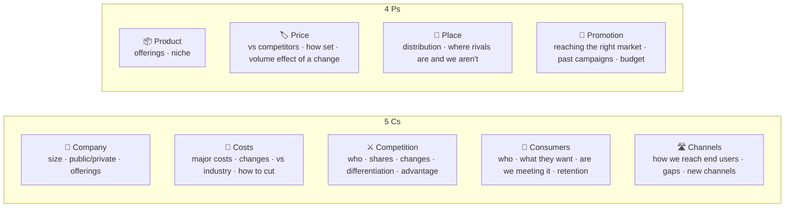
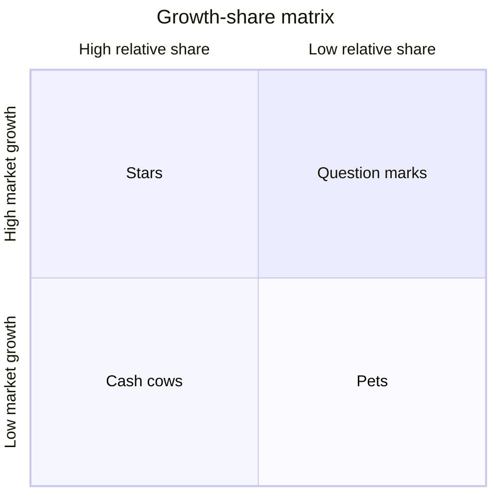
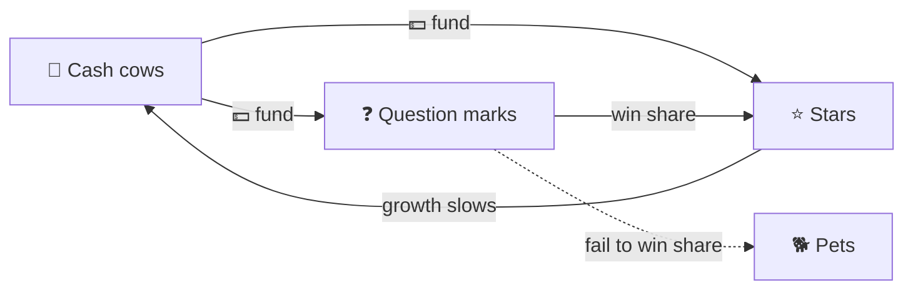
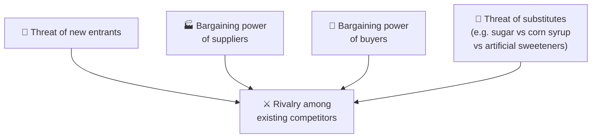
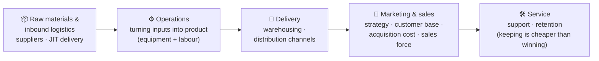
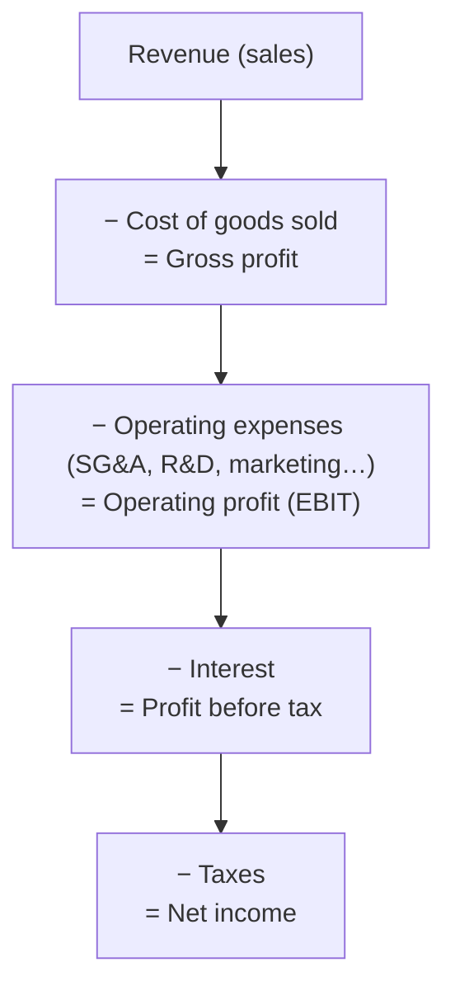
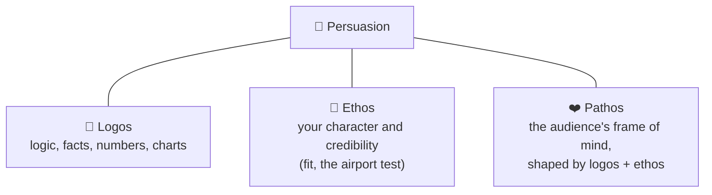
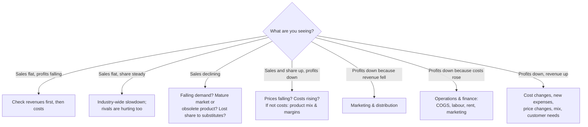

# 5 · Additional tools and frameworks

> **In one line:** a small, deliberately limited toolbox (5 Cs, 4 Ps, BCG matrix, Five Forces, value chain, income statement), plus cheat lists for cost cutting and "if X, then look at Y" scenarios. None was designed for case interviews, so use them to fill gaps, not as a fix-all.

<BookRef pages="102–120" section="Chapter 5 · Additional Tools and Frameworks" />

The list is short on purpose: too many options become a burden in the room. Understanding the real problem and attacking it logically beats forcing a framework onto it.

## 5.1 The 5 Cs and the 4 Ps

<BookRef pages="102–103" section="Five C's and Four P's" />

Basic frameworks that will keep you afloat but won't impress anyone. Two secrets:

1. **Reorder them to fit the case.** Read out as a laundry list, they sound mechanical and non-linear.
2. **Disguise them.** If the interviewer spots "the 5 Cs", you may lose points.

## 5.2 The BCG growth-share matrix

<BookRef pages="104–108" section="BCG Matrix" />

BCG's product portfolio idea: a company needs products with **different growth rates and market shares**, because cash flow depends on the balance between them. Fast-growing products need cash; slow-growing ones should throw cash off.

**Four rules behind it:**

1. Margins and cash generated rise with **market share** (the experience-curve effect).
2. **Growth eats cash**: holding share in a growing market needs investment in assets.
3. High share must be **earned or bought**, and buying it costs extra.
4. **No market grows forever.** The payoff from growth comes when it slows, or never.

| Quadrant | Share / growth | Cash behaviour | What to do |
|---|---|---|---|
| ⭐ **Star** | High / high | Reports profits; may or may not fund itself | Defend leadership; it becomes a cash cow when growth slows |
| 🐄 **Cash cow** | High / low | Throws off far more cash than it needs | Harvest; fund stars and question marks. Don't over-reinvest |
| ❓ **Question mark** | Low / high | Needs far more cash than it makes | Invest heavily to win share, or exit. Holding share just turns it into a pet |
| 🐕 **Pet** (dog) | Low / low | Accounting profit, but it all goes back in | Essentially worthless except in liquidation |

<KeyIdea>A balanced portfolio has **stars** to secure the future, **cash cows** to pay for it, and **question marks** to turn into stars. Pets aren't needed; they're evidence of failing to win leadership during growth, or failing to get out in time.</KeyIdea>

## 5.3 Porter's Five Forces

<BookRef pages="108–110" section="Michael Porter's Five Forces" />

Not built for cases, but useful for **new product, new market and new business** questions (e.g. "a regional food maker wants to enter gourmet toothpaste. Should it?").

| Force | The key idea |
|---|---|
| **New entrants** | Low threat if barriers are high or incumbents will retaliate (e.g. a price war). Barriers: economies of scale, capital needs, government policy, switching costs, access to distribution, product differentiation, proprietary technology. |
| **Rivalry** | How hard existing players compete. |
| **Substitutes** | Other products that do the same job and cap your prices. |
| **Buyers** | Push prices down, demand quality and service, play rivals against each other. |
| **Suppliers** | Many suppliers + few buyers → buyers win. Few suppliers + many buyers → suppliers win. |

## 5.4 The value chain

<BookRef pages="110–111" section="The Value Chain" />

Follows the product inside the company from raw material to after-sales service. Asking about each step's efficiency shows you understand product flow, and often surfaces the clue you need.

## 5.5 The income statement

<BookRef pages="111–112" section="Income Statement" />

You may be handed one and asked what looks off. Know the skeleton and look for **lines that are out of proportion**. If a small shoe company's labour is $50,000 on $100,000 of revenue (50%!), alarm bells should ring.

| Ratio | Formula | Tells you |
|---|---|---|
| Gross margin | Gross profit ÷ revenue | How much is left after making the product |
| Operating margin | Operating profit ÷ revenue | How much is left after running the business |
| Net margin | Net income ÷ revenue | What shareholders end up with |

## 5.6 The persuasion tripod

<BookRef pages="113" section="An Aristotelian Framework" />

Aristotle's *Rhetoric* was arguably the first case-interview book, because a case interview is an exercise in persuasion.

All logic and no personality tips the tripod over. Presentation matters as much as reasoning.

## 5.7 21 ways to cut costs

<BookRef pages="113–114" section="21 Ways to Cut Costs" />

Memorise these and give two or three per area when asked. But first think strategically: does this cost **drive value** or make the company **distinctive**? Don't cut equally across the board, and consider long-term effects under different economic scenarios.

| 👷 Labour (8) | 🏭 Production (8) | 🏦 Finance (5) |
|---|---|---|
| Cross-train workers | Invest in technology | Get customers to pay sooner |
| Cut overtime | Consolidate production space | Refinance debt |
| Reduce retirement-plan match | Flexible production lines | Sell non-essential assets |
| Raise employees' share of health premiums | Reduce inventory (JIT) | Hedge currency rates |
| Four 10-hour days instead of five 8-hour days | Outsource | Redesign health insurance |
| Make workers part-owners | Renegotiate with suppliers | |
| Consider layoffs | Consolidate suppliers | |
| Across-the-board pay cuts | Import parts | |

## 5.8 "If" scenarios to remember

<BookRef pages="114–117" section="If Scenarios to Remember" />

**By product life-cycle stage**

| Stage | Focus on |
|---|---|
| Emerging | R&D, competition, pricing |
| Growth | Marketing, competition |
| Mature | Manufacturing, costs, competition |
| Declining | Niche markets, competitors' moves, exit strategy |

**Pricing facts of life**

- Cut prices → volume rises → past full capacity, overtime drives costs up and **profits fall**.
- Prices stay stable only when: competitors grow at similar rates, prices track costs, and competitors' prices are roughly equal.
- Volume and costs are easier to change than industry price levels, unless everyone moves together (airfares, petrol).
- For a high-cost producer, the ideal is convincing rivals that share can't be shifted quickly, so **everyone keeps prices high**. Price wars hurt everybody.

## 5.9 General and business-case tips

<BookRef pages="117–120" section="General Tips · Business Case Tips · Peer Advice" />

Keep three things in the back of your mind in **every** case: **the internet**, **the economy**, and **competition** (inside the industry, and substitutes from outside it).

<IconCards items={[
  {icon: '🙊', title: 'Heard it before?', text: 'Say so. Interviewers can tell: you move too fast and your thinking looks rehearsed. It is hard to fake discovery.', color: '#0d9488'},
  {icon: '📐', title: 'Bring graph paper', text: 'Keeps numbers lined up and reminds you to draw.', color: '#3b82f6'},
  {icon: '🔢', title: 'Ask for numbers', text: 'If they don’t matter, the interviewer will tell you.', color: '#f59e0b'},
  {icon: '🧮', title: 'Drill your math', text: 'No calculators. Most mistakes are a zero or two.', color: '#ec4899'},
  {icon: '💬', title: 'Make it a conversation', text: 'Interact as much as possible.', color: '#10b981'},
]} />

**Advice from people who got offers:**

- Think out loud during the math, as if explaining over the phone.
- Final rounds are long (five hours). Before the last interviews, re-energise: water on your face, coffee, a brisk walk.
- **Non-business backgrounds:** you must clearly justify why consulting and how it fits your long-term goals. Firms could fill their classes with MBAs, so the burden is on you.
- Prepare stories for ambiguity, conflict, leadership and teamwork, and expect follow-up questions that dig several layers deep. Practise with friends.
- Not every story needs you as the hero; a failure you learned from works well. **Never invent a story.** Interviewers dig until they find the gaps.
- Interviewing abroad: learn what that office mostly does (e.g. lots of market-entry work) and practise those cases.
- Don't second-guess how it's going mid-interview. A math slip isn't fatal; letting it rattle you is.

## 🧠 Check yourself

<Quiz question="A product has high relative market share in a slow-growing market. In BCG terms it's a…" options={["Star", "Question mark", "Cash cow", "Pet"]} answer={2} explain="High share + low growth = cash cow: it generates more cash than it needs. Use it to fund stars and question marks." />

<Quiz question="What happens to a question mark that only holds its share as the market matures?" options={["It becomes a star", "It becomes a cash cow", "It becomes a pet", "It stays a question mark forever"]} answer={2} explain="Without winning leadership during the growth phase, it ends up low share in a low-growth market." />

<Quiz question="Sales and market share are rising, but profits are falling. First places to look?" options={["Marketing and distribution", "Falling prices or rising costs; if neither, product mix and margins", "Close the business", "Industry-wide demand"]} answer={1} explain="Growing share while making less profit usually means you're selling more, but either cheaper or at higher cost, or shifting to lower-margin products." />

<Quiz question="Few suppliers, many buyers. Who holds the power?" options={["Buyers", "Suppliers", "Neither", "The government"]} answer={1} explain="Scarcity on the supply side gives suppliers bargaining power." />

<Quiz question="Why shouldn't you openly recite the 5 Cs?" options={["They're wrong", "They're basic; reading them as a list sounds mechanical and can cost points", "They're copyrighted", "Interviewers don't know them"]} answer={1} explain="Rearrange them to fit the case and weave them in naturally." />

**Practice prompts**
- Map a company you know onto the BCG matrix (4–6 products). Which cash cows are funding which bets?
- Run Five Forces on food delivery apps in your city. Which force squeezes profit hardest?
- Pick a "declining-stage" product and propose a niche strategy and an exit plan.
