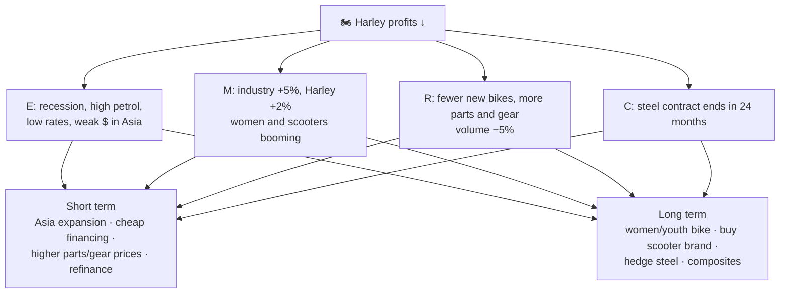
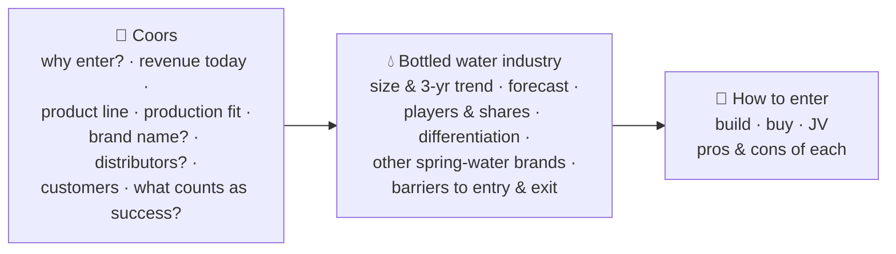
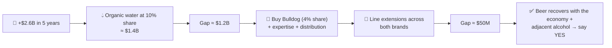

# 6.1 · Anatomy of a case: Harley-Davidson and Coors

> **In one line:** two complete cases, one **profit & loss** and one **entering a new market**, replayed move by move with a coach pointing out what scored points and what lost them.

<BookRef pages="121–142" section="Chapter 6 · Practice Cases (Anatomy)" />

Chapter 6 has four parts. This page covers the first: the two most common case types, annotated. Then come [10 case starts](/docs/chapters/part-3/case-starts), [20 dialogue cases](/docs/chapters/part-3/cases-level-1) and [15 partner cases](/docs/chapters/part-4/partner-cases-level-1).

The transcripts below are **condensed and paraphrased** to show the moves; the 📖 pointers lead to the full dialogue.

👤 Interviewer

Lines from the interviewer look like this.

🧑‍💼 Candidate

The candidate's lines look like this.

🎓 Coach

Commentary on what just happened looks like this.

---

## Harley-Davidson: profit & loss {#harley}

<CaseMeta format="Annotated dialogue" types={['Profit & loss']} pages="122–132" />

**Prompt:** Harley-Davidson's stock dropped from $54 to $49 on news of falling profits. What's going on, and how do we turn it around?

### Opening

🧑‍💼 Candidate

Restates the problem and asks: "Besides fixing profits, any other objectives?" → **Yes: keep market share.**

🎓 Coach

✅ Verifying the objective uncovered a second goal she'd never have learned otherwise.
⚠️ She should have **quantified**: "the stock fell about 10 percent", not "$54 to $49".

🧑‍💼 Candidate

Asks for a moment and writes **E(P=R−C)M**. Then asks the interviewer, "What's going on in the economy?"

🎓 Coach

❌ Don't *ask* about the economy; **tell** them. It shows you follow the news and lets you set the scene. Second attempt: tail end of a recession, mortgage crisis, high unemployment (less disposable income), petrol over $4, dollar strong against the euro and pound but **weak against Asian currencies**, interest rates **near 30-year lows**. Every one of these comes back later.

### Industry: a data dump

👤 Interviewer

Industry grew 5%, Harley only 2%; small bikes and scooters grew 8%. Women riders up 12% and now 10% of all riders, but only 2% of Harley's. Shares: Honda 27, **Harley 24**, Yamaha 17, Suzuki 10, Kawasaki 8, BMW 6, two scooter makers 9. (Assume each sells one model; Harley's is its big heavyweight bike.)

🎓 Coach

With a data dump, your job is to sort it into **relevant now**, **smoke**, and **relevant later**. Conclusion: it's a **Harley** problem, not an industry one: Harley is out of step with the two fastest-growing segments, **women and small bikes**.
💡 Never accept a single growth number. **Ask for the trend.** 5% after 10% is a very different story from 5% after 2%. Few candidates ask, so asking makes you stand out.

### Revenues: read the mix shift

| Revenue stream | Year 1 | Year 2 | Change |
|---|---|---|---|
| Domestic bikes | 45% | 35% | ⬇️ |
| International bikes | 40% | 40% | ➡️ |
| Replacement parts | 10% | 15% | ⬆️ |
| Merchandise ("garb") | 5% | 10% | ⬆️ |

👤 Interviewer

In four sentences or fewer: what's happening with Harley's customers?

🧑‍💼 Candidate

(Paraphrased:) They're buying fewer new bikes, fixing up the old ones, and buying gear to look the part.

🎓 Coach

✅ One sentence, plus a bit of humour. She also **asked for volume** (350K → 330K bikes, about −5%), since volume is part of revenue. Points scored.
She asked "what are the major costs and how have they changed?" The only one that matters: **steel**. The current contract is cheap but ends in 24 months, and prices may jump as the economy recovers. Keep it in mind.

### Short-term strategies (≤ 18 months)

🧑‍💼 Candidate

*First attempt:* "Market to women… design a new bike…" (too slow for 18 months) "…market the big bike to women…" (too heavy for most) "…lay people off?"

👤 Interviewer

Are you asking me or telling me?

🎓 Coach

❌ Ping-ponging, getting cut off, sounding unsure. The fix: **ask for a moment, write "revenue-based" and "cost-based" headings**, jot ideas, then present all revenue ideas first. If you're stuck, glance at page 1 of your notes: **low interest rates** and a **weak dollar in Asia** are sitting right there.

**Second attempt, organised:**

| Revenue-based | Cost-based |
|---|---|
| Raise prices on parts and merchandise (demand is holding up) | Refinance corporate debt at low rates |
| Expand international distribution, especially **Asia** (weak dollar) | Trim headcount in line with the ~5% volume drop |
| Cheap financing + generous trade-ins to pull buyers back into new bikes | |

### The pricing decision (and the stress test)

| Option | Bikes | Net profit per bike | Total |
|---|---|---|---|
| Keep price | 330,000 | $10,000 | **$3.30B** |
| Cut price | 440,000 | $7,000 | $3.08B |
| Raise price | 275,000 | $12,000 | **$3.30B** |

🧑‍💼 Candidate

Keep the price. Same profit as raising it, but raising loses 55,000 bikes (hurting the **market-share** objective); more bikes also mean more parts and merchandise sales later; and unsold inventory would have to be discounted, eating next year's sales.

👤 Interviewer

Let me tell you why you're wrong. Raising the price lets us cut more labour and strengthens the brand. Extra inventory can ship to the Asian markets you just proposed. And is share measured in units or revenue?

🧑‍💼 Candidate

Interesting, but not compelling enough. I don't believe all of that can happen within 18 months, so in this economy I'd keep the price.

🎓 Coach

✅ Textbook. It was a test of composure, not of the answer. She **defended without getting defensive**, and it was the turning point of her interview. (Run the numbers carefully before answering; you can't take back a wrong figure once it's out.)

### Long-term ideas and summary

- **Revenue:** a lighter bike for **women and younger men**; **acquire a scooter maker** (keep the Harley name off it) to get into the two fastest-growing segments, with synergies.
- **Cost:** **hedge steel** with futures or stockpile at today's price; use more **composites** in the new bike; modernise plants; source some parts abroad.

> **Summary (her version, condensed):** Stock fell about 10% on falling profits. It's a Harley problem, not an industry one: the company is missing women and small bikes. Short term: cheap financing for buyers, refinance our debt. Long term: a new bike for women and younger riders, buy a scooter brand, hedge steel. Profits should recover within 24–36 months.

---

## Coors: entering a new market {#coors}

<CaseMeta format="Annotated dialogue" types={['Entering a new market', 'M&A', 'Growth']} pages="133–142" />

**Prompt:** for 50 years Coors has advertised that its beer is made with Rocky Mountain spring water. The CEO is thinking about entering **bottled water**. Analyse the market, find the key issues, and recommend.

### Opening

🧑‍💼 Candidate

"Besides the analysis and recommendation, any other objectives?" → **Yes: the CEO told the board he'd grow revenue 50% in five years, or resign.**

🎓 Coach

✅ Without asking, he'd never have found the real driver of the case. Because this case is **interviewee-led**, he states a **hypothesis** within five minutes: "entering bottled water will grow total revenue 50%." Then he draws his structure and **turns his notes toward the interviewer**.

🎓 Coach

✅ He **started with the client**, not the water industry; many candidates get this backwards. Asking "what counts as success?" gives a target to reality-test.

### The numbers that frame everything

- Coors revenue: **$5.2B** → needs **+$2.6B** to reach $7.8B in five years. Beer is flat; new beers would just cannibalise existing ones.
- Coors expects **10%** of the water market in five years.
- Water market: **$11B**, growing **5% a year**. Tiers: premium (imported brands), **mid-tier** (the three giants together hold ~60% of the whole market; Coors' target), and low-priced regional and private-label water. Sparkling is only 4%.

**Can 10% of water close a $2.6B gap?**

🧑‍💼 Candidate

Starts writing `11B × (1.05)^5`… then simplifies: 5% for 5 years is 25% simple growth, a bit more with compounding, call it **~28%**. $11B × 1.28 ≈ **$14B**. 10% = **$1.4B**, so **$1.2B short**. To hit $2.6B he'd need **~18–19%** of the market.

🎓 Coach

✅ Good approximation. (Exact: 1.05⁵ ≈ 1.276.) Nobody wants to watch you grind through exponents. The real danger is the zeros: saying "$140 billion" ends the interview even if you correct it a second later.

### Losing and regaining confidence

👤 Interviewer

What's the quickest way to increase market share? *(asked three times)*

🧑‍💼 Candidate

Lower prices… a marketing campaign?… an acquisition?

🎓 Coach

⚠️ Being asked again shook his confidence. Boiled down, cases come to **structure and confidence**, and the two usually travel together. (Answer: **acquisition**.)

**The acquisition:** a regional low-tier brand, "Bulldog", with **4%** national share, made from tap water ~2,000 miles away. It will run as a separate company. Besides share, what else does Coors gain? **Expertise** ✅ · production facilities ❌ (nobody ships water 2,000 miles to save money) · **distribution channels** ✅.

### Brand and distribution

| Question | Candidate's answer | Verdict |
|---|---|---|
| Call it "Coors Water"? | No. Water means pure and healthy; beer doesn't. Parents won't buy their kids a beer brand. (Coca-Cola didn't call its water "Coke Water" either.) | ✅ Sound |
| Use the beer distributors? | Yes: saves shipping and the cost of building a network | ❌ **"Why you're wrong":** water sells in **3× as many places** (vending machines, fast food, schools); a beer truck outside a primary school is bad PR; and the goal is **revenue**, so why focus on cost? |
| Candidate's response | "Those are valid points; you're right. Build a new distributor network." | ✅ Admitting a real mistake is a strength. Don't defend a weak position out of pride. |

🎓 Coach

On how the market leader would react, he quoted Churchill and the interviewer challenged the history. ✅ He confirmed his point briefly and **steered straight back** to the case (the leader will respond hard and fast) instead of debating the tangent.

### Closing the gap

👤 Interviewer

We're still $1.2B short. No more acquisitions, and exporting isn't profitable. How do we close the gap?

🧑‍💼 Candidate

We've already done the hard, expensive part: a new brand and new distribution, all for one bottle of water. Now **widen the product line** through both brands: flavoured water, lemonade, iced tea, green tea, sports drinks.

👤 Interviewer

Now we're $50M short. You're meeting the CEO. What do you tell him?

🧑‍💼 Candidate

Let me find a way to say **yes** first. The economy will be stronger in five years, so beer sales recover. We could add other alcoholic products (spirits, flavoured malt drinks). And the brief was whether to enter water: water gets us 95% of the way. We shouldn't throw that away over $50M.

**Recommendation:** enter under a new brand (Rocky Mountain Spring); buy Bulldog for share, expertise and distribution; build a new distributor network; then add adjacent drinks.

🎓 Coach

✅ What clinched it: insisting on walking into the CEO's office with a **"yes, and here's how"**, not "close, but $50M short". He also gave the **recommendation first**, then the plan. He got knocked around in the middle but kept his cool and took back control.

## Lessons from the anatomy cases

| Do this | Harley | Coors |
|---|---|---|
| Verify objectives (find the hidden one) | Keep market share | 50% revenue growth or the CEO resigns |
| Quantify | Stock −10%, volume −5% | Gap of $2.6B, share needed ~18% |
| Look outside first | Economy and industry → Harley problem | Start with the client's reasons, then the industry |
| Write headings before ideas | Revenue vs cost, short vs long term | Build / buy / JV |
| Handle "you're wrong" | Held firm (argument too weak) | Gave way (argument correct) |
| Close strong | Short + long-term plan with timeline | "Yes, and here's how" |

## 🧠 Check yourself

<Quiz question="In the Harley case, the candidate first asked the interviewer about the economy. Why was that a missed opportunity?" options={["The economy wasn't relevant", "Telling them shows business awareness and lets you set the case's context", "Interviewers hate economic questions", "She should have started with costs"]} answer={1} explain="Framing the economy yourself shows you follow the news and reduces surprises. Her economic points all came back in the solutions." />

<Quiz question="Keeping or raising Harley's price both give $3.3B. What tipped the decision to keep it?" options={["Lower labour costs", "The market-share objective plus follow-on parts and merchandise sales", "Brand prestige", "Steel prices"]} answer={1} explain="Raising the price loses 55,000 bikes, hurting the share objective and future parts and gear revenue." />

<Quiz question="Coors needs $2.6B; water at 10% gives about $1.4B. Fastest way to gain share?" options={["Price cuts", "Marketing", "Acquisition", "Exporting"]} answer={2} explain="Buying a player brings instant share, plus expertise and distribution." />

<Quiz question="Why was using Coors' beer distributors for water a bad idea?" options={["They're too expensive", "Water sells in far more (and different) places, a beer truck at a school is bad PR, and the goal is revenue not cost", "They refused", "Water can't be trucked"]} answer={1} explain="The cost saving doesn't help a revenue goal, and the network can't reach most water outlets." />

<Quiz question="Facing a $50M shortfall before the CEO meeting, what's the best move?" options={["Report that it's not feasible", "Find a credible way to say yes, then recommend", "Ask for more time", "Cut costs by $50M"]} answer={1} explain="Look for a credible path to the client's goal first; a 'can-do' recommendation wins." />
