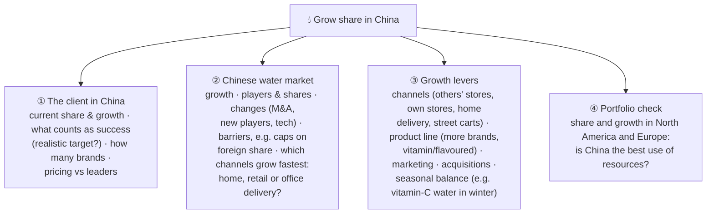
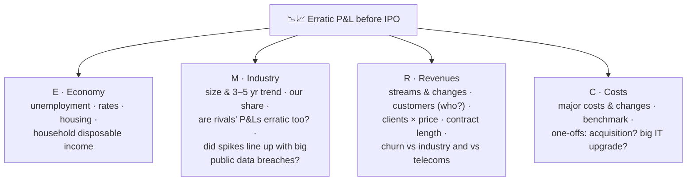
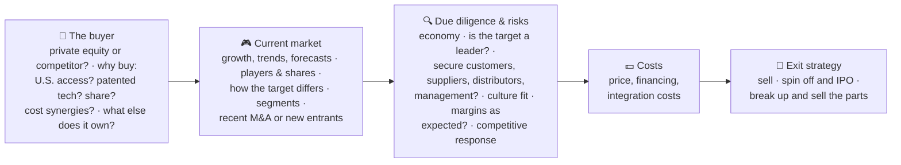
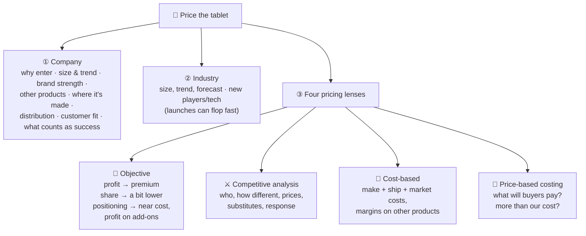
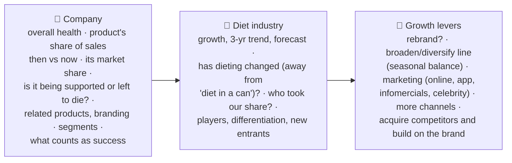
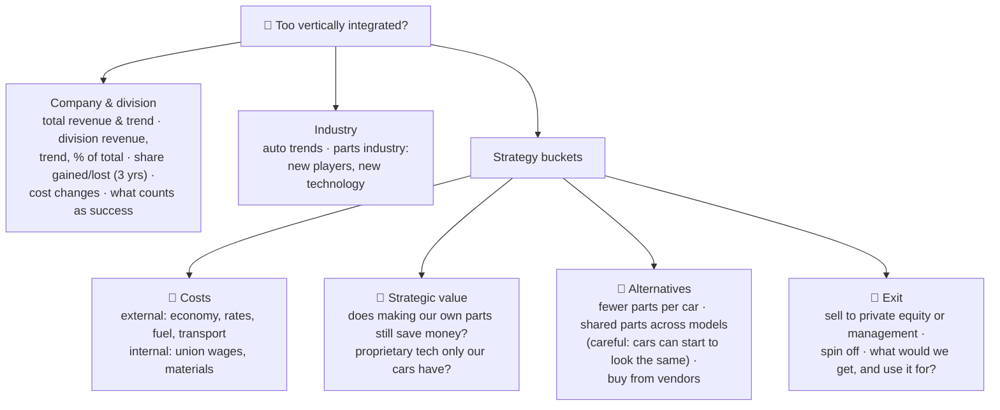
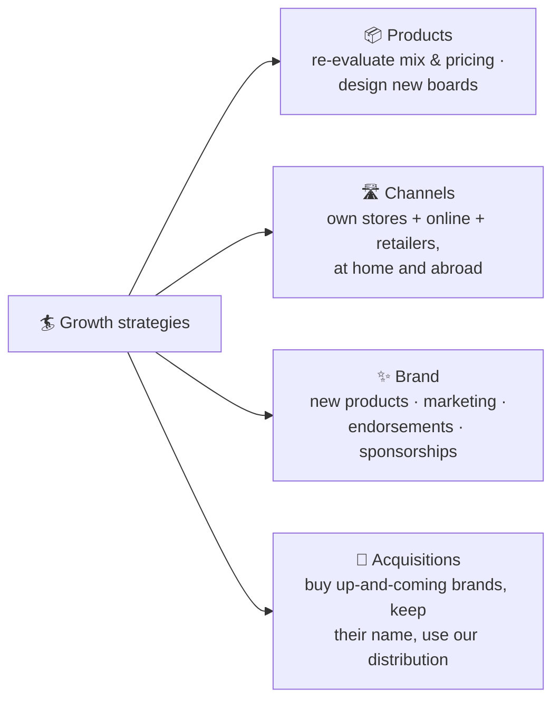
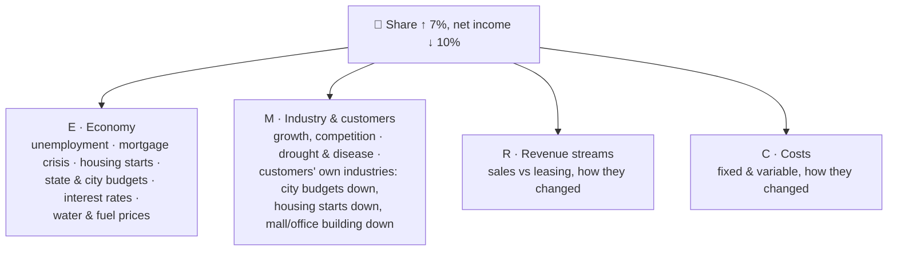
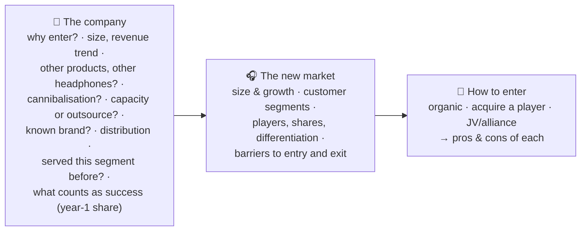

# 6.2 · Case starts: the first five minutes

> **In one line:** ten prompts for practising just the opening: summarise, verify the objective, ask the key questions, and draw a **hand-crafted** structure. E(P=R−C)M is the only structure set in stone; everything else should be built for the case in front of you.

<BookRef pages="143–175" section="Case Starts" />

## How to use this page

Many people struggle most with getting started. For each prompt:

1. **Read it out loud** as if you're in the room, and **record yourself**.
2. Summarise, verify the objective, ask your questions, and **draw your structure on paper** (2–3 minutes).
3. Open the walkthrough and compare. It's fine if they differ; there's no single right answer.
4. Play the recording back. Listen to your **speed, tone and confidence**. You'll wince at first; that's the point.

Do one or two now and save the rest for when you're more confident.

### Two kinds of openings

| | "Here's my problem. What do I do?" | "Work out the market size, price, breakeven and profit" |
|---|---|---|
| More typical of | BCG, Bain | McKinsey |
| Structure | Hand-crafted, **hypothesis-driven** (start from the likely answer) | Driven by the list: draw a [final slide](/docs/chapters/part-1/case-questions#310-the-summary-and-the-final-slide) as your structure, scorecard and summary |
| Common slip | Using P = R − C for *everything* (a checklist, not thinking) | Jumping into market size before you know the price of a new product |

Sizing the market first is right about 80% of the time, but only if you have what you need (for a new product, that means price and differentiation). Simple frameworks like **short term / long term** or **internal / external** are perfectly good. Step back and look at the big picture rather than forcing the same template every time.

**Order of play:** summarise → verify objective → clarifying questions → structure. **Exception:** in a P&L case, draw E(P=R−C)M first, then ask.

---

## CS1 · Bottled water in China {#cs1}

<CaseMeta format="Case start" types={['Growth', 'Market share']} pages="144, 147–150" />

**Prompt:** most of China's lakes and rivers are polluted by industry, so city dwellers are switching to bottled water and the market keeps growing. A global food company wants to know **how best to grow its share** of the Chinese bottled-water market.

🔓 Reveal the structure

**Summarise & verify:** city tap water is poor, bottled water is booming, the client wants more share. Other objectives? *Assume none.*

**Facts to keep in mind (as given in the book):** China's market was projected to grow from about $9B (2012) to $16B (2017), up from just $1B in 2000; North America to about $26B; Europe flat. The client's Chinese share was only **1.7%** (revenue up 27%); the local leader held about 14%.

## CS2 · Identity-theft monitoring company {#cs2}

<CaseMeta format="Case start" types={['Profit & loss', 'IPO']} pages="144, 150–155" />

**Prompt:** the U.S. leader in identity-theft monitoring wants to go public, but it has swung between profits and losses in six of the last ten quarters. How can it **stabilise and grow profits**? (You're handed a chart of quarterly profit/loss.)

🔓 Reveal the structure

**Read the chart first:** no pattern, and big swings (e.g. −$12M one quarter, +$18M another). What could cause that?

**P&L, so draw E(P=R−C)M immediately**, then build on it:

**Hypotheses worth testing:** sign-ups spike after news of a big data breach and then churn away; lumpy one-off spending; marketing bursts.

## CS3 · Hong Kong buyer, U.S. video-game maker {#cs3}

<CaseMeta format="Case start" types={['M&A']} pages="146, 155–157" />

**Prompt:** a Hong Kong company is acquiring a U.S. video-game developer. What should it consider?

🔓 Reveal the structure

Short prompt, so don't repeat it word for word. Just ask: "Besides identifying the key factors, any other objectives?" (*None.*)

## CS4 · Ad agency buying a running-shoe brand {#cs4}

<CaseMeta format="Case start" types={['Diversification', 'Pros & cons']} pages="146, 157–160" />

**Prompt:** a mid-size ad agency won some national accounts, then lost two last year and hasn't replaced them. Its CEO wants to buy a running-shoe brand that was big from the 1950s to the 1980s before the giants pushed it aside. Good idea? **List the pros and cons first**, then draw your structure.

🔓 Reveal the approach

**Pros/cons technique:** draw a line down the page, label "Pros" and "Cons", **ask for a moment**, jot ideas in any order, then present **all pros, then all cons**. If you improvise, you'll get cut off mid-thought and struggle to restart.

| ✅ Pros | ❌ Cons |
|---|---|
| Diversifies away from lumpy agency revenue | No experience making or selling shoes |
| A "retro" brand with heritage could be revived | Brutal competition from giant brands |
| Agency can market the brand in-house cheaply | Needs capital the shrinking agency may not have |
| Could become a showcase client for the agency | Distracts management from the core problem (lost accounts) |
| Retro fashion trends can make old brands cool again | Brand may be valued at nostalgia, not sales |

**Then ask:** Why does the CEO want this? Can we afford it? Any shoe experience? Running-shoe industry trends? Players and differentiation? **Is there a better way** to fix the agency (e.g. win new accounts) or to get into shoes?

## CS5 · Pricing a new tablet {#cs5}

<CaseMeta format="Case start" types={['Pricing']} pages="146, 160–162" />

**Prompt:** a large Italian electronics firm has launched a tablet much like the market leader's. How should it price it?

🔓 Reveal the structure

Verify the objective, and ask *why* the CEO wants to be in this market.

## CS6 · Diet-drink acquisition gone wrong {#cs6}

<CaseMeta format="Case start" types={['Turnaround', 'Profit & loss']} pages="146, 162–165" />

**Prompt:** a big food company paid $2.2B for a diet-shake brand four years ago, hoping to grow its revenue five-fold in three years. Instead U.S. revenue fell **40%** to $196M and profits fell **33%**. What's going on, and how do we turn it around?

🔓 Reveal the structure

Quantify in the summary: revenue down 40%, profits down 33%, and a purchase price over 10× today's revenue.

## CS7 · Automaker's parts division {#cs7}

<CaseMeta format="Case start" types={['Vertical integration', 'Strategy']} pages="146, 165–167" />

**Prompt:** a Detroit automaker's parts division (20% industry share, ~500,000 parts and accessories) hasn't been profitable for years. The CEO suspects too much **vertical integration**: the company makes about **80%** of its own parts versus about **40%** at rivals. How would you approach this?

🔓 Reveal the structure

It looks like a P&L case, but approach it as a **make-or-buy strategy** question.

## CS8 · Reviving a surfboard brand {#cs8}

<CaseMeta format="Case start" types={['Growth', 'Brand turnaround']} pages="146, 167–170" />

**Prompt:** you're the new CEO of a surfboard maker founded in the 1960s. It held 75% share into the 1980s, missed the shift to smaller boards as competition grew, and now has **10%**. Grow the company, regain share, and restore the brand.

🔓 Reveal the structure

Three objectives, stated in the prompt: **grow, regain share, rebuild the brand**. Structure: company → industry → growth strategies.

| Company questions | Industry questions |
|---|---|
| Image with consumers and the trade? | Growth trend, last 3 years |
| Revenue and 3-year trend; product mix by revenue | Players, shares, how their boards differ |
| Prices vs the industry | Mergers, new entrants, exits |
| Channels (own stores, retailers, online): shrinking? mix? | |
| Customer segments and changes | |
| Target share? Can we fund the changes? | |

## CS9 · Palm-tree grower {#cs9}

<CaseMeta format="Case start" types={['Profit & loss']} pages="147, 170–172" />

**Prompt:** a company grows, sells and leases twenty kinds of palm trees and tropical plants across the U.S. Net income fell from $105M to **$95M**, yet **market share grew 7%**. What's going on, and how do we fix it?

🔓 Reveal the structure

**Quantify in the summary:** "net income fell about 10%", not "$10M".

P&L → **E(P=R−C)M**, outside first.

**Hypothesis:** share rose because rivals shrank faster in a shrinking market (construction and city budgets down), while costs like water and fuel rose. Gaining share isn't a win if the whole market is shrinking.

## CS10 · High-end headphones {#cs10}

<CaseMeta format="Case start" types={['Entering a new market']} pages="147, 173–175" />

**Prompt:** a large Japanese electronics company wants to enter the **high-end headphones** market. Good idea?

🔓 Reveal the structure

---

## Patterns across the ten starts

| Pattern | Seen in |
|---|---|
| Start with **the client** ("why do they want this?") before the market | CS1, CS3, CS5, CS6, CS10 |
| **E(P=R−C)M** drawn first, then questions | CS2, CS9 |
| **Pros and cons** listed in bulk (all pros, then all cons) | CS4 |
| **Build / buy / JV** as the closing bucket | CS10, CS3 (plus exit), CS8 (acquisitions) |
| An **exit strategy** bucket | CS3, CS7 |
| "**What counts as success?**" asked every time | All |

## 🧠 Check yourself

<Quiz question="Which structure does the book treat as fixed, to be drawn before asking questions?" options={["Build/buy/JV", "E(P=R−C)M for profit & loss cases", "5 Cs", "Pros/cons"]} answer={1} explain="Every other structure should be hand-crafted for the case." />

<Quiz question="A palm-tree company's share rose 7% but net income fell from $105M to $95M. How should you open the summary?" options={["Net income fell $10M", "Net income fell from $105M to $95M", "Net income fell about 10% even as share grew 7%", "Profits are bad"]} answer={2} explain="Always turn related numbers into percentages; that's how executives think." />

<Quiz question="The interviewer asks for pros and cons. The best delivery?" options={["Alternate pro, con, pro, con", "Ask for a moment, write them down, then give all pros followed by all cons", "Only list pros", "Draw a full structure first"]} answer={1} explain="Writing first protects you when you get cut off, and grouping keeps it organised." />
