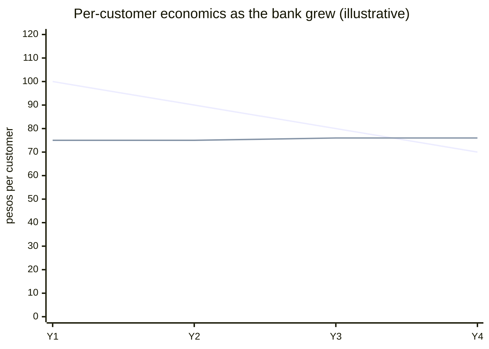
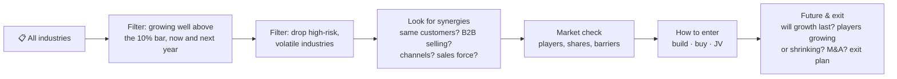
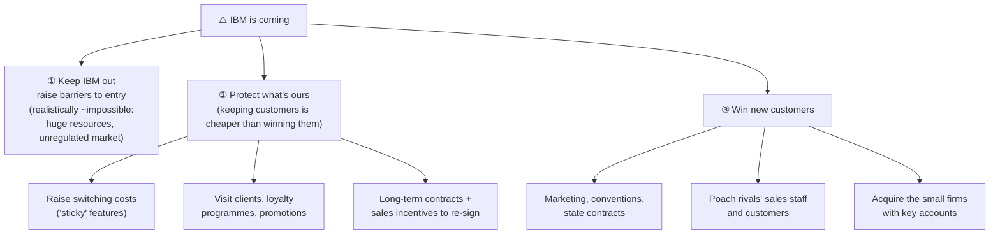
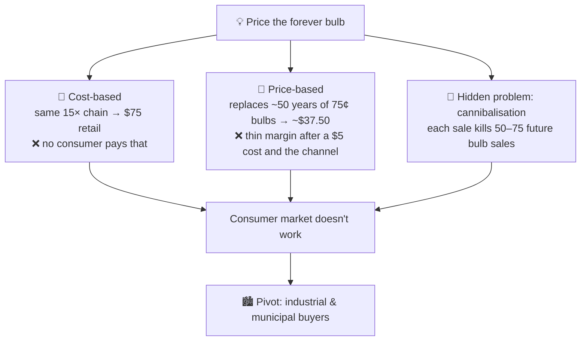
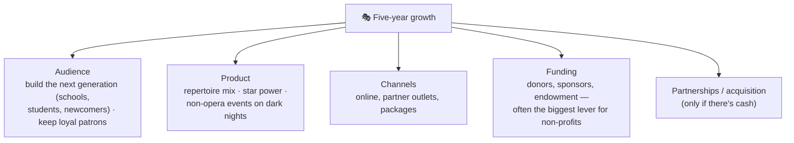

# 6.3 · Dialogue cases, Level 1 (Cases 1–7)

> **In one line:** seven warm-up cases covering profit & loss, diversification, competitive response, number-driven strategy, pricing, sizing + entry, and growth. Read the prompt, write your structure, *then* open the walkthrough.

<BookRef pages="175–201" section="Case Practice · Cases 1–7" />

Reading lots of cases builds a mental archive you'll draw on in the room. The walkthroughs can't match yours exactly, because interviewers add twists you can't predict. So draw your structure, read the walkthrough, write down **what you didn't think of** in your [case journal](/docs/chapters/part-1/case-questions#311-keep-a-case-journal), then read it again.

| # | Case | Type |
|---|---|---|
| 1 | [Mexican bank](#case-1) | P&L → customer segmentation |
| 2 | [Yellow Stuff chemicals](#case-2) | Diversification / entering a new market |
| 3 | [Eastern Training Network](#case-3) | Competitive response |
| 4 | [Cola price rise](#case-4) | Strategy from numbers |
| 5 | [Light bulb that never burns out](#case-5) | Pricing |
| 6 | [Super-absorbent diaper material](#case-6) | Market sizing + entry |
| 7 | [New York opera company](#case-7) | Growth strategy |

---

## Case 1 · Mexican bank {#case-1}

<CaseMeta level={1} format="Dialogue" types={['Profit & loss', 'Customer segmentation']} pages="177–180" />

**Prompt:** a major Mexican commercial bank has growing revenue, but for two years its profits have fallen and are now negative. You meet the CEO in a week. Why are profits falling, and how do we restore them?

🔓 Reveal the walkthrough

**Structure:** two parts, **diagnose** then **fix**. Diagnosis uses E(P=R−C)M: industry → revenues → costs.

- **Industry:** other banks dipped only slightly, so it's mainly **our** problem. We have 20% share, three national rivals of similar size, and many small regional banks.
- **Revenues:** about 70% interest income, 30% fees. 8M customers.
- **The chart:** average **revenue per customer is falling** while average **cost per customer stays flat**. The lines have crossed, so each customer now loses money.

*(Top line = average revenue per customer; flat line = average cost per customer.)*

**Why:** branch managers were rewarded for **new customers**, so they signed up less profitable ones (students, lower-income workers instead of professionals). Meanwhile the bank added branches and tellers in proportion, so there were **no economies of scale**.

**Three levels of answer:**

| Answer | Idea | Quality |
|---|---|---|
| Simple | Drop the new low-value customers; shrink branches and tellers back | Works, but crude |
| Better | Raise revenue per customer (new products, higher fees) **and** cut cost per customer (close weak branches, fewer tellers) | Solid |
| **Best** | **Segment customers into tiers** and match service cost to customer value: personal bankers for high-net-worth clients; steer low-value customers to ATMs and online (e.g. two free teller visits a month, then a small fee) | Raises revenue *and* cuts cost |

**Lesson:** a P&L case turned into a **segmentation** case. Reading the chart correctly was the turning point.

## Case 2 · Yellow Stuff chemicals {#case-2}

<CaseMeta level={1} format="Dialogue" types={['Entering a new market', 'Diversification']} pages="181–183" />

**Prompt:** an industrial solvents and pesticides maker is losing sales because of new environmental rules. It is reformulating products and selling old stock abroad, but the chemical industry will grow only about 3% a year. Management wants to keep chemicals and **diversify into a high-growth industry**. Don't list industries; tell me **what you'd research** to choose one.

🔓 Reveal the walkthrough

**Key clarifiers:** What does "high growth" mean? → **10% a year.** Risk appetite? → **Medium.**

**Synergy example:** if you sell cleaning solvents to a big soft-drink maker, an aluminium can business could sell to the same customer. As a **B2B** seller, avoid consumer products.

**Barriers that push you toward buying instead of building:** regulatory approval (years of agency review), a market locked up by two dominant players, scarce raw materials, substitutes.

**Smart closing touch:** compare the opportunity with simply **investing the cash in the stock market**. It might earn more and is far more liquid.

**Lesson:** about 90% of the prompt is irrelevant. It isn't about chemicals; it's an **entering-a-new-market** case where diversification is the only growth path on the table.

## Case 3 · Eastern Training Network {#case-3}

<CaseMeta level={1} format="Dialogue" types={['Competitive response']} pages="184–187" />

**Prompt:** a mid-size computer-training and consulting firm in New England and the Atlantic seaboard learns that **IBM is entering its segment**. What should it do?

🔓 Reveal the walkthrough

**Assumed objectives (confirmed):** keep IBM out, or keep as much share as possible. Market: three main players including us (we have **24%**), plus a few small firms with one or two big clients each.

**Three-pronged plan:**

**Push-back 1:** "Isn't buying small firms risky when IBM is arriving?" → No guarantees, but size cuts both ways: big firms let things slip through the cracks. We'll compete on **people and service**.

**Push-back 2:** "IBM offers steep discounts. Do you match them?" → **No price war**; you can't win one against IBM. Services are bought on service, not small savings. But be flexible with good deals for clients who sign **long-term contracts**.

**Lesson:** a simple, clear three-prong structure, and he **held his ground** under pressure.

## Case 4 · Cola price rise {#case-4}

<CaseMeta level={1} format="Dialogue" types={['Strategy from numbers']} pages="188–190" />

**Prompt:** a leading cola brand wants to boost U.S. profitability by **raising prices** in grocery stores (high volume, low margin). What are the economics, and is it a good idea?

🔓 Reveal the walkthrough

**Extra objective:** don't lose market share. Market share and unit cost? → *"Not relevant."* (Accept that and move on.)

**Data:** 100M cans at 23¢ last year. Keep the price → volume +6%. Raise to 27¢ → volume +1%.

| | Price | Cans | Revenue |
|---|---|---|---|
| Hold | $0.23 | 106M | $24.38M |
| **Raise** | **$0.27** | **101M** | **$27.27M** |
| Difference | | −5M cans | **+$2.89M** (about +12%) |

To protect share it plans a big brand-awareness campaign. **Now you're the rival (80M cans at 23¢). What do you do?**

| Rival's option | Volume change | Cans | Price | Revenue |
|---|---|---|---|---|
| **Follow to 27¢** | +3% | 82.4M | $0.27 | **$22.25M** |
| Hold at 23¢ | +12% | 89.6M | $0.23 | $20.61M |
| Cut to 21¢ | +20% | 96.0M | $0.21 | $20.16M |

**Answer: follow the price rise**, even if the leader's volume growth turns out to be +3% instead of +1%.

*Qualitative angle the candidate also raised:* price-sensitive grocery shoppers might switch at the shelf if the rival undercuts, letting it "ride" the leader's marketing spend. But **the numbers favour following**. Always let the numbers decide.

**Lesson:** a straightforward case once you have the numbers. Set up the table and compute cleanly.

## Case 5 · The light bulb that never burns out {#case-5}

<CaseMeta level={1} format="Dialogue" types={['Pricing']} pages="191–193" />

**Prompt:** a big electrical manufacturer has invented a bulb that will last more than 500 years. The marketing director asks: **how would you price it?**

🔓 Reveal the walkthrough

**Clarifiers:** patent pending, no competition. **Disadvantages?** Only the price. R&D cost: **$20M**.

**The value chain of a regular bulb:** costs 5¢ to make → sold to distributor at 25¢ → to the store at 50¢ → to the consumer at 75¢ (a 15× markup from factory to shelf).

The new bulb costs **$5** to make.

**The pivot:** a city with ~2,000 street lights buys ~$20 bulbs twice a year, but the real cost is **labour**: a crew and a truck, maybe **$150 per change**. Sell them a forever bulb at around **$400**; it pays for itself in under two years, and the maker earns a fat margin.

**Lesson:** he tried both pricing methods, spotted **cannibalisation** (beyond the standard checklist), and instead of scrapping a $20M investment he **found a market where value beats price**. (Supply-and-demand reasoning doesn't help: there's no market yet.)

## Case 6 · Super-absorbent diaper material {#case-6}

<CaseMeta level={1} format="Dialogue" types={['Market sizing', 'Entering a new market']} pages="194–196" />

**Prompt:** a chemical company invented a lightweight, super-absorbent, **biodegradable** material that would be perfect for disposable diapers. What should it do with it? First, **size the U.S. diaper market**.

🔓 Reveal the walkthrough

**Objectives:** decide what to do, **and make a handsome profit**.

**Market sizing (population-based):**

| Step | Number |
|---|---|
| 320M people ÷ 80 years | 4M per age year |
| Ages 0–3 in diapers | 12M children |
| × ~80% use disposables | ≈9–10M children |
| × 5 diapers a day | ≈50M diapers a day |
| × 365 | ≈**18B diapers a year** |
| × ~$1 each (the book's rough figure) | ≈**$18B a year** |

**Market check:** one big incumbent plus generics. Competition is tough, but no hard barriers.

**The insight:** the interviewer said "profit", **not** "become a major consumer diaper brand". So list the ways in and weigh each:

| Option | Pros | Cons |
|---|---|---|
| Launch its own brand | Full control | Slow and costly: plant, management, marketing, sales, channels; no brand name in diapers |
| JV with a diaper maker | Their brand, team, channels already in place | May end up as just their supplier |
| Buy a diaper maker | Same strengths as JV, plus control | Big investment; do we really want to *market* diapers? |
| **Make the material and license it to many brands** | Plays to its strength (manufacturing); lets diaper marketers compete for it | Smaller share of end-customer value |

**Recommendation:** become the **supplier/licensor**. Even line up **pre-orders** from diaper makers to prove demand and pricing.

**Lesson:** great listening: he built on what the interviewer *didn't* say.

## Case 7 · New York opera company {#case-7}

<CaseMeta level={1} format="Dialogue" types={['Growth strategy']} pages="197–201" />

**Prompt:** a New York City opera company wants a **five-year growth strategy**. What should it look at, and what do you recommend?

🔓 Reveal the walkthrough (and why it went wrong)

**Facts:** the industry shrank 7% last year; the client grew 2%. Competition: about four NYC opera companies (the biggest is world-famous), plus *anything* fighting for leisure money.

**What the candidate covered:**

- Benchmark other opera companies (NYC, U.S., London, Paris) on revenue streams, ticket channels, costs, seasons, prices, star names, marketing and **other uses of the venue**; then copy best practices.
- **Revenue streams:** tickets, programmes, interval drinks, merchandise, **fundraising**.
- More revenue: higher prices, more marketing, more spending per visit.
- **Fill the dark nights:** rent the hall for concerts and other events (the acoustics are superb).
- New ticket channels; school programmes to build **the next generation** of opera fans.

**Interviewer:** "Too much detail. The question was **growth strategy**." Her recovery summarised the ideas but added nothing new, until a late idea from a summer job: **focus on the most profitable customers** (in one firm, 95% of business came from 5% of customers) and stop spending on unprofitable ones. Interesting, but not a great fit for an opera company.

**What a stronger answer looks like:**

**Lesson:** a scattered answer that wandered into detail and never produced anything new. Many firms ask a version of this about a museum, music school or orchestra, so prepare a crisp **growth structure** for non-profits.

---

## 🧠 Check yourself

<Quiz question="Mexican bank: revenue per customer falls while cost per customer stays flat. Best fix?" options={["Close half the branches", "Segment customers and match service cost to customer value", "Raise all fees", "Stop acquiring customers"]} answer={1} explain="Tiered service raises revenue from valuable clients and moves low-value ones to cheaper channels." />

<Quiz question="Cola case, you're the rival: follow to 27¢ (+3% volume), hold at 23¢ (+12%), or cut to 21¢ (+20%) on 80M cans?" options={["Follow", "Hold", "Cut", "They're all equal"]} answer={0} explain="Follow: $22.2M vs $20.6M vs $20.2M." />

<Quiz question="Why doesn't the forever bulb work in the consumer market?" options={["People don't need light", "Cost-based price is too high, value-based margin too thin, and every sale cannibalises future sales", "No patent", "It uses too much electricity"]} answer={1} explain="The value is in avoiding labour costs, which is why industrial and municipal buyers are the target." />

<Quiz question="Diaper material: why license rather than launch a brand?" options={["Licensing is always better", "The objective was profit, not becoming a consumer brand, and manufacturing is the company's strength", "Diapers are illegal to sell", "No market exists"]} answer={1} explain="Listen to what's said and what isn't. Profit can come from supplying every brand." />
