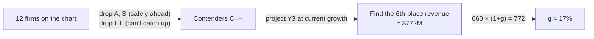
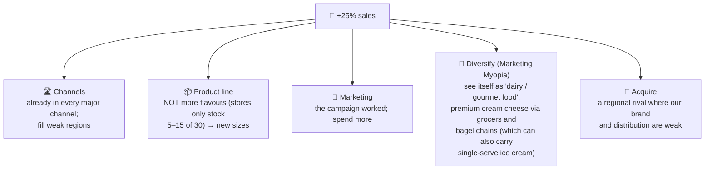
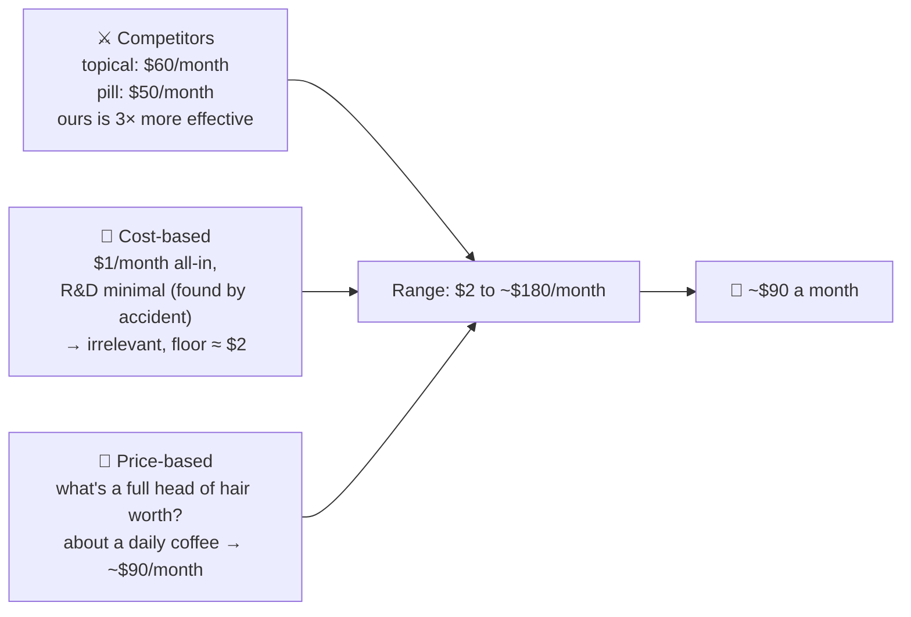

# 6.4 · Dialogue cases, Level 2 (Cases 8–11)

> **In one line:** four medium cases: a pure numbers race, a growth target that needs more than one scenario, a sizing-plus-pricing case for a "miracle" drug, and a cost case hiding inside a customer-loss mystery.

<BookRef pages="202–220" section="Cases 8–11" />

| # | Case | Type |
|---|---|---|
| 8 | [Discount brokerage race](#case-8) | Numbers |
| 9 | [Cow Brothers ice cream](#case-9) | Growth + increasing sales |
| 10 | [Hair-raising](#case-10) | Market sizing + pricing |
| 11 | [Wireless worries](#case-11) | Cost reduction |

---

## Case 8 · The discount brokerage race {#case-8}

<CaseMeta level={2} format="Dialogue" types={['Numbers']} pages="202–206" />

**Prompt:** you're handed a chart of twelve discount brokerages (A–L) with revenues and growth rates. Our client, **Company F**, grew 10% in Y1 and ranked **6th**; in Y2 it grew 10% again (to **$660M**) but slipped to **7th**. Assuming every competitor keeps its growth rate, **how fast must F grow in Y3 to win back 6th place?**

🔓 Reveal the walkthrough

1. **Confirm the assumption:** all other firms keep their growth rates. ✅
2. **Ask permission to write on the chart.** ✅
3. **Eliminate the obvious:** firms below F that grow at the same rate or slower, or are far smaller (I–L), can't pass it. A and B will stay on top. Only **C–H** matter.
4. **Project Y3 for each contender.** At 10%, F reaches 660 × 1.1 = **$726M**, still 7th.
5. The firm F must beat for 6th (Company E) projects to about **$772M**.
6. Required growth: 660 × (1 + g) = 772 → g = 112 / 660 ≈ **17%**.

**Follow-up:** "Which company would you invest in?" → **G**, provided it keeps up its ~20% growth.

**Lesson:** a pure numbers case. She **saved time by eliminating** firms before calculating anything.

## Case 9 · Cow Brothers premium ice cream {#case-9}

<CaseMeta level={2} format="Dialogue" types={['Growth', 'Increasing sales']} pages="207–210" />

**Prompt:** a super-premium ice cream maker (30 natural flavours in pints, plus single servings on a stick) sells through supermarkets, convenience stores, franchises and its own shops. A hit "Have a Cow" campaign helped sales reach **$200M** (third place; the top three hold 62%). The founder wants **$250M next year**. How?

🔓 Reveal the walkthrough

**Quantify first:** $200M → $250M is **+25%**. Last year it grew **10%**; the industry grew **12%**; the fastest rival grew **20%**. So **benchmark** what that rival did. The company is privately held.

**Three ways to raise sales:**

| Lever | Finding |
|---|---|
| Raise prices | ❌ already exactly in line with competitors |
| Sell more per purchase | ✅ add a **larger size** (two pints, alongside one) |
| Expand the customer base | → the growth strategies below |

**Five growth strategies, weighed:**

**Recommendation:** step up the marketing; add a bigger size; diversify into gourmet dairy using the brand and existing channels; look at a regional acquisition.

**Lesson:** she saw it was **two scenarios** (increase sales *and* grow the company), reality-tested the 25% target, and found that ice cream alone couldn't get there. The diversification idea was the standout.

## Case 10 · Hair-raising {#case-10}

<CaseMeta level={2} format="Dialogue" types={['Market sizing', 'Pricing']} pages="211–215" />

**Prompt:** a big drug company has a daily pill that regrows hair to teenage thickness within three months (it must be taken every day to keep working). **Size the U.S. market** and **price it**.

🔓 Reveal the walkthrough

**Objective:** sizeable **profits**; market share matters less ("price it right and the share will come").

**Clarifiers that shape the sizing:** men and women? Yes. Insurance? No. Prescription only. Thinning hair too? Yes. Side effects: sexual dysfunction in 2% of men; **women who may have children shouldn't take it** (possible birth defects) → exclude women 40 and under.

**Market sizing (by generation and sex; 80M per generation, 40M men and 40M women):**

| Age | Men losing hair | Women losing hair | People |
|---|---|---|---|
| 0–20 | 0% | 0% | 0 |
| 21–40 | 20% | 0% (excluded) | 8M |
| 41–60 | 40% | 1% | 16.4M |
| 61–80 | 60% | 10% | 28M |
| **Total** | | | **≈52M** |
| − shavers, the indifferent, can't afford | | | −7M |
| **Market** | | | **≈45M people** |

**Pricing: three lenses, drawn as a quick diagram:**

**On a huge markup:** comfortable, because it's cosmetic, not life-saving. (And the candidate learned rule number one: **never joke about the interviewer's own hairline.**)

**If the goal were share, not profit:** enter below competitors (around $40), win loyal users, raise later. Not needed here: strong efficacy plus press coverage should win share anyway. Some topical users will never switch to a pill.

**Lesson:** a clean sizing chart, all three pricing methods with one quickly ruled out, and a quick diagram to organise the pricing.

## Case 11 · Wireless worries {#case-11}

<CaseMeta level={2} format="Dialogue" types={['Cost reduction']} pages="216–220" />

**Prompt:** in Q4 the number-three U.S. wireless carrier fell further behind rivals in customer count, **even as profits rose 35%**. What's going on?

🔓 Reveal the walkthrough

**Facts:** the year ended with **60M customers** after losing 2.5% (1.5M) in Q4, which annualises to ~10%. Normal churn is about **1% a quarter**, and others gain more than they lose. We also gained 2M customers in Q4.

The candidate lists the usual reasons (network, ads, price, phones, service), all only minor. Then the hint: **"What if we *wanted* to lose those customers?"** → **Bad debt.** Collections are a runaway cost because new accounts weren't credit-checked properly.

**The chart:** late payment rate by credit score.

| Credit score | Share of customers | Pay late | Customers |
|---|---|---|---|
| 500–549 | 1% | 50% of the time | 0.6M |
| 550–599 | 9% | 40% of the time | 5.4M |
| **Problem group** | **10%** | | **6M** |

Dropping them leaves 54M customers, 10M behind the number-two carrier. Is that worth it?

**The economics (per month):**

| | Calculation | Amount |
|---|---|---|
| Revenue from the group | 6M × $75 average bill | $450M |
| Profit at 25% margin | | ≈$112M |
| Collection cost | 6M × ~45% late × $50 per chase | ≈$135M |
| **Net** | | **≈ −$20M a month** |

**Recommendations:**

- Shed the high-risk late payers.
- **Vet new customers**: require a credit score of 600 or above.
- **Charge late fees.**
- Chase every **two months** instead of monthly, so you spend $50 to recover $150, not $75.

**Lesson:** solid math and a good reading of a cluttered chart (interviewers often hand out badly designed charts deliberately), but she **missed the interviewer's hint** at first. Listen for the rescue line.

---

## 🧠 Check yourself

<Quiz question="Company F has $660M and must beat a rival projected at $772M. Required growth?" options={["10%", "≈13%", "≈17%", "≈25%"]} answer={2} explain="772 ÷ 660 ≈ 1.17." />

<Quiz question="Why didn't Cow Brothers simply add more flavours?" options={["Too expensive", "Retailers already carry only 5–15 of its 30 flavours, so more flavours won't reach shelves", "Customers dislike variety", "Patent issues"]} answer={1} explain="The bottleneck is shelf space, so new sizes (bigger purchases) beat new flavours." />

<Quiz question="Wireless case: 6M risky customers, $75 bills, 25% margin, $50 to chase each late payment, ~45% late. Monthly result?" options={["≈ +$100M", "≈ +$20M", "≈ −$20M", "Exactly zero"]} answer={2} explain="≈$112M profit − ≈$135M collection cost ≈ −$20M a month." />

<Quiz question="Hair pill: costs $1 a month, rivals charge $50–60, ours is 3× better. Why is cost-based pricing irrelevant?" options={["Costs are unknown", "With such low costs, value to the customer, not cost, sets the price", "It's illegal to mark up drugs", "Cost-based always wins"]} answer={1} explain="When cost is tiny, price is set by willingness to pay and competitors." />
