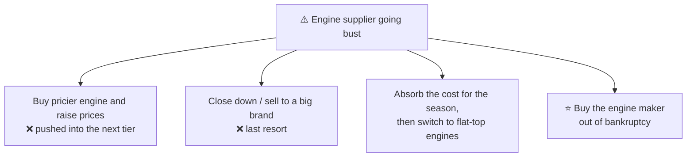
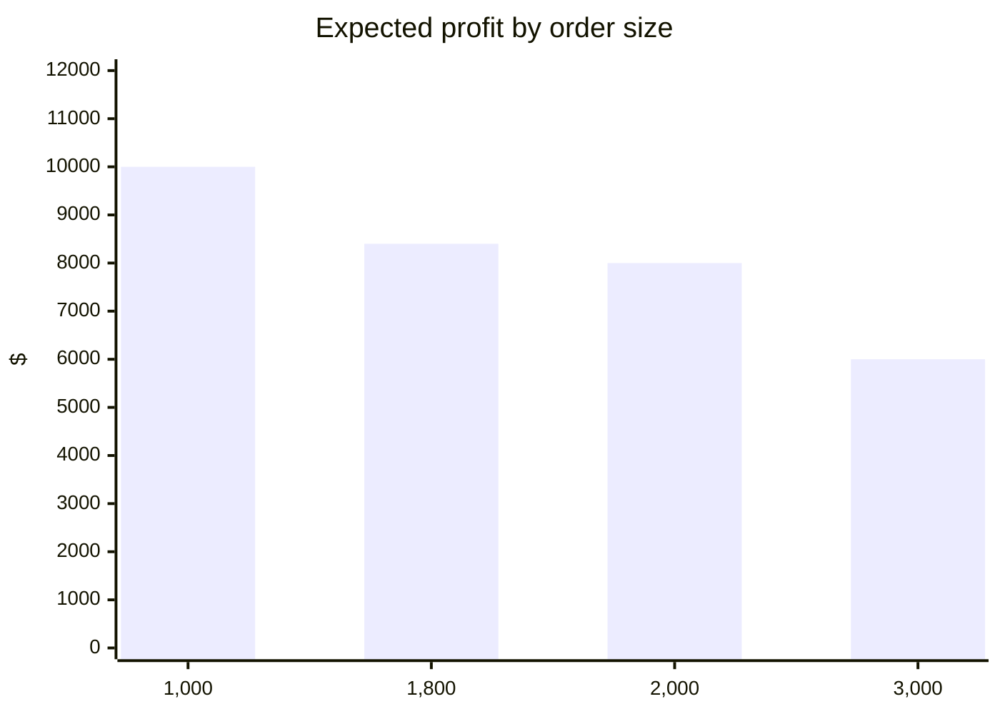

# 6.5 · Dialogue cases, Level 3, part 1 (Cases 12–16)

> **In one line:** final-round-length cases: a supplier going bankrupt, a space-tourism launch with four questions, the infamous snow-shovel risk problem, a market where tariffs fall year by year (with switching sides), and an airline coffee deal where the interviewer attacks the answer.

<BookRef pages="220–252" section="Cases 12–16" />

| # | Case | Type |
|---|---|---|
| 12 | [Blade to Blade](#case-12) | M&A (buy your supplier) |
| 13 | [World Spacelines](#case-13) | Sizing, pricing, capacity, entry |
| 14 | [Snow Job](#case-14) | Numbers & risk |
| 15 | [Jamaican Battery](#case-15) | Entry with falling tariffs, switching sides |
| 16 | [North American Airlines](#case-16) | New product / increasing sales |

---

## Case 12 · Blade to Blade {#case-12}

<CaseMeta level={3} format="Dialogue" types={['M&A', 'Supply crisis']} pages="220–227" />

**Prompt:** a small private lawn-mower maker in Alabama makes basic low-end mowers and has **1%** of the U.S. market (25 competitors; one look-alike rival, "Y", holds the other 1% at the bottom end). Sales are flat, like the industry. The real problem: its engine supplier of **40 years** is going bankrupt. The only alternative engine (same distinctive side-mounted design) costs **40% more**. Raising prices ~12% would push it into the next tier against much better-equipped big brands. It runs just-in-time inventory, so it has **one month of engines** heading into the busy season. What should it do?

🔓 Reveal the walkthrough

**Summarise:** survive the crisis and keep sales and share.

**The cost squeeze:**

| Item | Share of $100 cost | $ |
|---|---|---|
| Engine | 60% | $60 → **$84** with the +40% engine |
| Other parts | 25% | $25 |
| Labour | 15% | $15 |
| **Total cost** | | $100 → **$124**, against a **$125** selling price |

The margin almost disappears. Moving production abroad or buying parts elsewhere won't fix it (local community, local suppliers). A standard flat-top engine costs the same as the old one but would mean an **8-week** redesign and retool.

**Short-term options:**

**Due diligence on the engine maker:** why did it fail? → bad management: the owner took cash out of a profitable business (25% margins) and borrowed **$2M** for a failed venture. The bank will take **40¢ on the dollar → $800K**. We have $1M cash; good credit means **$500K down + a $300K loan**. Workers just laid off are easy to rehire, the cultures are similar, the suppliers are healthy. Equipment is ten years old with 2–3 years of life left.

**What about rival Y (which buys the same engine, with no contract)?**

| Option | Effect |
|---|---|
| Cut Y off | Y pays +40% or moves up a tier; we might grab its share, but we lose half the engine plant's revenue |
| Sell at +30% | Y probably buys for the season, then switches to flat-top engines |
| **Sell at +5%, on a 2-year contract** | Keeps engine revenue, keeps Y on side-mounted engines (so we don't have to redesign either), and we supply this whole market segment |

**Making the deal pay:** buy new equipment under the **same roof** as mower production; sell the old building and equipment to pay down the loan. **Three cost and revenue ideas:** build other engines (trimmers, leaf blowers, **snow-blowers** for seasonal balance) · **cross-train** workers and use flexible lines · renegotiate with suppliers and **refinance** while rates are low.

**Lesson:** he saw quickly that cost cutting couldn't solve it, split short term and long term, recognised an **M&A** case, and treated Y **analytically, not emotionally**.

## Case 13 · World Spacelines {#case-13}

<CaseMeta level={3} format="Dialogue" types={['Market sizing', 'Pricing', 'Entering a new market']} pages="228–233" />

**Prompt:** a company has built a rocket-boosted plane that takes off and lands like an airliner but can orbit Earth, for three-hour space tours. The prototype cost **$500M**; each additional plane costs **$100M**. (1) Size the U.S. market, (2) set a ticket price, (3) decide how many planes to build, (4) decide whether to build planes for competitors.

🔓 Reveal the walkthrough

**Extra objective:** be the first to build a **space hotel**. No competitors; patent protection good for about **3 years**. 100 seats, two trips a day, 360 days a year → **72,000 seats a year per plane**. Plane life 20 years.

<KeyIdea>**The big insight:** you can't size the market without the **price** (at $1 everyone flies; at $1M almost nobody does), and you can't set the price without knowing **cost per passenger**. So work backwards: cost → price → market.</KeyIdea>

**Cost:** fuel = 10 gal/mile × 500 miles × $10 = $50K per trip → $100K a day → **$36M a year**. With the other costs (plane over 20 years, crew, maintenance, airport fees, insurance, marketing) the total is **$72M a year** → **$1,000 per passenger**.

**Price:** no competitors; cost-plus ($2K) leaves a fortune on the table for a once-in-a-lifetime experience → **price-based**: test **$10,000**.

**Market at $10K:** ~250M adults → 2% earn enough to afford a $10K trip (5M) → 20% want to go → **≈1M customers**.

**How many planes?** One plane could serve that pool for about 14 years. Each plane takes 6 months to build, so build as many as possible for **3 years** (until competitors get around the patent), then reassess. By the end of year 3, about six planes have flown ~756K passengers; by year 4 the pool runs out. Then **cut the price to ~$5K** (demand jumps), shuttle people to the **space hotel**, and sell **internationally**.

**Sell planes to competitors?** Each plane earns about $720M − $52–72M ≈ **$650M+ a year**. A rival would have to pay billions per plane. **No.**

| Question | Answer |
|---|---|
| Market | ~1M U.S. passengers at $10K (much larger at $5K) |
| Price | $10,000 |
| Planes | As many as possible for 3 years, then reassess |
| Build for rivals? | No |

**Lesson:** big points for seeing **cost → price → market** as the order of play.

## Case 14 · Snow Job {#case-14}

<CaseMeta level={3} format="Dialogue" types={['Numbers', 'Risk']} pages="234–237" />

**Prompt:** a company imports and distributes snow shovels in one town. It must order **four months ahead**. How many should it order?

🔓 Reveal the walkthrough (rated about 9/10 for difficulty)

**Objective:** maximise profit with the **least risk and least leftover stock** (the client hates carrying inventory). Don't drift into expansion or new channels; the interviewer shuts that down.

**Data:** last year it ordered 2,000, had 500 left over, and sold all 2,500 in a cold, snowy winter. **Cold winter → sells 3,000. Mild winter → sells 1,000.** Forecast: **40% cold, 60% mild.** Buys at $10, sells at $20.

**The trap:** "0.4 × 3,000 + 0.6 × 1,000 = **1,800 shovels**." That's the expected *demand*, not the best *order*. The interviewer has heard it all day.

**Do it properly: expected profit for each order size** (unsold shovels counted as a loss this season):

| Order | Mild winter (60%) | Cold winter (40%) | Expected profit |
|---|---|---|---|
| **1,000** | sell 1,000 → **+$10,000** | sell 1,000 → **+$10,000** | **$10,000** (no risk) |
| 2,000 | sell 1,000: $20K − $20K = **$0** | sell 2,000 → **+$20,000** | $8,000 |
| 3,000 | sell 1,000: $20K − $30K = **−$10,000** | sell 3,000 → **+$30,000** | $6,000 |
| *1,800 (the trap)* | $20K − $18K = +$2,000 | +$18,000 | $8,400 |

**Answer: order 1,000.** A guaranteed $10K profit, the highest expected value, and no leftover stock. (Ordering 3,000 is a 40% chance of +$30K against a 60% chance of −$10K.)

**Nuance worth raising:** leftover shovels aren't really a total loss; they're inventory for next winter. The interviewer agrees but sets it aside.

**Lesson:** the candidate jumped to a fast answer, read the interviewer's reaction, and **recovered** with expected values. Expected value isn't common knowledge outside business school, so learn it now.

## Case 15 · Jamaican Battery Enterprise {#case-15}

<CaseMeta level={3} format="Dialogue" types={['Market sizing', 'Entering a new market', 'Switching sides']} pages="238–244" />

**Prompt:** a Jamaican car-battery maker sells across the Caribbean, Africa and Latin America and has long wanted into **Cuba**, where a state-owned maker has 100% of the replacement market behind a **50% tariff** on imported batteries (on manufacturing plus shipping cost). Cuba will cut the tariff by **5 points a year for 10 years**, down to zero. How big is the market, and should the client enter, when and how?

🔓 Reveal the walkthrough

**Objective:** share and profit. Reasonable target: **25% within five years of entering**.

**Market sizing:**

| Step | Number |
|---|---|
| Population | 10M |
| People per household (multi-generation) | 5 → 2M households |
| Households with a car | 1 in 10 → 200K |
| + taxis, trucks, government vehicles | +10K → 210K |
| − government/military (won't buy imports) | −5K → 205K |
| Replacement every 3 years (local battery quality) | **≈68K batteries a year** |
| 25% target | **≈17K a year** |

(Our batteries last 5 years, which shrinks the replacement market over time. Worth flagging even if you can't model it.)

**Costs:**

| | Cuban maker | Jamaican client |
|---|---|---|
| Make | $12 (materials 20%, **labour 50%**, overhead 30%) | $9 (materials 20%, labour 25%, other 55%) |
| Ship | — | $1 |
| Tariff | — | 50% of $10 = $5 today |
| **Landed cost** | **$12** | **$15 today** |

**When are we competitive?** Pick the midpoint instead of computing every year: in year 5 the tariff is 25% → $10 × 1.25 = **$12.50**, nearly there. At 20% (year 6) → **$12.00** = parity. **Enter in year 6 on cost alone, or year 5 if we can charge a premium** for a battery that lasts 5 years instead of 3.

**🔄 Switch sides: now advise the Cuban maker.**

- Lobby against the tariff cut → *the decision is final.*
- Why is labour 50% of cost? Old, labour-heavy **technology** (plus free healthcare built into every cost).
- **Upgrade technology** → a world-class battery at about $9. The tariff hardly matters now.
- Fix perception and service: national **marketing**, better **customer service**, and **lock up distribution** before foreigners arrive. Supply every petrol station with batteries, racks and incentives in exchange for **exclusivity**. Team up with the state tyre maker for **battery + tyre + oil-change** service centres in the best locations.

**🔄 Switch back: should the Jamaican company still enter, and how?**

| Mode | Assessment |
|---|---|
| Build from scratch | Hard if petrol stations are locked up; 17K batteries a year may not justify our own stores |
| Buy | Few targets in a state economy; the time to buy the Cuban maker was when it was weak |
| **Joint venture** | ⭐ Partner with a foreign **tyre** company entering at the same time and form a coalition |

**It all comes down to distribution channels.**

**Lesson:** a final-round case. The hardest part was **switching sides** and attacking his own strategy. Picking a midpoint year instead of calculating every year's tariff saved time; a small cost table kept everything easy to find.

## Case 16 · North American Airlines {#case-16}

<CaseMeta level={3} format="Dialogue" types={['New product', 'Increasing sales']} pages="245–252" />

**Prompt:** to boost in-flight sales, a regional airline is thinking of partnering with a leading coffeehouse chain to sell its premium coffee on board. From the **airline's** point of view, would it be profitable?

🔓 Reveal the walkthrough (and the beat-down)

**Objective:** profit (a joint marketing campaign is possible, but focus on profit).

**Data gathered:**

- 50 flights a day: **80% short** (under 2 hours, East Coast) and 20% long (~6 hours, cross-country). **25 early / 25 late**, each 80% short.
- 200 seats, **95% full** → 190 passengers. Mostly **business** day-trippers.
- Free on board: soft drinks, water, tea, regular coffee. Sold (50% markup): juices, breakfast items, snacks on long flights, alcohol.
- Average sales per flight: early short **$50**, early long **$100**, late short **$150**, late long **$200**. Buyers spend about $5 each.

| Flight type | Flights a day | Sales per flight | Daily |
|---|---|---|---|
| Early, short | 20 | $50 | $1,000 |
| Early, long | 5 | $100 | $500 |
| Late, short | 20 | $150 | $3,000 |
| Late, long | 5 | $200 | $1,000 |
| **Total** | 50 | | **$5,500** (≈$1,833 profit) |

**Estimating coffee buyers** (share of passengers not already buying something): ~10% on early flights, ~5% on late flights (people sleep, the free coffee is good enough, many bought coffee in the terminal, coffee suits mornings).

| Flight type | Buyers per flight | Flights | Cups a day |
|---|---|---|---|
| Early, short | 18 | 20 | 360 |
| Early, long | 16 | 5 | 80 |
| Late, short | 8 | 20 | 160 |
| Late, long | 7 | 5 | 35 |
| **Total** | | | **635** |

At $3 a cup ≈ **$1,905 a day** in revenue, before the coffee chain's share. She lists concerns (cannibalising the chain's airport sales, preparation, storage, brand risk) and recommends **no**.

**The interviewer's attack:** "You're thinking like the coffee chain, not the airline." Things she missed:

- **Positive cannibalisation:** every paid cup also saves the cost of a free one.
- Would **premium coffee win passengers** from other airlines? +1 point of occupancy is worth far more than coffee profit.
- Option of serving it **free** as a differentiator.
- **Competitive response** (other airlines adding a coffee brand).
- **Business travellers are price-insensitive** (often expensing it), the "wake-up" coffee on red-eyes, cross-country fliers working, real occupancy rarely 95%, **time zones and jet lag**.

**Her response:** calm and firm. She was told to focus on profit; she prioritised under time pressure; her math was done in her head with clear tables; she offered to model the free-coffee and occupancy scenarios and benchmark competitors. → "You did a decent job. **I wanted to see whether you could handle criticism.**"

**Lesson:** strong economics, and she **defended herself without getting defensive**. The case itself fits neither "new product" nor "increase sales" neatly. Sometimes the interviewer criticises you just to see how you react. Roll with it.

---

## 🧠 Check yourself

<Quiz question="Snow Job: why is 1,800 shovels the wrong answer?" options={["The arithmetic is wrong", "It's expected demand, not the order that maximises (risk-adjusted) profit", "1,800 is too many to store", "The forecast is unreliable"]} answer={1} explain="Compare expected profit for each order size. 1,000 gives $10K guaranteed, which beats every alternative." />

<Quiz question="World Spacelines: what's the right order of analysis?" options={["Market → price → cost", "Cost → price → market", "Price → market → cost", "Market → cost → price"]} answer={1} explain="Market size depends on price, and price (at minimum) depends on cost per passenger." />

<Quiz question="Jamaican battery: at what tariff does the $10 landed cost match the Cuban $12?" options={["50%", "25%", "20%", "10%"]} answer={2} explain="$10 × 1.20 = $12, which is year 6 of the 5-points-a-year cuts." />

<Quiz question="Blade to Blade: why sell engines to rival Y at only +5%?" options={["Charity", "It keeps half the engine plant's revenue and stops Y moving to flat-top engines, protecting the niche", "Required by law", "Y is a customer of the mower business"]} answer={1} explain="Cutting Y off is an emotional answer. The +5% contract protects the deal you just paid for." />
