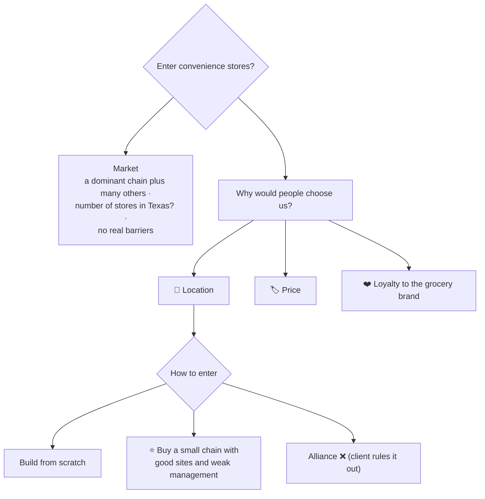
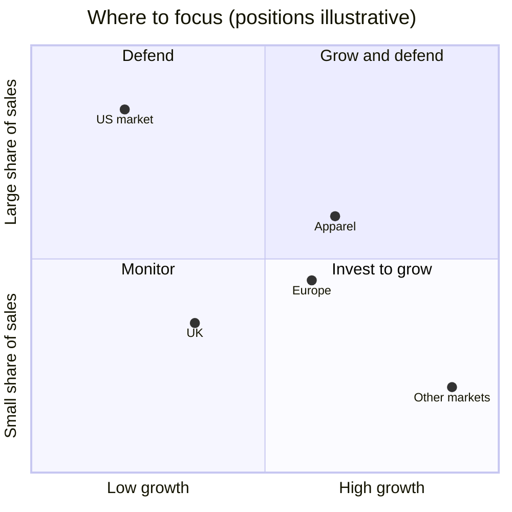
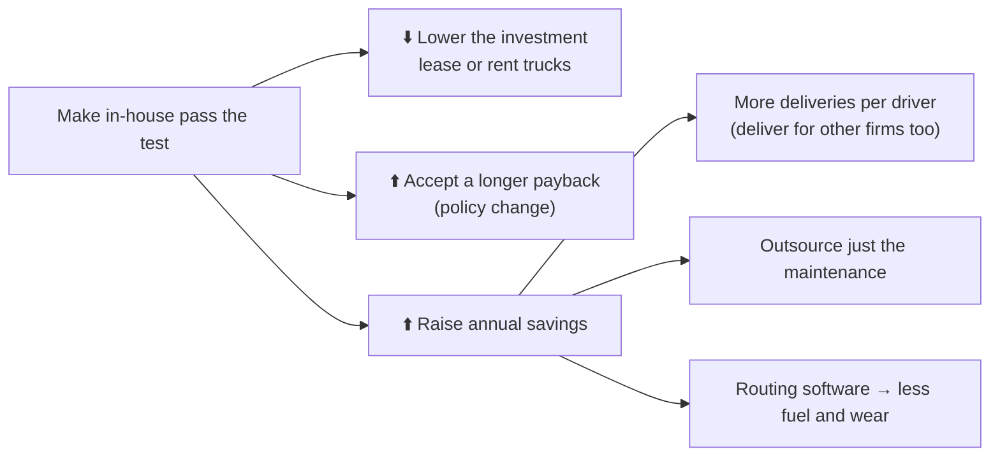

# 6.6 · Dialogue cases, Level 3, part 2 (Cases 17–20)

> **In one line:** a grocer weighing convenience stores and in-store banks, a 30-minute written company analysis, an outsourcing decision driven by payback, and a factory that can't keep up with a celebrity-driven demand spike.

<BookRef pages="253–275" section="Cases 17–20" />

| # | Case | Type |
|---|---|---|
| 17 | [Texas Star Markets](#case-17) | Entering a new market (twice) |
| 18 | [Red Rocket Sports](#case-18) | Company analysis (written) |
| 19 | [Up-in-Smoke](#case-19) | Outsource vs in-house |
| 20 | [Cabana Feet](#case-20) | Production capacity & strategy |

---

## Case 17 · Texas Star Markets {#case-17}

<CaseMeta level={3} format="Dialogue" types={['Entering a new market']} pages="253–259" />

**Prompt:** a large suburban grocery chain across Texas wants to grow, **only in Texas**. It thinks the suburbs are saturated, has ruled out downtown stores, and already runs online ordering and delivery. Should it enter the **convenience-store** business, and if so, how?

🔓 Reveal the walkthrough

**Why would it want this?** He offers four guesses: (A) spare cash looking for a better return, (B) more share of Texas food retail, (C) a declining core business, (D) a growing market → **A, B and D** are right.

He draws a decision tree:

**The price edge:** the grocer already buys in huge volume, so it has scale economies. Price between grocery and convenience-store levels: milk at $2.95 in the supermarket and $3.95 at the corner shop → **$3.49** pulls in traffic. Add **store-brand** goods (even cheaper), a salad bar and prepared meals; cross-promote with **coupons** from the supermarkets. No cannibalisation, because the supermarket stays cheaper.

> ⚠️ **Jargon trap.** He said "leverage our value-chain components" and, asked what that meant, admitted he wasn't sure. The interviewer let it go only because he was doing well. **Never use a phrase you can't explain**; if you do it here, they'll assume you'd do it in front of a client.

**Recommendation:** enter. The market is growing, there are no major barriers, and the brand, buying power and team carry over. **Buy a small chain with good locations and poor management**, rebrand it, install our managers, stay **close to our supermarkets**. If there's no good target, build.

**Twist: an in-store bank?** No competitor does it. Space is available (about the size of the florist department, with minor remodelling). Banking basics are commoditised (ATMs, debit, cash back), so the only real benefit is convenience and extra store traffic.

| Mode | Pros | Cons |
|---|---|---|
| Build our own bank | Locations and rent are cheap | Need banking talent and regulatory approval; a failure hurts the grocery brand |
| Buy a bank | People, branches and brand at once; could sell some branches | Expensive; heavy due diligence; we know nothing about banking |
| **JV / lease space to a bank** | ⭐ Simplest, least risk; rental income | Compare rent against remodelling cost |

**Lesson:** he laid out his plan early and stuck to it, found ways to differentiate, and came into the banking twist with more confidence. Only the jargon slip hurt.

## Case 18 · Red Rocket Sports {#case-18}

<CaseMeta level={3} format="Written analysis" types={['Company analysis']} pages="260–265" />

**Prompt:** a footwear and apparel company (many brands, shared manufacturing, channels and customers) hands you its sales by product and region for three years. "Tell me what's going on and where they should focus. I'll be back in 30 minutes."

🔓 Reveal the walkthrough

**Step 1: year-on-year growth by product and region (eyeballed, no calculator):**

| | Y1→Y2 | Y2→Y3 | Read |
|---|---|---|---|
| Footwear | ~10% | ~10% | Steady |
| Apparel | ~20% | just under 10% | Slowing, but still strong |
| U.S. | 12% | **2%** | Stalling, but still the biggest market |
| UK | ~7% | ~7% | Steady |
| Europe | ~15% | ~15% | Steady |
| **Other (Asia, Latin America)** | ~20% | **30%+** | 🚀 Will pass the UK next year |

**Step 2: share of total sales:**

- Footwear ≈ **two-thirds** of sales (stable).
- U.S. > 50% and slowly falling; UK down from 15% to 12%; Europe holding at ~20%; Other up to **11%**.

**Step 3: look past percentages to absolute dollars.** Total sales rose from $3.10M to $3.79M (+$685K). **Apparel delivered almost half of that growth** while being only ~35% of sales.

**Recommendations, as a 2×2:**

1. **Invest in growth areas**, especially "other" markets: wider product line (apparel), more channels, stronger sales force, a big marketing push.
2. **Defend the core** (U.S., UK): marketing in mature markets; focus on the best-performing stores and outlets.
3. **Watch the trends:** talk to industry analysts and refine the product/market plan.

**Lesson:** charts and bullet points, eyeballed numbers under time pressure. Consultants persuade with charts; so should you.

## Case 19 · Up-in-Smoke {#case-19}

<CaseMeta level={3} format="Dialogue" types={['Cost reduction', 'Outsource vs in-house']} pages="266–269" />

**Prompt:** a cigarette maker must either **upgrade its delivery truck fleet** (new rules require electronic logs of speeds, driving time and breaks) or **outsource** distribution. The COO wants your call.

🔓 Reveal the walkthrough

**Before the case:** "Do you have a problem with a tobacco client?" → you don't always choose your clients. Answer honestly now, not halfway through. (Firms may reassign you for a genuine reason, but scheduling doesn't always allow it.)

**Structure:** **economics** (investment vs costs and savings) and **risks** (internal: culture, strikes; external: fuel prices, regulation, flexibility).

**Numbers:** upgrade ≈ **$1M** (the trucks are due for replacement anyway). The company requires a **4-year payback**. 10 drivers × $5,000 a month = $600K a year over **400 deliveries** = $1,500 labour per delivery.

| Per delivery | In-house | Outsourced |
|---|---|---|
| Labour | $1,500 | — |
| Other (fuel, maintenance…) | $500 | — |
| **Total** | **$2,000** | **$2,500** |

In-house saves $500 × 400 = **$200K a year** → payback = $1M ÷ $200K = **5 years** > the 4-year rule → **outsource**.

**Risks:** drivers aren't unionised and culture impact is small. Outsourcing (especially on a long contract) **shifts fuel-price and regulatory risk** to the vendor and keeps flexibility if the company expands.

**Switch sides: how could in-house work?** It needs **investment ≤ annual savings × payback period**:

**Lesson:** read the simple table, filled in the gaps, and covered internal and external factors plus both sides of the decision.

## Case 20 · Cabana Feet {#case-20}

<CaseMeta level={3} format="Dialogue" types={['Production', 'Strategy']} pages="270–275" />

**Prompt:** a maker of gel-cushioned flip-flops has advertised "**100% made in the U.S.**" for ten years. A film star wore them in a spring blockbuster and demand exploded. Capacity is **12,000 pairs a month**; demand went from ~6,000 to an estimated **25,000**. Inventory runs out this month. Outline short- and long-term strategies.

🔓 Reveal the walkthrough

**Clarifiers:** the film came out in April; it's now September; 25,000 is an estimate; orders have been filled from inventory until now; the home-video release is in December. **Plan for two scenarios:** demand falls back to ~6,000 (the next film features boots) or **settles around 25,000**.

**Six ideas:** (1) more shifts, weekends, or new hires · (2) fix bottlenecks in the line · (3) labour-saving technology · (4) a new line or factory · (5) raise prices · (6) **outsource abroad**.

**Push-back on outsourcing:** "We'd be crucified for dropping 'Made in USA'." → Present it to the business press as **temporary**. Even if 5,000 of the original 6,000 buyers care about U.S. manufacturing, the **~20,000 new buyers** care about looking like the film star. Miss this window and **knock-offs** will take it.

**The math drills:**

| Question | Working | Answer |
|---|---|---|
| Demand growth from March to April | (10K − 6K) / 6K | **+66%** |
| Cost of one shift | Workers $15 × 8h × 10 = $1,200; supervisor $20 × 8 = $160; wages $1,360 + 30% benefits $408 + misc $232 | **$2,000** |
| Breakeven per shift at $8 profit per pair | 2,000 / 8 | **250 pairs** |
| Maximum output per shift | 12,000 a month ÷ 2 shifts ÷ 20 days | **300 pairs** |
| A third shift adds | 300 × 20 | **+6,000 → 18,000 a month** |
| Third shift at overtime | Workers $22.50 × 8 × 10 = $1,800; supervisor $30 × 8 = $240; $2,040 + 30% = $2,652 + $232 | **$2,884** (+$884 vs a normal shift) |
| Profit per pair on the third shift | $8 − (884 / 300 ≈ $2.95) | **≈ $5.05** |

*(The book's own working arrives at $892 extra and $5.03 a pair; the conclusion is the same: about $5 a pair.)*

**Third shift with current staff:**

| ✅ Pros | ❌ Cons |
|---|---|
| Fast, with no new equipment | Profit per pair falls ~37% |
| Trained, quality-proven workers | Fatigue, quality and safety risk |
| Easy to reverse when demand falls | Still short: 18K vs 25K demand |

**A new line** making 800 pairs a day (two shifts) → +16,000 a month → **28,000**. With triple shifts on both lines → **42,000**.

**Lesson:** fast strategy ideas, held firm on outsourcing under pressure, solid mental math, and numbers wherever possible.

---

## 🧠 Check yourself

<Quiz question="Up-in-Smoke: $1M investment, $200K annual savings, 4-year payback rule. Decision?" options={["Upgrade in-house", "Outsource: a 5-year payback breaks the rule", "Buy a second fleet", "Not enough data"]} answer={1} explain="$1M ÷ $200K = 5 years, more than the required 4." />

<Quiz question="Red Rocket: apparel is ~35% of sales but delivered almost half the growth. Why does that matter?" options={["It doesn't", "Absolute dollars show apparel is the growth engine despite its slowing percentage", "Apparel should be dropped", "Footwear is shrinking"]} answer={1} explain="Look past percentages to the dollar contribution to growth." />

<Quiz question="Cabana Feet: shift cost $2,000, profit $8 per pair. Breakeven per shift?" options={["125", "200", "250", "300"]} answer={2} explain="2,000 ÷ 8 = 250 pairs, against a capacity of 300 per shift." />

<Quiz question="Texas Star: the candidate said 'leverage our value-chain components' and couldn't explain it. The lesson?" options={["Use more jargon", "Never use terms you can't explain; it destroys trust", "Jargon is fine if you're doing well", "Always define jargon first"]} answer={1} explain="If you do it in an interview, they'll assume you'd do it in front of a client." />
