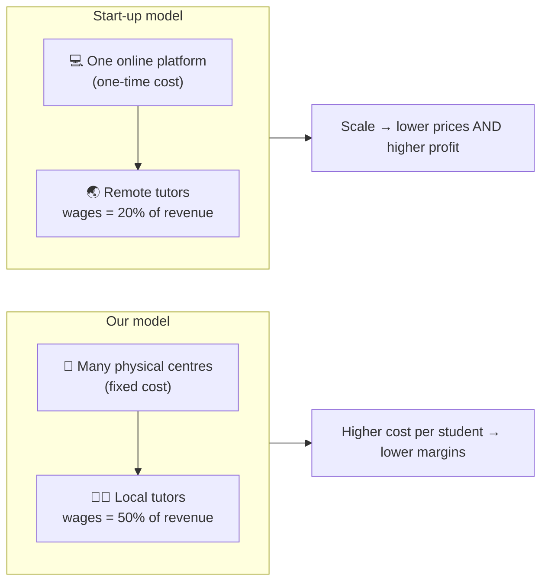
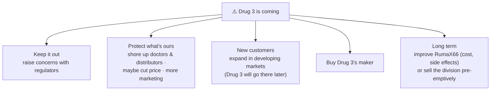
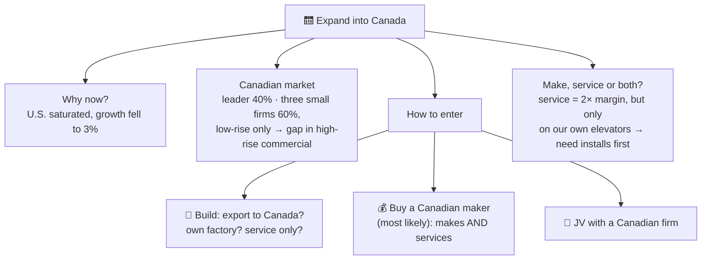

# 6.7 · Partner cases, Level 1 (and the guide for the person giving them)

> **In one line:** cases written so *anyone* (business background or not) can interview you and give useful feedback. Your partner reads the guide and the case twice; you just answer.

<BookRef pages="276–300" section="Partner Cases · The Roommate's Guide · Cases 1–5" />

Serious candidates do **at least 30 live cases**. After you answer a case, **give it to someone else**: you learn as much from giving a case as from answering one.

| Level | # | Case | Type |
|---|---|---|---|
| 1 | 1 | [Mexican beer brand → frozen food](#grupo-modelo) | Entry, brand extension |
| 1 | 2 | [Test prep](#test-prep) | Profitability |
| 1 | 3 | [Online movies](#online-movies) | Sizing, payback, ROI |
| 1 | 4 | [Tate Pharmaceuticals](#tate) | Sizing, competitive threat, P&L |
| 1 | 5 | [Gator Vator](#gator-vator) | Entering a new market |
| 2 | 6–10 | [Stuck · Nerves of Steel · GPS App · Finding Fulfillment · KBO](/docs/chapters/part-4/partner-cases-level-2) | |
| 3 | 11–15 | [Bulletproof Glass · Statin Blue · Bottled Water · Smackdown · TedEx](/docs/chapters/part-4/partner-cases-level-3) | |

## The guide for the person giving the case

<BookRef pages="278–279" section="The Roommate's Guide" />

So you've been begged, bribed or blackmailed into helping. Here's how to be useful.

<IconCards items={[
  {icon: '📖', title: 'Before', text: 'Read the case and answer all the way through, twice. There are several "right" answers. It’s fine to help if they get lost. No know-it-all attitude.', color: '#0d9488'},
  {icon: '👀', title: 'At the start', text: 'Are they writing it down? Long silence before answering? Summarising? Asking about the objective? Asking about company, industry, competition, product? Laying out a logical structure?', color: '#3b82f6'},
  {icon: '👂', title: 'During', text: 'Enthusiastic? Logical, organised? Assumptions stated? Creative? Engaging you in a conversation? Probing questions? Quantifying? Asking for help when needed?', color: '#f59e0b'},
  {icon: '📝', title: 'Afterwards', text: 'Organised and well-timed? Bogged down or off on tangents? Jargon used correctly? Math trouble? Tried to get you to answer? Coachable? Spoke before thinking? Summarised? Took criticism well, defended without being defensive?', color: '#ec4899'},
]} />

**Aftermath:** go out and celebrate. 🎉

**How each case below is laid out:**

1. **Prompt:** read it out loud to the candidate.
2. **🎙️ Interviewer's data bank:** facts to hand over *only when asked* (or when you need to steer).
3. **✅ Solution & scorecard:** a good answer, and what separates good from great.

---

## Case 1 · Mexican beer brand moves into frozen food {#grupo-modelo}

<CaseMeta level={1} format="Partner case" types={['Entering a new market', 'Brand extension']} pages="280–282" />

**Prompt (read aloud):** *Mexico's leading brewer (64% of the global Mexican-beer market, 13 brands, including the world's best-selling Mexican beer) is thinking of using its flagship beer brand to launch a **premium Mexican-food line**: shelf-stable and frozen meals for U.S. supermarkets. Is this a good idea?*

🎙️ Interviewer's data bank

- Objective: extending the brand. **Other objective? Yes: profit.**
- Expect structure buckets like: industry characteristics (players, shares, differentiation, barriers) · industry size and performance (growth, margins) · industry future (entrants, exits, mergers) · **customers** (Hispanic shoppers vs young professionals; who drinks the beer?) · the brewer's finances (can it invest?).
- U.S. shelf-stable/frozen/refrigerated Mexican food: **$2.4B**, **fragmented** with niche brands; local players and **private labels** are threats.
- **Ask:** "The market grew 6% last year. What was it the year before?" → 2.4 / 1.06 ≈ **$2.26B (≈$2.3B)**.
- **Ask:** "Give me three pros and three cons."
- **Ask:** "Best way to enter? Pros and cons; pick one."
- Then: "They've decided to **build it themselves**. Plant in the U.S. or Mexico? How should they roll it out?"

✅ Solution & scorecard

| ✅ Pros | ❌ Cons |
|---|---|
| Huge brand awareness among U.S. shoppers | Beer brand on food (and on kids' plates?) could confuse or put off shoppers |
| Existing U.S. distribution relationships | No food-making or grocery experience |
| Fragmented market with no dominant leader | Private labels and local brands compete on price |

| Entry mode | + | − |
|---|---|---|
| License / JV | Less risk, less capital | Less control over product and brand; smaller profit share |
| Buy a player | Management and distribution in place; instant share | Big investment, big risk |
| Build | Control of cost and quality; full ownership | Huge investment (plant, people, trucks); slowest to market |

| Plant | + | − |
|---|---|---|
| U.S. | Higher perceived quality; easier distribution | Higher wages, construction, energy; backlash over jobs not created in Mexico |
| Mexico | Cheaper labour and construction; good PR at home | Perceived lower quality; border crossings, security, empty trucks heading back south |

**Roll-out:** start small, **follow the beer's strongest markets**, cross-promote with the beer.

**Instead of a summary:** ask "Would you go ahead?" Either answer is fine if it's well argued.

**Good interview:** restates and verifies the objective (finds *profit*) · no math slips · fair assumptions · tidy notes · a clear recommendation. Little math, so it's mostly about **what goes through their head, and in what order**.

## Case 2 · Test prep {#test-prep}

<CaseMeta level={1} format="Partner case" types={['Profitability', 'Profit & loss']} pages="283–287" />

**Prompt (read aloud):** *Our client is one of America's leading test-prep companies. Revenue is up, but **profitability and market share are down**. Why, and what should they do?*

🎙️ Interviewer's data bank

- No other objectives. Structure: **E(P=R−C)M**. Economy: tail end of a recession.
- When they ask about the market, give **Chart 1** (industry, Y1 → Y3): students **3.0M → 5.5M**; industry revenue **$1,210M → $1,595M**; revenue per student **$403 → $290**.
- When they ask about competitors, give **Chart 2**: our profitability is rising, but more slowly than the leader's, and **far** more slowly than a fast-growing start-up's.
- Revenue streams: classes, tutoring, maybe books and software (the split doesn't matter).
- Costs: developing materials (~**$50M/yr**; no reason to think rivals do it cheaper), test centres (fixed), teachers (variable).
- Once they've guessed at costs, reveal: the start-up has **almost no real estate**; the leader hasn't added any; **wages as % of revenue: start-up 20%, leader 35%, us 50%**.

✅ Solution & scorecard

**Read Chart 1:** the market did well in the downturn (education feels essential): students **+83%**, revenue **+32%**, but revenue per student **−28%**. Prices are falling.

**The insight:** rivals are **tutoring online** with a one-time investment in platform and materials plus cheap tutors (across the U.S. and **in India**), with no stores to rent. That gives them **economies of scale**, so they charge less and still earn more per student. We keep opening physical centres and paying full-rate tutors.

**Recommendations:** launch **online tutoring** with U.S. tutors · build a **tutoring centre in India** · fight back by **marketing our quality** and **owning the premium tier** · optional non-market move: ally with teachers' groups that question whether offshore tutors meet state standards.

**Good interview:** analyses the numbers *without being asked*, with no mistakes; tidy notes; a short summary. **Great:** quickly spots the **virtual, low-fixed-cost model** and how to respond.

## Case 3 · Online movies {#online-movies}

<CaseMeta level={1} format="Partner case" types={['Market sizing', 'Payback', 'ROI']} pages="288–291" />

**Prompt (read aloud):** *Last year a giant retailer entered online movie rentals and sales by buying a streaming site for **$100M**. Customers can now download from either the retailer's own site or the acquired site. Find: (1) the retailer's online movie revenue, (2) the payback period, (3) first-year ROI, (4) whether it should keep the acquired site.* (Hand over the chart: the retailer has **5%** of the download market.)

🎙️ Interviewer's data bank

- Rent **$5**, buy **$15**. Rentals to purchases **4 : 1**. Retailer margin **30%**.
- Works on game consoles, Blu-ray, smart TVs, computers, tablets, phones; movies are available the same day as the DVD release.
- Best sizing method: **household**. Make them justify any big leap.

✅ Solution & scorecard

**Draw the final slide first** (revenue · payback · ROI · keep?), then fill it in.

| Step | Number |
|---|---|
| 320M people ÷ 3.2 | 100M households |
| With internet (book uses ~60–70%) | ~60–70M |
| Minus non-downloaders (no card online, dial-up, happy with cable/streaming, mail-order DVD fans); plus café/school downloaders | **50M households** |
| × ~20 movies a year | **1B downloads** |
| × 5% share | **50M downloads** |
| 4:1 split | 40M rentals × $5 = **$200M**; 10M purchases × $15 = **$150M** |
| **Revenue** | **$350M** |
| Profit at 30% | **$105M** |
| Payback on $100M | **≈1 year** (depends on cash flow timing) |
| First-year ROI | (105 − 100) / 100 = **5%** |

**Keep the acquired site?** The key is **demographics**: the two sites serve very different customers. The retailer bought it for its **back-end technology**. Option: **sell the name and customer list** to someone with a better-matched (higher-income) audience, recovering part of the price, shortening payback and lifting ROI.

**Good interview:** objective verified; sharp questions; no math slips; tidy notes; **final slide** used as the summary.

## Case 4 · Tate Pharmaceuticals {#tate}

<CaseMeta level={1} format="Partner case" types={['Market sizing', 'Competitive threat', 'Profit & loss']} pages="292–296" />

**Prompt (read aloud):** *Our client makes drugs for chronic arthritis. Its best seller, RumaX66, leads the market for one type of knee arthritis. Its share is steady and sales are up, but **profits are slipping**. What's the worldwide market size (the U.S. is 20%), and what's happening to profits?*

🎙️ Interviewer's data bank

- U.S. population 300M. Whatever they assume, steer to **20M Americans** with this arthritis.
- **Why are profits down?** Industry-wide: higher costs for ingredients, utilities and energy. **An industry problem.**
- Competitors and the drug's share of each company's sales:

| Drug | Price per dose | Side effects | % of its maker's sales |
|---|---|---|---|
| **RumaX66 (client)** | **$5** (cheapest) | Limited | 10% |
| Drug 2 | More expensive | Limited (men over 50) | 20% |
| Drug 3 (awaiting approval) | **$2** (expected) | **None** | 60% (forecast) |
| Five others | $7 | Three | — |

- Prescription share today: client **~50%**, Drug 2 **25%**, five small drugs 25%. Once approved, Drug 3 is expected to grab **≥25%** quickly, pushing out small players and possibly taking ours.
- They'll reach for E(P=R−C)M; let them touch it briefly, then push for **strategy**.

✅ Solution & scorecard

**Market size:** 20M U.S. ÷ 20% = **100M patients worldwide**.

**Diagnosis:** profits are slipping across the industry because of input costs. The **bigger threat** is Drug 3: cheaper, no side effects, and its maker is betting most of its business on it (60% of sales), so it will fight hard.

**Good interview:** a **comparison table** of the three drugs (price, efficacy, side effects, importance to each maker) · a light industry analysis · hypotheses about what's coming · a walk through every option (cut price, buy the rival, do nothing, grow elsewhere, sell) with costs and benefits.

## Case 5 · Gator Vator {#gator-vator}

<CaseMeta level={1} format="Partner case" types={['Entering a new market', 'Growth', 'M&A']} pages="297–300" />

**Prompt (read aloud):** *Our client is a U.S. elevator maker. Its revenue comes from **making elevators** and **service contracts** to maintain them. Management wants to expand into **Canada**. How should it think about its options?*

🎙️ Interviewer's data bank

- Makes residential and commercial elevators; strongest in **cities** rather than suburbs.
- U.S. revenue split **50/50** between elevators and service. **Service margins are about 2× higher**, but it only services its own elevators.
- Customers: high-rise flats; offices, department stores, factories (50/50). **In Canada, management sees more promise in commercial.**
- U.S. market grew 8–12% a year for a decade, then **only 3%** last year. U.S. shares: market leader **50%**, client **20%**, three others 30%. **Saturated.**
- Canada: the same U.S. leader has **40%**; **three small Canadian firms share 60%** and focus on buildings **under five storeys**. Nobody of the client's scale.
- No major barriers: just a small tariff and shipping costs.

✅ Solution & scorecard

**Two layers:** (1) the classic **how to enter**; (2) a **sub-framework: make elevators, service them, or both?**

**If buying:** why buy (share, local relationships, service base, talent)? Can we afford it, and can we carry the debt if the economy worsens? Due diligence on the Canadian industry and **real estate** · competitive response from the market leader · exit strategy. Also: **hire talent away** from competitors.

**Good interview:** hard to mess up. If they get stuck chasing exact numbers, steer back to overall growth strategy. **Great:** mentions barriers even though they're minor, and gives a short cost-benefit view of **make vs service vs both**.

---

## 🧠 Check yourself

<Quiz question="Online movies: profit $105M on a $100M purchase. First-year ROI?" options={["105%", "5%", "30%", "0.5%"]} answer={1} explain="(105 − 100) / 100 = 5%." />

<Quiz question="Test prep: revenue per student fell from $403 to $290. Roughly what %?" options={["−13%", "−28%", "−39%", "−72%"]} answer={1} explain="(290 − 403) / 403 ≈ −28%." />

<Quiz question="Gator Vator: service has 2× the margin but only covers its own elevators. What does that imply for Canada?" options={["Only offer service", "Installed base comes first, so buying a maker that also services is attractive", "Ignore service", "Exit the U.S."]} answer={1} explain="No installed base means no service revenue. An acquisition brings both at once." />
