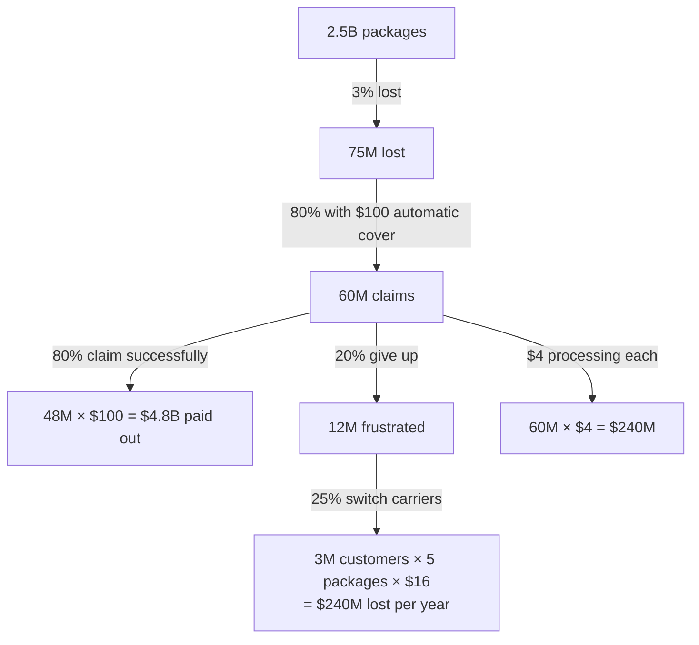

# 6.9 · Partner cases, Level 3 (Cases 11–15)

> **In one line:** the hardest partner cases: a worldwide sizing with an entry strategy, a prescription-vs-OTC drug launch, a make-or-buy decision with a two-year payback, a cost analysis of a public company's income statement, and a customer-service fix that turns out to cost more.

<BookRef pages="327–368" section="Partner Cases 11–15" />

Read the [guide for the person giving the case](/docs/chapters/part-4/partner-cases-level-1#the-guide-for-the-person-giving-the-case) first.

| # | Case | Type |
|---|---|---|
| 11 | [Bulletproof Auto Glass](#bulletproof-glass) | Worldwide sizing, pricing, plant location, entry |
| 12 | [Statin Blue](#statin-blue) | Sizing, breakeven, Rx vs OTC |
| 13 | [Bottled Water](#bottled-water) | Make vs buy, payback |
| 14 | [Smackdown Rivals](#smackdown) | Cost analysis, dividends |
| 15 | [TedEx](#tedex) | Numbers & customer service |

---

## Case 11 · Bulletproof auto glass {#bulletproof-glass}

<CaseMeta level={3} format="Partner case" types={['Market sizing', 'Pricing', 'Entering a new market']} pages="327–333" />

**Prompt (read aloud):** *Our client, an applied-materials manufacturer, has developed **one-way** bullet-resistant auto glass: bullets can't get in, but you can fire out. It's **lighter and cheaper to make**. When word leaked, its stock jumped from **$15 to $18**. Calculate the **worldwide market** for bulletproof auto glass, propose a **pricing strategy**, choose a **plant location**, and decide **whether to enter**.*

🎙️ Interviewer's data bank

- They should say the stock rose **20%**. No other objectives. Interviewer-led, so no hypothesis needed. Ideal order: **company → market → pricing → sizing → plant → how to enter**. (Sizing first is OK but not optimal; for a new product, price first.)
- **Company:** $15B revenue, all B2B. No auto products. Makes flat-screen panels, solar panels, semiconductors, bulletproof walls and windows for buildings. **Patented.** Success = **10% share within 3 years**.
- **Market:** four players with **25% each** (two are divisions of big companies, two are small). Growing **10% a year** for five years.
- **Differentiation:** lighter, cheaper, the only one-way glass. **Disadvantage:** once you fire out, the glass is compromised.
- **Barriers:** carmaker (OEM) contracts take **~4 years** to land. OEMs are **80%** of the market, the aftermarket **20%**.
- **Pricing:** rivals charge **$400–450 per sq ft**; their cost is probably ~$300 (industry margin ~25%). **Our cost is $250/sq ft.** An average vehicle uses **25 sq ft**. Buyers are **not price-sensitive**: nobody economises on bulletproof glass.
- **Plants:** Ireland (already makes building glass), Germany, Israel, U.S., Brazil. Carmakers are in Detroit, Tokyo, Berlin and South Carolina.
- **Demand by region:** Middle East 35% · South America 25% · Asia 20% · U.S. 10% · other 10%.

✅ Solution & scorecard

**Sizing (U.S., then extrapolate):** 100M households by income → **165M cars**, + **35M** fleet, military, taxi, rental, government and armoured vehicles → **200M**. Assume a 10-year car life → **20M new cars a year**; **1%** have bulletproof glass → 200K new + 1.8M existing = **2M U.S. vehicles**. The U.S. is **10%** of the world → **≈20M vehicles worldwide**.

**Entry reality check:** 10% share in 3 years, but OEM contracts take 4. So the share would have to come from the aftermarket: 10% of the total = **half the aftermarket**. Very unlikely organically → **acquire one of the smaller players, ideally one with an OEM contract** (each player has 25%).

**Pricing:** cost $250 vs rivals' prices of $400–450, buyers price-insensitive, and our product is better → price **at or near the top of the range (~$450/sq ft)**, about $11K per vehicle. Don't undercut.

**Plant:** a strong candidate is **Ireland** (existing bulletproof-glass know-how). Weigh raw materials, labour, transport and closeness to the Middle East and South America demand. An acquisition may bring a plant with spare capacity.

**Five ways to enter:** build organically · **acquire** ⭐ · sell or license the technology · make the glass for all the others (private label) · joint venture.

| Final slide | |
|---|---|
| Market size | ~20M vehicles worldwide |
| Price | ~$450/sq ft (premium) |
| Plant | Ireland, or the acquired company's plant |
| Enter? | Yes, **by acquiring** a smaller player with an OEM contract |

**Good:** a structure that starts with the company, sharp questions, no math slips, a **final slide**. **Great:** sees the question is *how* to enter, not just *whether*, and doesn't get stuck on the size of the sizing problem.

## Case 12 · Statin Blue {#statin-blue}

<CaseMeta level={3} format="Partner case" types={['Market sizing', 'Breakeven', 'New market entry']} pages="334–343" />

**Prompt (read aloud):** *A large pharma company has a new, **milder cholesterol drug**, weaker than standard prescription statins, so it can be launched either **by prescription (Rx)** or **over the counter (OTC)**. (1) Which market should it enter? (2) Breakeven number of customers in each. (3) Estimated profit in each. (4) Pros and cons of the prescription route.*

🎙️ Interviewer's data bank

- No other objectives. Start with **pros and cons**. Do they ask for a moment, then give all pros, then all cons, without ping-ponging?
- Then make them ask about the **Rx market first**: players, shares, differentiation, barriers (approval for both markets?). Our client makes **no other statins**; its portfolio is **50% OTC, 50% Rx**, so it has distribution and marketing in both.
- **Rx market:** **14M** patients, **$14B** in sales; the leading brand holds ~**49%** among seven drugs. Patients pay a **$15 monthly co-pay**.
- **OTC market:** doesn't exist yet. The OTC version would cost the consumer **$15 a month**, with no insurance.
- **Our drug:** a "light" version, about 10% less effective, with similar but milder side effects.
- **Costs: $40M a year** (the only cost figure needed).
- **Profit per bottle (one a month):** Rx **$20** → $240 per patient a year. OTC **$5** → $60 per patient a year.
- **Rx target:** patients with cholesterol of **200–220** (10% of the Rx market); we expect to win **4% of the 14M = 560,000** patients. (Below 180 is healthy; 180–200 gets "exercise and eat oatmeal"; above 220 gets a full-strength statin. People at 210 and up were often over-medicated before.)

✅ Solution & scorecard

| Rx ✅ | Rx ❌ | OTC ✅ | OTC ❌ |
|---|---|---|---|
| Higher price / profit | Very competitive | Easy access, no doctor needed | High-risk patients are already on Rx |
| Insurance coverage | One dominant brand (~49%) | High volume | Seen as less effective (it is) |
| Higher perceived value | | Easier to market | |
| Established sales force | | Strong company brand | |
| | | Possibly a large untapped market | |

**OTC market sizing (the hardest part):**

| Step | Number |
|---|---|
| 300M Americans, 80% insured / 20% uninsured | 240M / 60M |
| Cholesterol problem among the insured: 14M / 240M | ≈5% |
| Uninsured with a problem: 5% of 60M = 3M, + 1M (less care, more risk) | 4M |
| 25% would pay $15 a month | **1M** |
| "Preventers": ages 20–40 (75M); 5% have parents with the condition ≈ 4M; 25% buy | **1M** |
| **OTC customers** | **≈2M** |

**Breakeven and profit:**

| | Rx | OTC |
|---|---|---|
| Profit per patient per year | $240 | $60 |
| Breakeven: $40M ÷ annual profit | **≈167K patients** | **≈667K patients** |
| Expected patients | 560K | 2M |
| Gross profit | 560K × $240 = $134.4M | 2M × $60 = $120M |
| **Profit after $40M costs** | **≈$94M** | **≈$80M** |

**Recommendation:** **Rx first** (higher profit, lower breakeven, existing sales force), then consider **entering both**, sharing the plant, distribution and marketing. Expect a competitive response from the dominant brand.

**Good:** a **final slide** with Rx and OTC side by side; logical OTC sizing; a split page (Rx on one side, OTC on the other); a discussion of competitive response and entering both.

## Case 13 · Bottled water: make or buy the bottles? {#bottled-water}

<CaseMeta level={3} format="Partner case" types={['Production', 'Make vs buy', 'Payback']} pages="344–350" />

**Prompt (read aloud):** *Americans bought over **4 billion gallons** of bottled water last year. Our client sold **1 billion** half-litre bottles of spring water. It buys empty plastic bottles from a supplier at **5¢** each. The supplier wants **6¢**, adding $10M to our costs. The client could **make its own bottles** but doesn't have the resources yet. The CFO requires a **two-year payback**. Should we bring bottle-making in-house? And first: what's our **market share**?*

🎙️ Interviewer's data bank

- Share must be by **volume**. Assume 0.5 litre ≈ 1 pint; 2 pints = 1 quart; 4 quarts = 1 gallon → **8 pints a gallon**.
- Before the numbers: "Off the top of your head, pros and cons of making the bottles ourselves?" Don't tell them what they missed; the numbers will show it.
- Cost table to fill in (the supplier's price would be 1B × 6¢ = **$60M**):
  - **Plastic pellets:** $5 a gallon; 10 gallons make 1,000 bottles.
  - **Labour:** 20 people × $4,000 a month.
  - **Transport:** $0.005 a bottle.
  - Given: **building and equipment $10M** (one-time), **utilities and maintenance $0.04M**, **administration $1M**.
- Year 2: volume **+5%** (1.05B bottles); materials and transport +5%; building and equipment **zero**; everything else the same. Tell them $59.75M ÷ 1.05B ≈ **$0.056** a bottle.
- Year 3: tell them profit is **$3.31M**.

✅ Solution & scorecard

**Market share:** 4B gallons = **32B pints**; 1B pints ÷ 32B ≈ **3%**.

| Cost line | Year 1 | Year 2 |
|---|---|---|
| Plastic: $50 per 1,000 bottles = 5¢ each | $50M | $52.5M |
| Labour: 20 × $4,000 × 12 | $0.96M | $0.96M |
| Transport: $0.005 × bottles | $5M | $5.25M |
| Utilities and maintenance | $0.04M | $0.04M |
| Administration | $1M | $1M |
| Building and equipment (one-time) | $10M | — |
| **Total** | **$67M** → 6.7¢ a bottle | **$59.75M** → ≈5.6¢ a bottle |
| vs supplier at 6¢ | **−$7M** | **+$4.2M** (0.4¢ × 1.05B) |
| Running total | −$7M | **−$2.8M** |

Year 3: +$3.31M → **+$0.51M**. So it pays back in **year 3, not year 2**.

**Before you walk into the CFO's office, find a way to say "yes":**

- **Revenue side:** make extra bottles and **sell them to competitors**.
- **Cost side:** **lease the building and equipment** instead of buying, which removes most of the $10M year-1 hit.

**Mark of a good discussion:** the candidate who stops and says "If I go in now I have to say no. Let me first find a way to do it in two years" shows the can-do attitude every consultant wants. Almost nobody does.

## Case 14 · Smackdown Rivals {#smackdown}

<CaseMeta level={3} format="Partner case" types={['Cost analysis', 'Financial statements']} pages="351–362" />

**Prompt (read aloud):** *Our client is a publicly traded sports-entertainment company with passionate fans worldwide: live and TV events, digital media and merchandise. Last year: revenue **$526.5M**, operating profit **$70.3M**, net profit **$45.4M**; **72.85M shares**; dividend **$1.44 a share**. International revenue grows twice as fast as domestic. About 600 employees plus ~150 contracted wrestlers. Analysts love its cash generation, lack of debt and generous dividends, but some worry that **costs are rising faster than growth**. The COO wants to keep growing aggressively but wisely. (1) Are costs rising out of proportion to growth? (2) Is the analysts' concern valid? (3) What should the COO do about costs? (4) How should the right cost structure be set? (5) What do you think of the dividend?*

🎙️ Interviewer's data bank

- Hand over **Chart 1** (the income statement over several years) and give them time. If they ask for more, give **Charts 2–4** (profitability ratios, headcount, revenue by business unit). The charts are on PDF pp. 352–361.
- Key facts the charts reveal: total costs roughly track revenue, but **SG&A jumped 50%+** in the latest year while **headcount didn't rise**; **advertising and promotion more than doubled**; a new **studio/film** revenue stream is growing fastest (50%+); **bad debt** rose; "All other" expenses are large and unexplained (details not available); **operating margin is falling**. No cost data by business unit; no competitor benchmarks.

✅ Solution & scorecard

**Q1–2:** in total, costs and revenue grow roughly in step, but **SG&A is pulling away** (about +50%, up nearly 10 points as a share of revenue with the same headcount). The concern is **valid**: analysts fear a trend.

**Observations worth making:**

- Advertising and promotion **more than doubled**, possibly to launch the new **studio** business (the fastest-growing revenue line).
- **Bad debt** rose: looser credit, or simply more aggressive write-offs?
- "All other" is suspiciously large. Ask what's in it.
- **Gross margin vs operating margin:** gross = after cost of goods; operating = after cost of goods **and SG&A**. Operating margin falls because SG&A rises.

**Q3:** investigate the biggest jumps (advertising, bad debt) and get **cost data by business line** and **benchmarks**. Costs are an **investment**: make sure they go to the units with the most potential.

**Q4:** base the cost structure on **ROI analysis** for new growth areas (start-ups may lose money for a year or two) and **cut costs in units that aren't growing**. No unit, however fast it grows, gets a "no-holds-barred" budget.

**Q5: the dividend.**

| | Calculation | |
|---|---|---|
| Total dividend | 72.85M × $1.44 | **≈$105M** |
| Net profit | | $45.4M |
| Payout ratio | 105 / 45.4 | **≈230%** |

It pays out **more than all of its profit**, which isn't sustainable. Growth companies usually **reinvest** instead of paying dividends. The likely reason: in an unusual business, the dividend underpins the share price. Worth flagging.

**Mark of a good discussion:** stays calm in a case that's easy to drown in, knows which data to ask for, and **quantifies** findings.

## Case 15 · TedEx {#tedex}

<CaseMeta level={3} format="Partner case" types={['Numbers', 'Customer service']} pages="363–368" />

**Prompt (read aloud):** *Our client is a parcel carrier with **$40B** revenue, shipping **2.5B packages** a year; the average customer ships **5 packages a year**. A survey rates its service highly except for **lost-package compensation**: customers aren't told when a package is lost, the claims process is long and puts the work on them, and payment takes four weeks. What are lost packages and poor service costing us, and how do we improve service?*

🎙️ Interviewer's data bank

- Objective: better service **and** more profit. Split the case into **costs** and **service**.
- The three cost numbers wanted: (1) insurance payouts (assume the company self-insures), (2) **business lost** to frustrated customers, (3) **claim-processing cost**.
- **3%** of packages are lost; **80%** of those carry the automatic **$100** minimum cover (the group that matters). Of those, **20%** of customers give up on claiming; **25% of those** switch carriers. Treat one lost package = one customer.
- Processing costs **$4 per lost package**. Revenue per package = $40B ÷ 2.5B = **$16**.
- **Notes matter a lot:** a **tree** keeps this case clean.
- Later: "Another team streamlined the process. Processing fell to **$1** per package, defecting customers stay, satisfaction scores are high, and successful claims rose from **80% to 100%**. What does that mean?"

✅ Solution & scorecard

| Cost | Amount |
|---|---|
| Insurance payouts | $4.8B |
| Lost business | $240M |
| Processing | $240M |
| **Total** | **$5.28B ≈ 13% of revenue** |

**After streamlining:** processing $240M → **$60M** ✅ · defections $240M → **$0** ✅ · satisfaction ✅ · but payouts rise from $4.8B to **$6.0B** (60M × $100) ❌, **$1.2B more**.

**Cutting payouts:**

1. **Lose fewer packages.**
2. Cut the automatic payout from **$100 to $50**: saves **$3B**. Not every package is worth $100.
3. ⭐ **Credit the customer's account** instead of paying cash: keeps the customer, no cash out, credits may be used slowly or never, and at a 50% margin a $50 credit costs only about $25 in actual service.

**Mark of a good discussion:** sees fast that a smoother process means **bigger payouts**; wonders whether the clunky process was **deliberate** (like mail-in rebates); finds the **account-credit** idea, which very few candidates do.

---

## 🧠 Check yourself

<Quiz question="Bulletproof glass: 10% share in 3 years, OEM contracts take 4 years, the aftermarket is 20% of the market. What follows?" options={["Easy organically", "You'd need half the aftermarket, so acquire a player, ideally one with an OEM contract", "Give up", "Cut prices to 50%"]} answer={1} explain="10% of the total = 50% of the aftermarket. An acquisition is the realistic route." />

<Quiz question="Statin Blue: $40M costs, $240 annual profit per Rx patient. Breakeven?" options={["≈16,700", "≈167,000", "≈667,000", "≈2M"]} answer={1} explain="40M ÷ 240 ≈ 166,667 patients." />

<Quiz question="Bottled water: −$7M in year 1, +$4.2M in year 2. The CFO wants a two-year payback. Best response?" options={["Report that it fails", "Find a fix before the meeting: lease the plant, sell spare bottles to competitors", "Ignore the CFO", "Raise the water price"]} answer={1} explain="Walk in with 'yes, here's how'." />

<Quiz question="TedEx: claims go from 80% to 100% successful on 60M $100 claims. Change in payouts?" options={["−$1.2B", "+$1.2B", "+$4.8B", "No change"]} answer={1} explain="48M → 60M paid claims × $100 = +$1.2B." />

<Quiz question="Smackdown pays ~$105M in dividends on $45M of net profit. The concern?" options={["Too little paid out", "Paying out more than 100% of profit isn't sustainable, especially for a growth company", "Dividends are illegal", "None"]} answer={1} explain="A payout ratio of about 230% means the company is paying out cash it didn't earn this year." />
