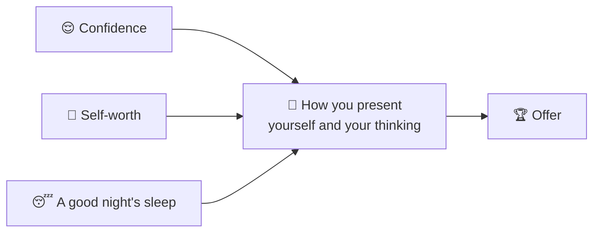

# 7 · Final analysis: it's mostly psychological

> **In one line:** bring confidence, a sense of your own worth and a good night's sleep. Warm up before you walk in. And remember: they wouldn't be interviewing you if they didn't already think you could do the job.

<BookRef pages="369–370" section="Chapter 7 · Final Analysis" />

## What actually decides it

In the end it isn't about being right or wrong. It's about **how you present yourself, your information and your thinking**. That's what an imperfect process is trying to measure.

## Warm up like an athlete

No athlete walks onto the field without warming up. **Don't let the interview be your first case of the day.** Most people do better on their second or third practice case than their first, even when the first is easier. So before you go in:

<Steps items={[
  {letter: '1', title: 'Mental math', body: 'Ten minutes of percentages, zeros and breakevens. Use the math drills page.'},
  {letter: '2', title: 'A market sizing', body: 'One quick sizing out loud, to get your voice and logic going.'},
  {letter: '3', title: 'A full case start', body: 'Summarise, verify, structure one case from the case starts page.'},
  {letter: '4', title: 'Your stories', body: 'Run through your "why consulting" bullets and three key stories.'},
]} />

## Enjoy it, or rethink it

If you're excited by the challenge, you're probably heading into the right profession. If you dread it, it may be worth rethinking. Churchill's advice to his children about careers was, in essence: do what you like, and like what you do.

<KeyIdea>The firms already believe you're smart enough; that's why you're in the room. The interview is your chance to prove them right.</KeyIdea>

## Your last-week checklist

- [ ] 30+ live cases done, including every case type in the [case library](/docs/case-library)
- [ ] The [cheat sheet](/docs/cheat-sheet) frameworks drawn from memory
- [ ] Six economic facts (three good, three bad) current as of this week
- [ ] Bullet answers to every personal question, with three stories each
- [ ] Researched questions for each firm
- [ ] Graph paper, pens, numbered pages
- [ ] Sleep

**Case closed.** 🎉
