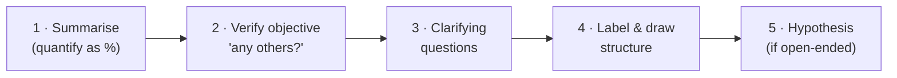

# ⚡ Cheat sheet: the night before

One page to review before a case interview. Each section links back to its chapter.

## The opening (every case)

P&L exception: draw **E(P=R−C)M** first, then ask. → [Chapter 4](/docs/chapters/part-2/ivy-case-system)

## The four scenarios at a glance

| Scenario | Trigger words | Structure |
|---|---|---|
| 💰 **Profit & loss** | profit, costs, bottom line, "what's going on?" | **E**conomy → **M**arket → company → **R**evenue (streams, price × volume, trends) → **C**osts (fixed/variable, benchmark) → ideas: **revenue first, then cost**; short and long term |
| 🚪 **Entering a market** | enter, launch, diversify, buy, JV | Company (why? what counts as success?) → market (size, growth, life cycle, customers, competitors, barriers in and out, risks) → **build / buy / JV** with pros and cons |
| 🏷️ **Pricing** | price, how much to charge | Company objective → product vs competitors → **competitive analysis + cost-based + price-based**; find where they meet |
| 📈 **Growth** | grow, increase sales or share | Company → industry → channels · product line · segments · marketing · acquisition · price · seasonal balance |

## Add-on checklists

| Situation | Remember |
|---|---|
| **M&A** | Shareholder value + culture fit · what else does the buyer own? · due diligence · competitive response · **exit strategy** |
| **New product** | **Disadvantages** · patent · cannibalisation · can our sales force sell it? · year-1 share usually 3–5%, rarely above 10% |
| **Start-up** | Would a VC invest? Management · plan · channels · edge · customers · funding |
| **Competitive response** | What changed? → redesign, new product, marketing, loyalty, lock up supply, acquire, copy. Avoid knee-jerk **price wars** |
| **Turnaround** | Why failing? Capital? → finance, people, plan, reassure stakeholders, quick wins |
| **Make vs buy / outsourcing** | Cost per unit both ways · payback vs the company's rule · risks (labour, fuel, regulation, flexibility) · how to make the losing option win |
| **Cost cutting** | Labour · production · finance (3 each). Cut strategically, not across the board |

## "If you see X, look at Y"

| You see | Look at |
|---|---|
| Sales flat, profits down | Revenue first, then costs |
| Sales and share up, profits down | Falling prices, rising costs, product mix |
| Share up, profit down | A shrinking market (rivals shrinking faster) |
| Revenue per customer falling | Mix of new customers; segmentation |
| Customers leaving, profits up | Maybe the "right" customers are leaving (bad debt) |
| Demand above capacity | Shifts, bottlenecks, price, new line, outsourcing; plan for demand falling back |
| New product, no competitors | **Price before market size** |
| A list of numbers to find | Draw the **final slide** first |

## Market sizing anchors

320M people · 80-year life → **4M per age year** · 100M households (3.2 people) · internet in ~70% of homes · size one country, then extrapolate · convert stock (in use) → flow (sold per year) using replacement cycles. → [Chapter 3](/docs/chapters/part-1/case-questions#market-sizing-questions)

## Behaviour under fire

- **"Let me tell you why you're wrong":** keep your answer unless a new fact changes it; switch openly if it does.
- **Cut off mid-idea:** glance at your written list and give the next one.
- **Stuck:** recap → reread page 1 → run the 5 Cs → ask for help (once).
- **Before a bad-news meeting:** find a way to say **"yes, here's how"**.
- **Summary:** start immediately, 30–90 seconds, problem + 2–3 points + recommendation.

## BCG matrix and Five Forces

| | High growth | Low growth |
|---|---|---|
| **High share** | ⭐ Star: defend | 🐄 Cash cow: harvest |
| **Low share** | ❓ Question mark: invest or exit | 🐕 Pet: divest |

Five Forces: new entrants · rivalry · substitutes · buyer power · supplier power. → [Chapter 5](/docs/chapters/part-2/tools-frameworks)
