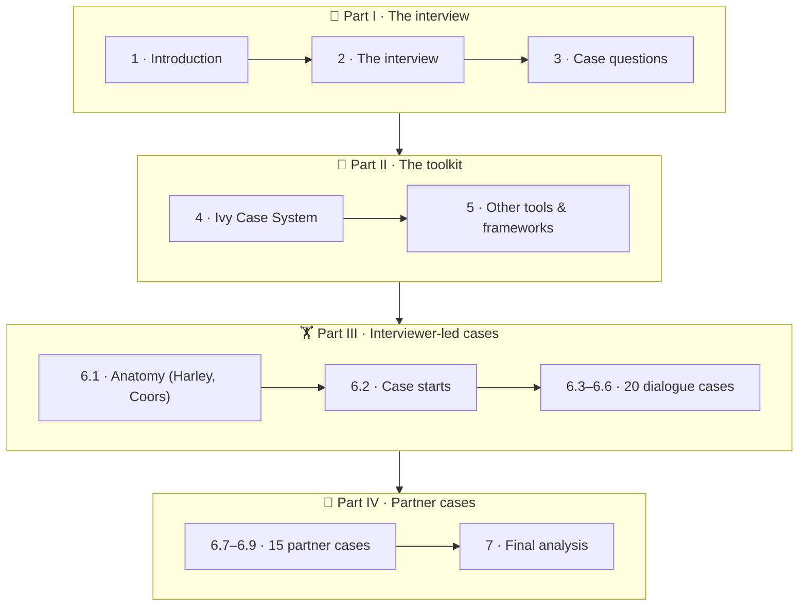
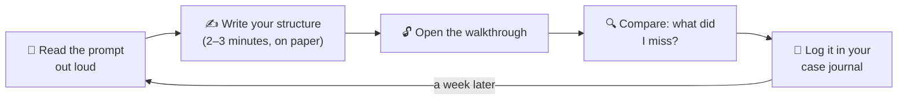

# 🗺️ Start here: how to use this book

These are **study notes**, not a copy of the book. Each chapter follows the structure of a chapter in Marc Cosentino's *Case in Point: Complete Case Interview Preparation* (8th edition, 2013). The text is rewritten in plain language, every framework is redrawn as a diagram, and each section has a 📖 page pointer so you can jump to the same topic in your PDF.

<IconCards items={[
  {icon: '📖', title: 'Page pointers', text: 'Every section links to the PDF page where the same topic starts, so the notes and the book stay in sync.', color: '#f59e0b'},
  {icon: '🖼️', title: 'Diagrams', text: 'Every framework and case structure is drawn as a Mermaid diagram that works in light or dark mode.', color: '#0d9488'},
  {icon: '🙈', title: 'Try first, then reveal', text: 'Practice cases hide the walkthrough in a fold. Lay out your own structure before you open it.', color: '#3b82f6'},
  {icon: '🧠', title: 'Quizzes & drills', text: 'Each chapter ends with quick checks. The math drill page generates endless mental-math questions.', color: '#10b981'},
]} />

## Suggested reading order

| If you have… | Read |
|---|---|
| **One evening** | [4 · Ivy Case System](/docs/chapters/part-2/ivy-case-system) → [6.1 · Anatomy](/docs/chapters/part-3/anatomy) → [⚡ Cheat sheet](/docs/cheat-sheet) |
| **One week** | Chapters 1 → 5 in order, then two or three cases a day from the [🗂️ case library](/docs/case-library) |
| **A practice partner** | Send them [6.7 · Partner cases](/docs/chapters/part-4/partner-cases-level-1) (it starts with a guide for the person giving the case) |
| **Weak math** | [🧮 Math drills](/docs/math-drills) every day, plus the number cases (Discount Brokerage, Snow Job, Nerves of Steel) |

## How to practise a case from this site

There is rarely one right answer. When your structure differs from the walkthrough, ask whether yours would still have led you to the key insight. If it would, it's fine.

## The four questions behind every case

1. **What is the client really asking?** (Listen to the last sentence. Verify the objective.)
2. **Is it the company or the whole industry?** (Look outside before you look inside.)
3. **What do the numbers say?** (Quantify everything, as percentages.)
4. **So what do we recommend?** (Lead with the answer, back it with two or three reasons.)

If you can answer those four, out loud, calmly, while someone tries to knock you off balance, you are ready.
